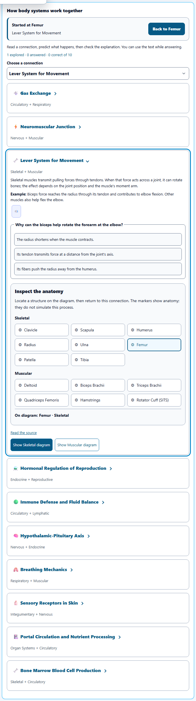
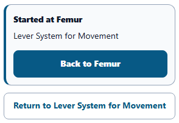
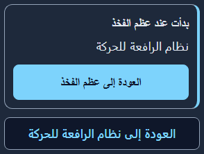
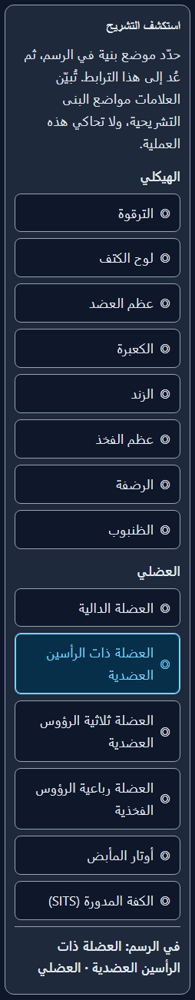

# Anatomy relationship exploration

Completed October 2, 2026.

## What improved

- Opening a structure’s relationship keeps a visible starting point and a **Back to [structure]** action. Return restores the original system, view, detail level, selection, search, study filter and 3D preference, then focuses the initiating button.
- Participating-system buttons open the relevant connection and diagram directly. A separate **Return to [connection]** action brings keyboard focus back to the expanded explanation.
- Connections now group relevant authored structures by system. Selecting a marker locates it on the 2D diagram, switches to the required anterior/posterior view and raises the detail level only when necessary. The selected marker has a clear active state.
- Diagram detours preserve quiz progress, flashcard position, notes, confidence, concept answers and the pinned comparison. Viewed flags merge with the latest state. Stale actions and deferred focus cannot replace a newer navigation context or steal focus after the learner moves it.
- Saved routes are validated before use and survive a session reload. Return banners and marker controls support narrow phones, all three themes, larger text, right-to-left layout and forced colors. Controls are at least 44 × 44 pixels.
- Seven new labels are registered in English and translated into French, Latin American Spanish and Arabic, with matching desktop copies. Other locales retain the existing English fallback.

The markers use the existing authored relationship list. They locate anatomy; they do not simulate physiology. This pass adds no medical advice, new scientific claims or changes to concept-check grading.

## Validation

- **443 tests passed in 7 files** in the final runs, including both runtime copies, malformed saved routes, state continuity, headings, phone accessibility, and the seven new translation registrations. Every one of the 66 authored origin locations is tested in both runtime copies.
- **5 Chromium journeys passed** with no skipped tests, retries or runtime errors. The journeys cover process and partner entry, posterior markers, exact return focus, retained practice work and a saved-session reload.
- **30 scoped axe scans passed** across desktop and 320-pixel phones, light/dark/high-contrast themes, Arabic with larger text, and forced colors. Overflow, reading font sizes, logical border direction and target sizes were also asserted. Eighteen measurements verify that the actual origin-heading colors meet 4.5:1 contrast, including inside the model panel.
- Source syntax, byte parity for both source copies and all four catalog pairs, and scoped whitespace checks passed.

These browser checks use the repository’s GlHarness with app styles and the 2D atlas. They do not verify a complete production login, persistence backend or rendered 3D anatomy. Unit tests verify restoration of the saved 3D preference.

## Evidence

- [Regression and localization results](unit-results.json)
- [Dedicated new journey tests](new-unit-results.json)
- [Initial continuity regression results](regression-results.json)
- [Playwright results](playwright-results.json)
- [Browser state, dimensions and accessibility results](browser-validation.json)
- [Source and catalog verification](verification.json)

The repository-wide STEM registration gate currently fails on existing gaps in 36 tools. The baseline audit found 1,716 missing Anatomy registrations before this pass and 1,715 afterward; the seven new labels are registered, with no newly missing keys. See [registration audit](registration-audit.json) and [initial gate results](diagnostic-first-unit-results.json).

### Desktop connection

### Phone return controls

### Arabic, dark theme and larger text

## Tested source

LF-normalized SHA-256: `b1050d0ef01779f8bdfc3480e72559722ffb9fd411ce2191b06d3100da844880`.

The commit is scoped to this enhancement. Existing unrelated changes in the shared workspace are retained.
