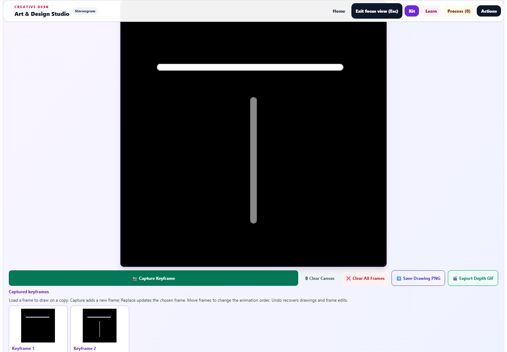
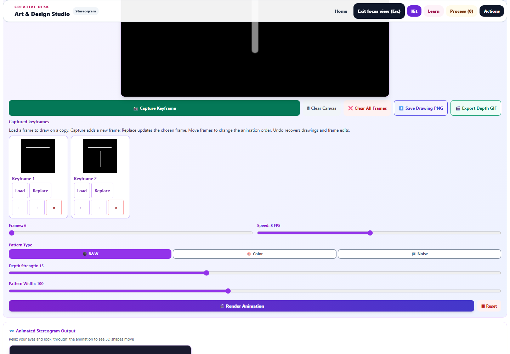
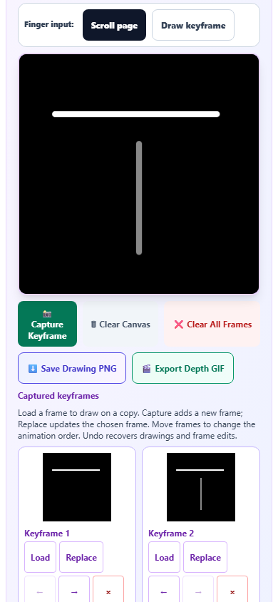
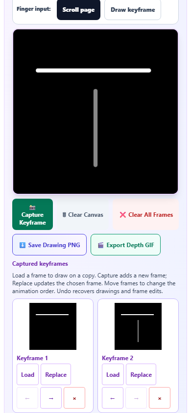

# Animation depth drawing and editable keyframes

October 1, 2026. Included in the Art Studio enhancement commit.

Animated Stereogram now has a larger depth drawing canvas, continuous strokes, twenty-step Undo/Redo for both drawings and captured frames, and a practical keyframe editing workflow. Its focus canvas measured **760 × 760 CSS pixels at 1440 × 1000**. Drawing, captured frame pixels, and PNG downloads retain their existing **400 × 400** resolution.

## Drawing and recovery

- Freehand strokes connect coalesced samples, the dispatched movement, and the release coordinate. Another pointer cannot move or finish the active stroke. Pointer cancellation, capture loss, blur, and Escape finish partial paint as one recoverable edit.
- Undo and Redo work through their visible controls and keyboard shortcuts. Clear is recoverable, including during an interrupted stroke or a pending saved-image restore. History is bounded to twenty steps; unchanged edits do not add redundant steps.
- The depth drawing survives switching animation sources. Save and Fork restore the exact drawing and captured frames without changing the saved original or retaining history from another study. While Draw is selected, the saved-study preview now depicts the depth drawing.
- Learner and study changes reject stale gestures and image decodes. Drawing and capture wait for a pending image restore; Clear invalidates it and any export queued for that restore. The keyboard cursor stays outside the captured artwork.

## Keyframe editing

Each captured frame now has **Load**, **Replace**, **Move earlier**, **Move later**, and **Remove** controls. Load puts a copy into the drawing canvas. Capture adds a frame; Replace explicitly updates the selected frame. Drawing on a loaded copy leaves the captured original intact until replacement.

Frame capture, replacement, ordering, removal, and Clear All Frames share the drawing history. Undo can recover each operation. Captured pixels remain independent typed RGBA buffers, and reordering retains those buffers without duplicating their contents. The existing twelve-frame limit is preserved; an existing frame can still be replaced when the limit is reached.

Changing captured frames cancels queued rendering and playback, clears the stale animation preview, and requires a fresh render. Existing interpolation and GIF export code is retained.

## Layout and access

The drawing area scales to the available width and height. Frame previews are larger and their controls wrap within responsive cards. Buttons and inputs have a minimum height of 44 pixels; buttons also have a minimum width of 44 pixels. Updated keyboard guidance, frame action labels, cursor descriptions, and history announcements use seventeen new English entries across the three existing registries.

At **390 × 844**, the drawing canvas measured **340 × 340 CSS pixels**. All 24 drawing and frame controls met the target-size checks, with no horizontal overflow. A **320 × 844** check also retained the drawing without horizontal overflow.

## Verification

**300 tests passed across 29 files, with no failures.** Sixteen new workflow cases cover continuous strokes, pointer ownership, interrupted paint, recoverable Clear, real Undo/Redo buttons, independent frame capture, copy loading and replacement, ordering and removal, capture limits, source switching, keyboard access, learner ownership, stale decodes and events, queued exports, history bounds, clean captures, and unavailable canvas contexts. The broader run covers existing Pixel Art import/layers/colors, symmetry, stereogram, persistence, hydration, accessibility, and touch behavior.

Chromium verified real mouse drawing, exact pixels after Undo/Redo, independent captured frames, actual frame controls, source changes, an exact downloaded PNG, a completed six-frame stereogram render, stale-output invalidation, saved-study restoration, and both phone widths. No page errors were recorded. Saved-study thumbnails use the existing 180 × 180 WebP format; their depth colors were checked separately from the exact 400 × 400 saved drawing and PNG export.

JavaScript syntax, JSON registry parsing, canonical/public byte equality, all seventeen English entries, scoped whitespace checks, and the pinned Spectral build check pass. The preservation diff is limited to the animation depth editor, keyframe controls, depth preview selection, and an animation output context guard. Browser checks use the standalone tool rather than the packaged desktop application. Existing GIF exports were not exercised in this pass.

Evidence:

- [Validation and source hashes](animation-depth-validation.json)
- [Browser results](animation-depth-browser-results.json)
- [Regression results](animation-depth-regression-results.json)
- [Downloaded depth PNG](animation-depth-export.png)
- [Changes against the pre-pass source](animation-depth-pass.diff)

Run `node dev-tools/artstudio_animation_depth_qa.cjs` for the browser check.
