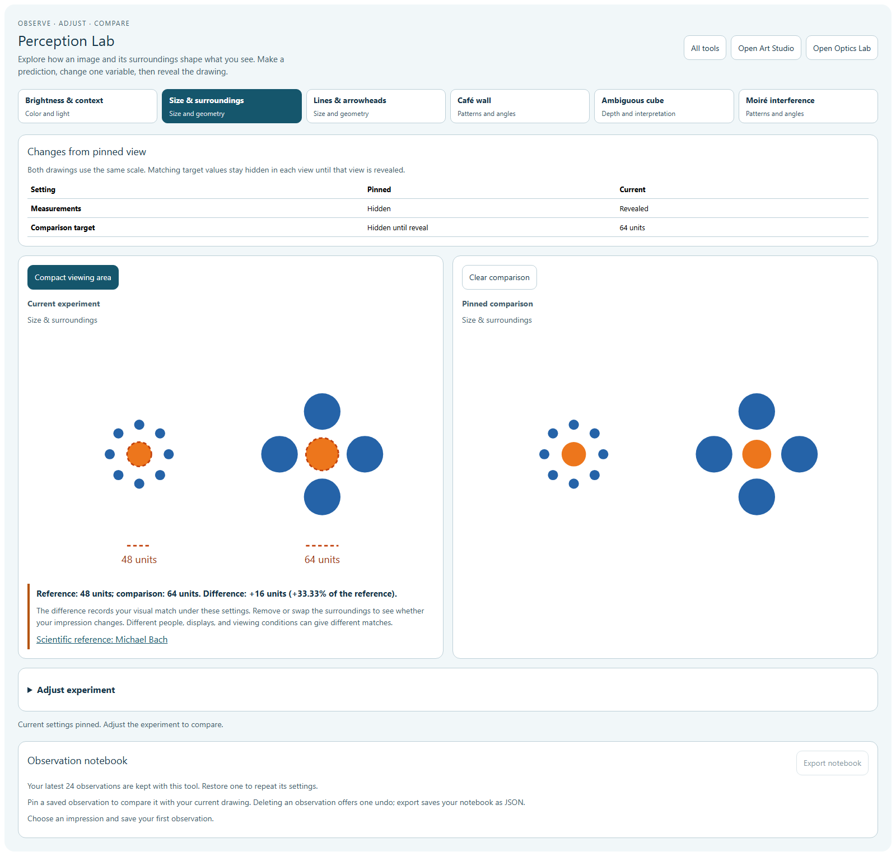
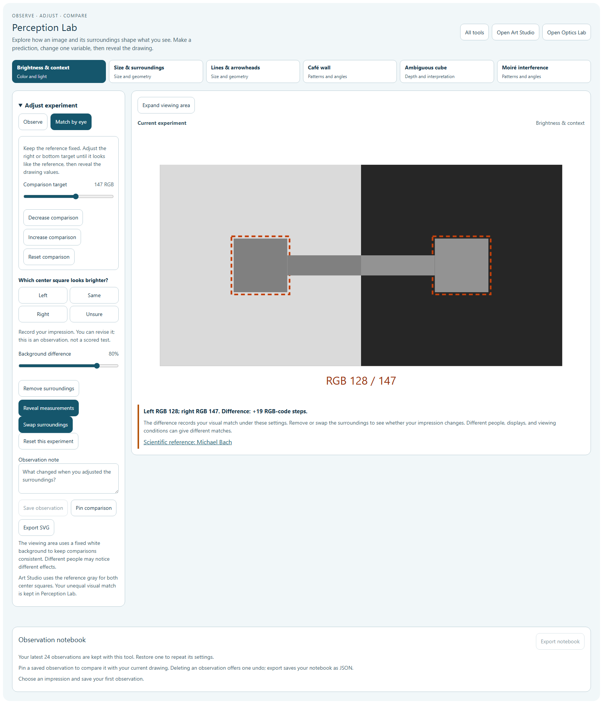
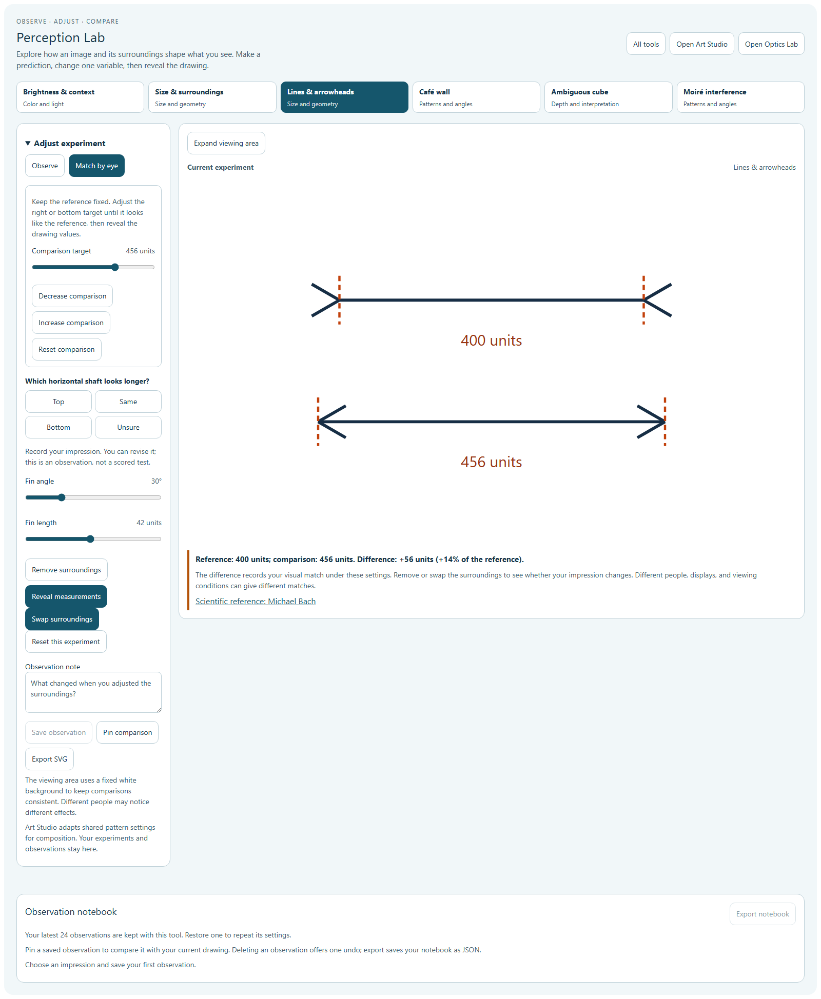
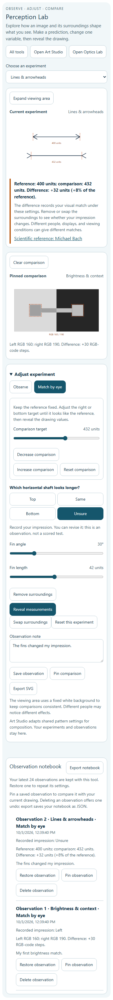

# Perception Lab: visual matching and a stronger notebook

Perception Lab now supports matching brightness, circle size, and line length by eye. A fixed reference stays in place while the learner adjusts a second target, then explicitly reveals the drawing values. The six existing experiments and their Observe settings remain available.

## Learning workflow

| Activity | Reference | Adjustable comparison | Revealed difference |
| --- | --- | --- | --- |
| Brightness & context | Left gray square | Right gray, RGB 16–240 | Signed RGB-code steps |
| Size & surroundings | Left diameter, 48 drawing units | Right diameter, 32–72 units | Signed units and percentage of reference |
| Lines & arrowheads | Top shaft, 400 drawing units | Bottom shaft, 250–550 units | Signed units and percentage of reference |

The comparison slider supports native keyboard operation and one-step increase/decrease buttons. Before reveal, its accessible description gives its position within the adjustment range; visible numerical target outputs remain hidden. Reset restores the reference value and hides measurements. Selecting an already active mode preserves the current trial.

Surroundings can trade places without moving or changing either target. Removing context also preserves the targets. Matching circles keep their surrounding rings in fixed positions with sufficient clearance throughout the supported range. Line fins stay attached to the changing shaft endpoints. Revealed brightness samples preserve each target's actual fill.

These bounds are interface choices. Measurements describe this drawing: RGB-code differences are not luminance percentages, and geometric values are drawing units. The tool records impressions and visual matches without scores or diagnostic interpretation.

## Comparison and notebook

Pinned and current drawings use equal-sized SVG viewports, shown beside each other on desktop and stacked on smaller screens. A settings table identifies what changed in the same experiment. Each matching view retains its own reveal state, including its reference gray; revealing the current drawing does not reveal a hidden pinned target. Different experiments retain their separate descriptions without a misleading difference table.

The latest 24 observations retain their settings, impressions, notes, and dates. Each has a stable identity, including repaired older or duplicate IDs. Saved observations can be restored or pinned without replacing the active draft. Deletion provides one undo, returns focus to Undo, and restores the observation's position. Concurrent deletion and notebook-replacement tests protect against stale records or incorrect ordering. A changed learner or externally replaced notebook invalidates the local undo. React development-mode updater replay preserves valid undo rather than being mistaken for an external replacement.

JSON export saves the normalized notebook using schema `alloflow.perception.notebook`, version 1. SVG export preserves the visible scene and its description with standalone 800 × 480 dimensions. Export failures have truthful feedback, and temporary anchors and object URLs are cleaned up.

Art Studio receives swapped brightness backgrounds in the correct order. A brightness match explicitly explains that Art Studio uses the reference gray for both of its center squares; the unequal match remains in Perception Lab.

## Verification

**273 tests across 23 files passed in the final per-file result set**, including 92 Perception Lab cases. Final results are recorded in [validation.json](validation.json) and [final-regression-results.json](final-regression-results.json). These preserve the provenance of the initial combined run and the clean retries rather than implying the first run was clean.

- Matching and notebook tests cover normalization, bounds, geometry, hidden values, precise controls, saved-state identity, deletion/undo, concurrent actions, comparisons, and export failures.
- **30 Chromium browser groups passed:** 14 matching/notebook groups and 16 existing-experiment regression groups. No page errors occurred. Checks include real native keyboard adjustment, downloads, persistence, equal-scale comparisons, motion stopping, 320/390/768/1280/1600-pixel viewports, 44-pixel buttons, dark theme, forced colors, and 200% text. Automated accessibility scans reported no violations in the tested views.
- Syntax, scoped whitespace, source/public mirrors, English catalog parity, loaders, and deep links were checked. The English Perception namespace contains 175 entries. All 150 pre-existing capability-index records remain unchanged.
- The first broader run hit worker shutdown/time-limit failures. A four-file retry recovered Process Shelf, observation notes, and the capability index. The Art Studio persistence suite's fixed 20-second case limit ignored the supplied timeout configuration: its first failed case took 21.039 seconds, then later cases inherited incomplete fixture state. It passed in isolation before editing. Only its timeout declaration now honors the existing shared environment setting with a 20-second minimum/default; all assertions remain unchanged. The configured retry also passed.

Browser checks use Chromium, real React/STEM plugins, and simulated viewports. Physical touch input, a screen reader, other browsers, and packaged desktop startup were not tested. Nothing was staged or committed.

## Previews

## References

The original vector scenes and educational explanations draw on Michael Bach's demonstrations of [brightness induction](https://michaelbach.de/ot/lum-inducedBrightness/index.html), [Ebbinghaus size context](https://michaelbach.de/ot/cog-Ebbinghaus/index.html), and [Müller-Lyer length context](https://michaelbach.de/ot/sze-muelue/index.html). Native slider behavior and accessible value descriptions follow the [WAI-ARIA slider guidance](https://www.w3.org/WAI/ARIA/apg/patterns/slider/) and [aria-valuetext specification](https://www.w3.org/TR/wai-aria-1.2/#aria-valuetext).
