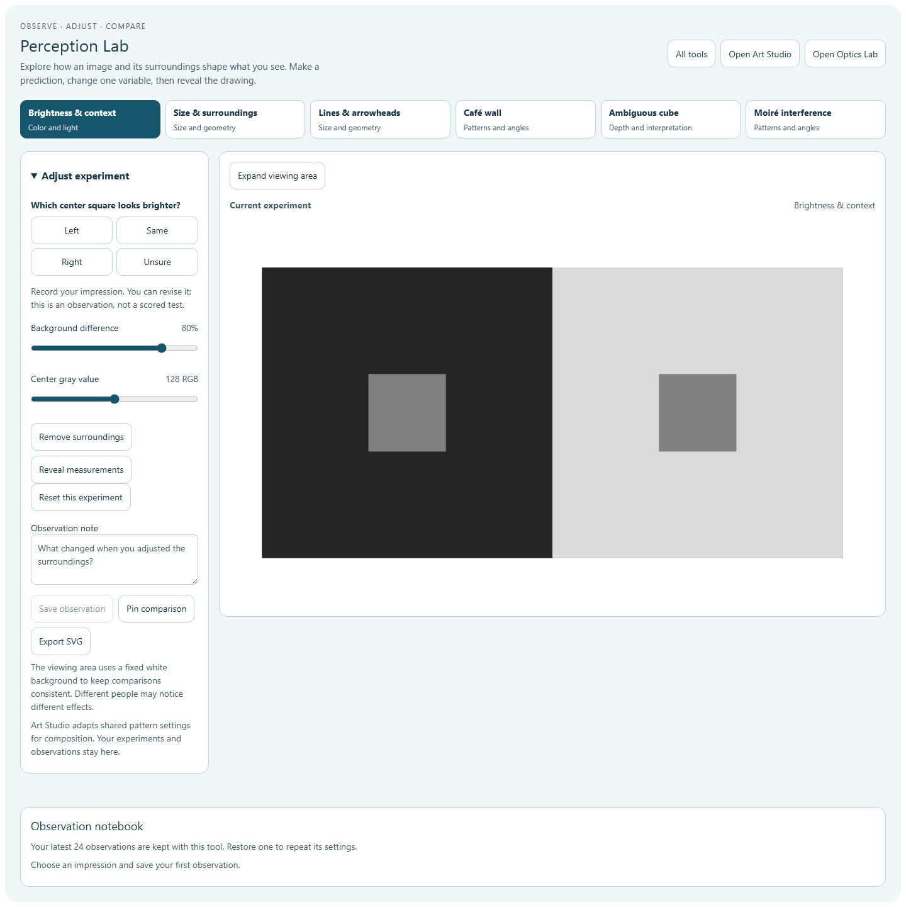
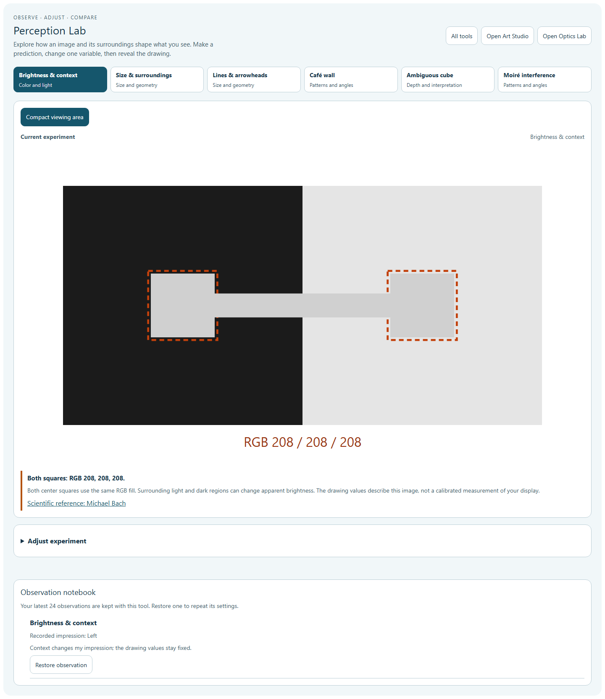
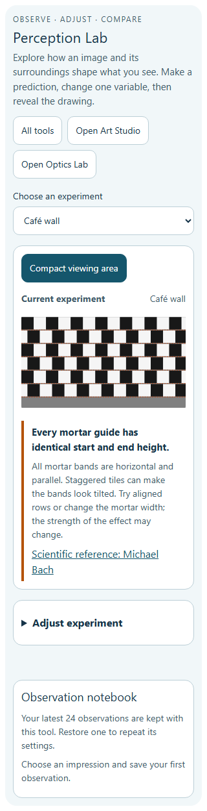
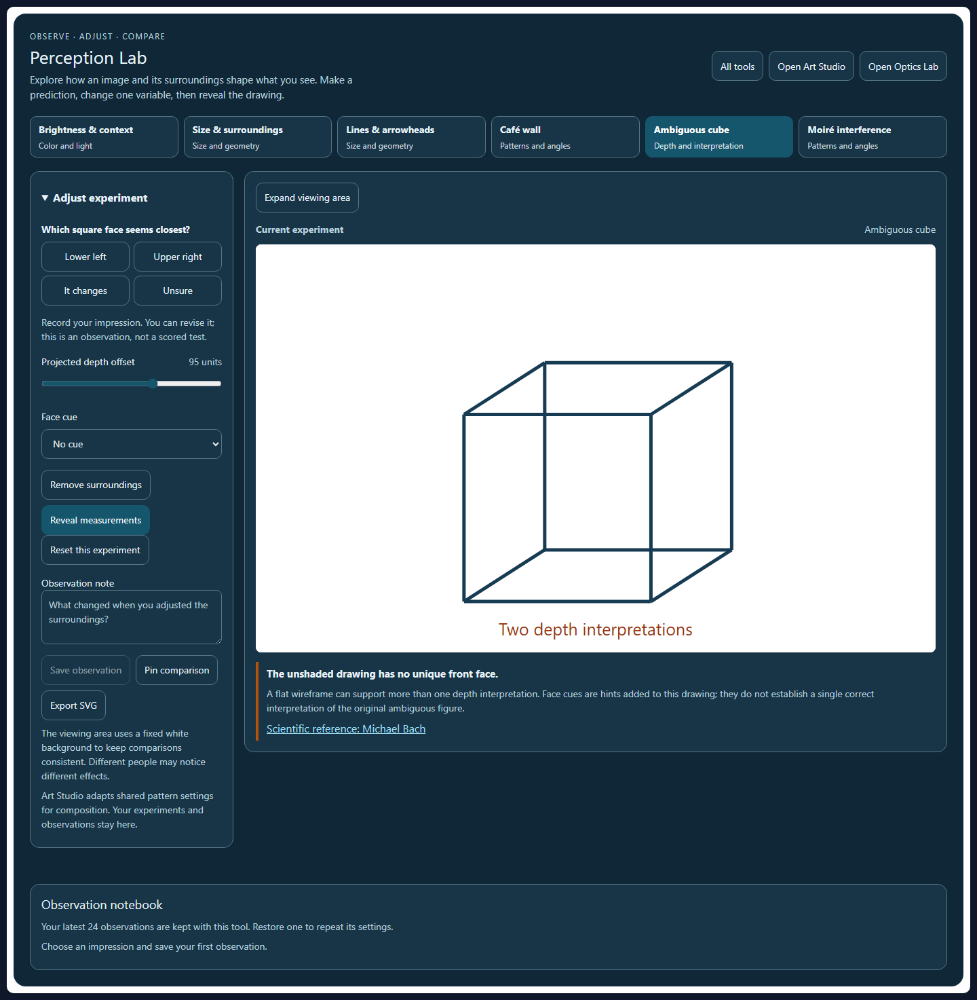
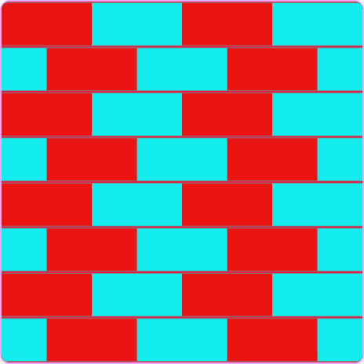
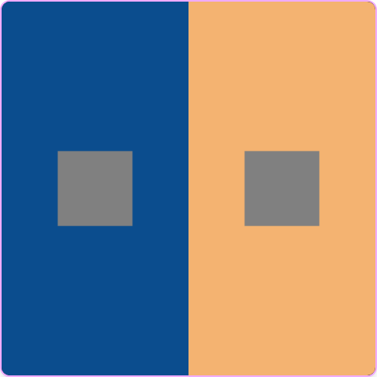
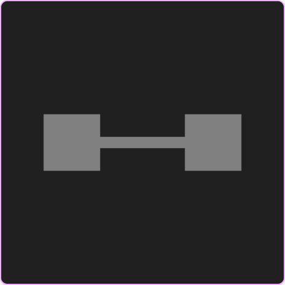

# Perception Lab and creative optical patterns

Added a standalone Perception Lab with six adjustable experiments, and expanded Art Studio's existing Op Art mode with Café wall and color-context compositions. Both tools are connected to the STEM catalog and Optics gallery. Existing Art studies remain in Art Studio.

## What changed

| Experiment | Adjustable context | Reveal or comparison |
| --- | --- | --- |
| Brightness & context | Background difference and center gray value | Shared RGB fill, outline and connecting strip |
| Size & surroundings | Surrounding circle radius and gap | Equal center diameters; separate, non-overlapping surrounds |
| Lines & arrowheads | Fin angle and length | Equal shaft lengths and endpoint guides |
| Café wall | Row offset and mortar width | Horizontal parallel guides |
| Ambiguous cube | Projected depth and face cues | Two possible interpretations; unchanged cube edges |
| Moiré interference | Crossing angle and shared spacing | The two component grids and their geometry |

Each experiment has an impression prompt, adjustable controls, removable context, opt-in explanation, and an independent saved model. The notebook keeps the latest 24 observations and notes. A pinned comparison stays frozen while current settings change. SVG downloads contain explicit 800 × 480 dimensions and standalone original vector geometry.

Expanded viewing uses most of the available width and collapses controls. Phones use a compact experiment selector. Keyboard controls, dynamic SVG descriptions, 44-pixel buttons, dark/contrast themes, and enlarged text are supported. Moiré rotation starts paused, freezes its displayed frame when stopped or hidden, and respects reduced-motion preferences.

Art Studio adds editable Café wall mortar, offsets, colors, density, rotation and parallel guides; color-context compositions add matching center swatches with HSL and size controls plus a shared-background comparison. Both use the existing saved-study, PNG and SVG workflow. Their irrelevant animation controls are hidden.

Opening Art Studio adapts shared brightness, Café wall or moiré settings into a composition. Tile proportions and density can differ in Art Studio; the original experiment and its observations stay in Perception Lab. Links also reach Optics and the full tool catalog. The new capability-index row preserves all 150 existing records, and the canonical route is /perception-lab.

## Verification

- **215 tests across 21 files passed** in the final combined run: new experiment and Op Art behaviors, saved-state restoration, canvas guards, studio navigation, stereo workflows, catalog search, index/deep links and Optics content wiring.
- **16 Perception and 14 Op Art browser groups passed**, with no page errors. These include each experiment's slider limits, target invariants, save/restore, pinned comparisons, SVG download, motion stopping, 320/390-pixel layouts and 200% text. Light-mode accessibility scans covered all six experiments; dark mode and forced-color viewing were also checked.
- Art PNG output matches the visible canvas and recovered state. SVG rasterization differs by at most 0.00705 per color channel on a 0–255 scale in the tested patterns. Matching center colors survive comparison, and new static styles stop earlier running animation.
- Source/public mirrors, three main JSX source mirrors, registered English labels and scoped syntax/whitespace checks passed. The new Perception English namespace contains 124 entries.
- The initial broader run found an older Watercolor test that required an exact description string. It now checks all required helper links while allowing additional descriptions, and the complete rerun passed.

[Validation](perception-lab-validation.json) · [Combined test results](perception-art-regression-results.json) · [Perception browser results](perception-lab-browser-results.json) · [Op Art browser results](opart-new-patterns-qa.json)

Browser verification used Chromium with the real React/STEM plugins and simulated phone viewports. Other browsers and the packaged desktop startup were not checked. Nothing was staged or committed in this pass.

## Previews

## Scientific references

The scenes are original code. Explanations were checked against Michael Bach's interactive vision-science references and keep image measurements separate from subjective impressions:

- [Brightness induction](https://michaelbach.de/ot/lum-inducedBrightness/index.html)
- [Ebbinghaus illusion](https://michaelbach.de/ot/cog-Ebbinghaus/index.html)
- [Müller-Lyer illusion](https://michaelbach.de/ot/sze-muelue/index.html)
- [Café wall](https://michaelbach.de/ot/ang-cafewall/index.html)
- [Necker cube](https://michaelbach.de/ot/sze-Necker/index.html)
- [Rotatory moiré](https://michaelbach.de/ot/lum-moire2/index.html)
