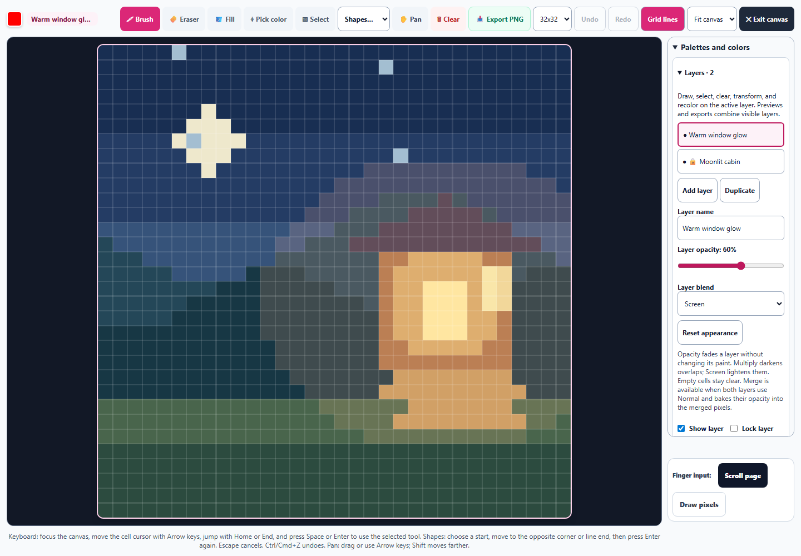
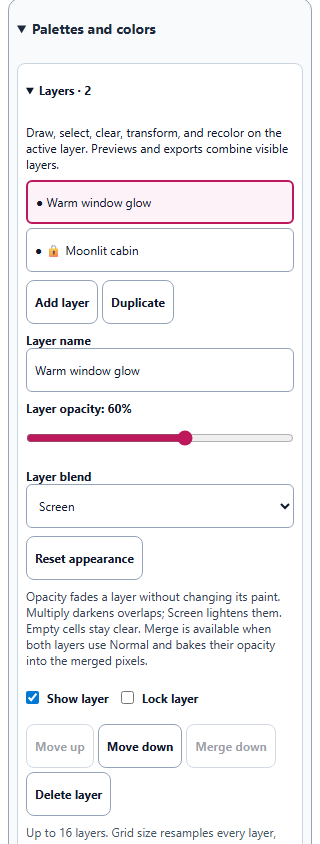
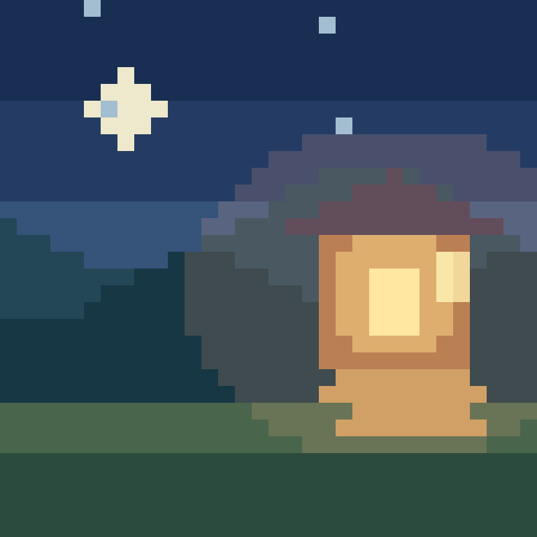

# Pixel Art layer opacity and blending

Pixel Art now supports reversible layer opacity from 0–100% and Normal, Multiply, and Screen blending. The expanded desktop grid remains 854 × 854 while the controls fit in its existing sidebar. Original cell colors stay intact, including in layers at zero opacity.

A mouse drag or repeated arrow-key adjustment uses one Undo step. Reset appearance restores full opacity and Normal in one edit. Duplicate retains independent appearance settings; locks protect them. Appearance survives resolution changes, saved studies, learner changes, and forks. Clean previews, the actual-size sprite, and the large PNG all use the same composite.

Merge down bakes the opacity of two Normal layers into their pixels exactly once. Multiply and Screen merging is unavailable because their appearance depends on the underlying artwork. Undo restores both source layers and their appearance. Legacy layers keep their original color strings and default metadata remains omitted.

The composite uses the [W3C source-over blending formula](https://www.w3.org/TR/compositing-1/#blending), including partial cell and layer alpha. Multiply and Screen affect the overlap; transparent space keeps the source color. An independent Chromium Canvas calculation agreed within one 8-bit RGB level across all 1,024 cells for each mode, with exact alpha.

Validation: 186 tests passed across 16 files, covering all Pixel Art suites, drawing capture and pointer ownership, study round trips, keyboard access, semantics, and translated guidance. The main run passed 161 cases across 14 files; two fork workers timed out during startup before running their files. A separate recheck passed both remaining files. No assertion failures remain. Both original output and the [worker recheck output](pixel-appearance-recheck.txt) are retained. The earlier focused run passed 64 cases across five files; those cases are included in the broader count. Syntax, source/public mirrors, all three English catalogs, and the pinned spectral builder passed. Seven English entries were added without changing existing Art Studio wording.

The browser check used actual controls, a real mouse drag, and real IndexedDB. It verified exact downloaded PNG bytes and saved-study recovery. The 390px and 320px phone checks found no horizontal overflow; all three new controls measured 44px high. These are standalone Chromium checks, not a packaged desktop launch. See [validation](pixel-appearance-validation.json), [browser results](pixel-appearance-browser-results.json), and [regression output](pixel-appearance-regression.txt).

## Expanded drawing workspace

## Narrow phone controls

## Clean PNG export

