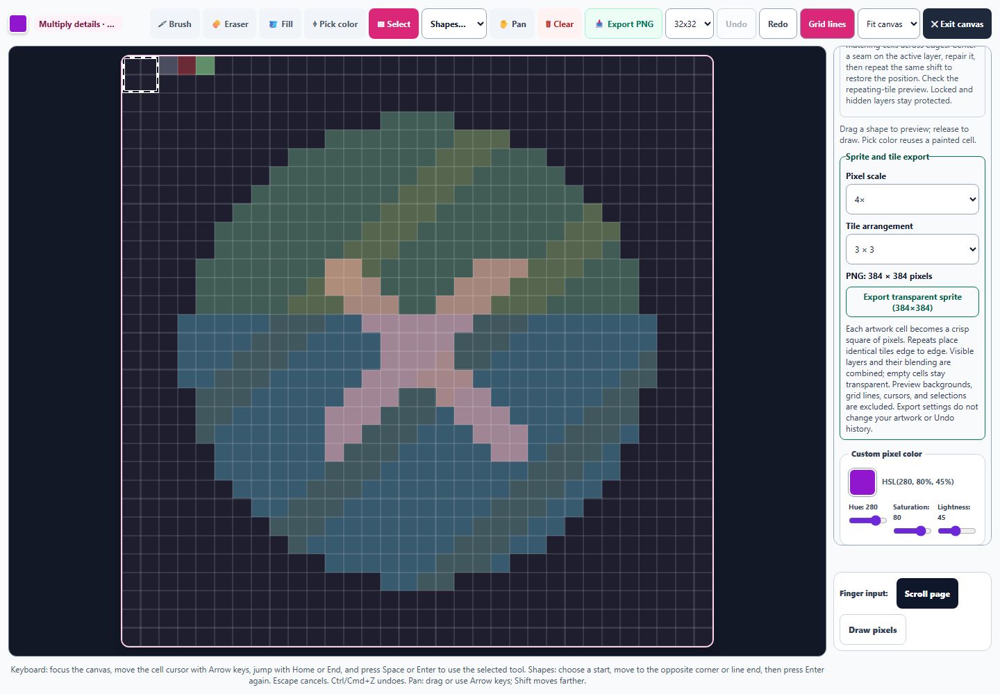
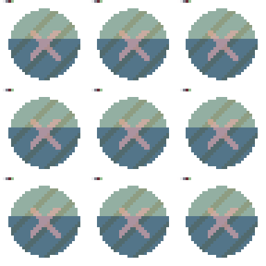
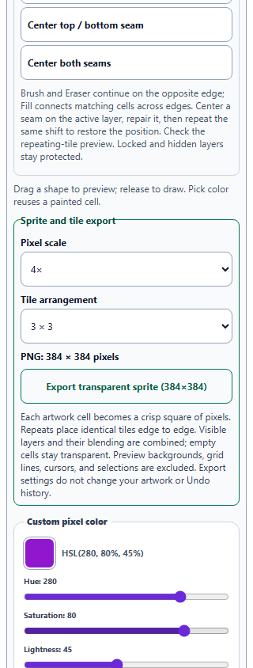

# Pixel Art: crisp sprite and tile exports

Pixel Art now offers **1×, 2×, 4×, 8×, and 16× pixel scaling**, plus **single, 2 × 2, and 3 × 3 tile arrangements**. The export panel shows the exact PNG dimensions before download. Every artwork cell becomes an integer square of output pixels, and identical tiles touch edge to edge. A 32-cell tile at 4× scale in a 3 × 3 arrangement produces a 384 × 384 PNG. The maximum supported combination is 3072 × 3072 pixels.

Visible layers are combined with their opacity and blending. Empty cells remain transparent. Preview backgrounds, grid lines, cursors, and pending selections are excluded. Export uses a fresh canvas, so zoom and the displayed canvas size do not determine the downloaded resolution. Native export without arguments continues to use one output pixel per cell.

Saved CSS colors are rendered by Canvas directly, preserving fractional HSL/RGBA paint and valid modern color formats such as oklch, lab, and color(). Review caught that filtering them through the older palette parser could make those cells disappear; the exporter now retains them. Invalid color assignments remain transparent and cannot reuse the preceding cell's color.

Export choices do not modify painting or consume Undo history. They are retained in saved studies, and Fork restores both preferences and artwork while keeping the saved original intact. Dimensions follow the current grid size. Invalid saved values fall back to supported defaults, and the output cannot grow beyond the bounded scale/repeat choices. Missing output contexts and PNG serialization failures produce no blank download; the control gives a retry message.

All **392 unique scoped tests across 27 files passed**, including **64 new export cases**, all Pixel Art suites, Watercolor simulation/lifting/navigation/mixing, artwork recovery, pointer and capture ownership, canvas guards, hostile saved state, idle loops, accessibility, and English keys. See [validation](pixel-export-validation.json), [regression output](pixel-export-regression.txt), and [focused export checks](pixel-export-focused.txt).

Standalone Chromium checks used actual export controls and PNG downloads, verified **2,589,696 scaled and repeated RGBA pixels** against the native image, exercised layered transparency and blending, and checked saved-study recovery through IndexedDB. A direct Canvas comparison of fractional and modern CSS paint matched all 4,096 channels; malformed paint stayed transparent. The expanded desktop grid remains **854 × 854**. All three export controls have 44px targets and fit 320px and 390px phones without horizontal document overflow. Desktop and phone previews were visually inspected. The packaged desktop application was not launched. See [browser results](pixel-export-browser-results.json).

Source and public mirror match. Syntax, the pinned spectral build, all eight new English entries across three catalogs, and preservation of prior Art Studio English entries passed. The preceding Pixel selection, seamless tile editing, Watercolor lifting, and paper navigation enhancements remain in the working tree. **No changes were staged or committed by this pass.**

## Export controls

## Repeating tile output

## Narrow phone controls

