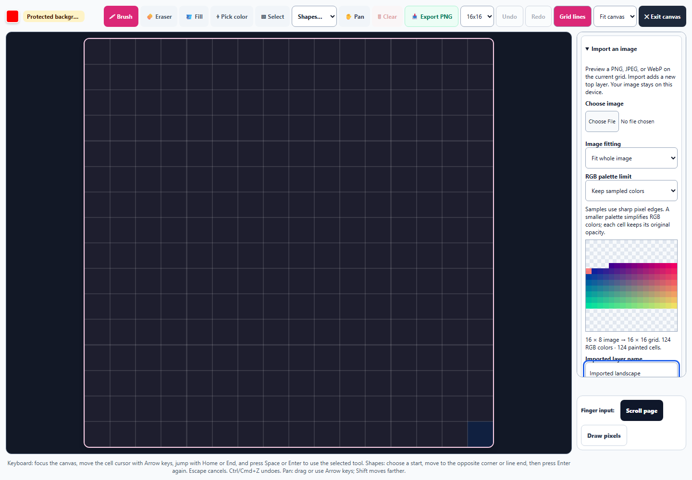
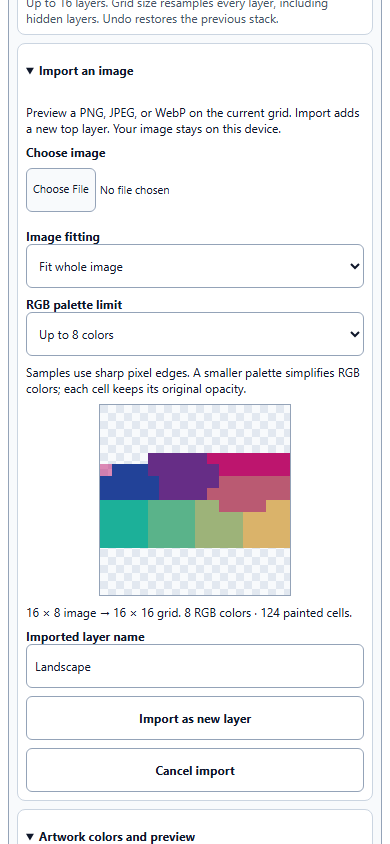

# Pixel Art: previewed image import

October 1, 2026. Included in the Art Studio enhancement commit.

Pixel Art now brings an existing PNG, JPEG, or WebP into the current grid. Image fitting and palette choices update a clean preview before importing. Applying adds one editable top layer, and Undo restores the complete previous stack. Existing locked, hidden, and editable layers retain their artwork.

## Import workflow

- Open **Import an image** in the palette column and choose a local image. No image is uploaded. The file input accepts PNG, JPEG, and WebP; files are limited to 10 MB and 40 megapixels, with a maximum dimension of 16,384 pixels.
- **Fit whole image** preserves proportions with transparent letterboxing. **Fill grid** preserves proportions and crops symmetrically around the center. **Stretch to square** fills the grid with the chosen distortion. Sampling uses nearest source-cell centers for sharp pixel edges.
- Keep the sampled RGB colors or simplify to at most 8, 16, 32, or 64 colors. The adaptive palette weights visible color by opacity and maps samples to the nearest palette RGB. Palette reduction retains each sampled alpha byte; wholly transparent cells remain empty. Already-small palettes keep their exact sampled colors.
- Review the source dimensions, target grid, RGB color count, and painted-cell count. Changing grid size rebuilds the preview. Rename the imported layer or keep the file name, then choose **Import as new layer**.
- Importing adds one independent, visible, unlocked top layer. The existing 16-layer ceiling is respected. Empty transparent previews cannot be applied. One Undo removes the import and restores the preceding stack and active layer; Redo restores the exact imported artwork and name.

Previewing and canceling do not paint or create history. Image-read errors leave the drawing untouched and show a correction message. Choosing another file invalidates older reads. Navigation, study restoration, learner changes, and unmounting invalidate pending decodes, including changing away and returning to the same learner.

The draft image lives only in the current editor session. Saved studies capture committed layers and exclude raw staged image data. Forking a saved study restores the committed imported stack without modifying the saved original. Existing brush, selection, recolor, resize, layer protection, preview, and export behavior remain available.

Large source images are first reduced to a buffer with at most 1,024 pixels on its longest side. This bounds the editor's working image data. This import workflow emphasizes sharp grid sampling; it does not provide smooth photograph resampling or animation import.

## Workspace

The import panel stays in the existing palette column. A long active-layer name now has a tighter badge in the expanded toolbar, preventing it from wrapping the toolbar at the checked desktop size. The grid remains **854 × 854 CSS pixels at 1440 × 1000**. On a **390 × 844 phone**, all visible import inputs, selects, and buttons meet the 44-pixel height floor and the page has no horizontal overflow.

## Verification

**179 tests passed across 17 files**, with no failures. The 25 new cases cover exact RGB/alpha, transparent holes, landscape and portrait fitting, centered crop, stretch, sharp downsampling, bounded palettes, malformed input, real controls, new-layer protection, Undo/Redo, updated grid previews, cancel, replacement reads, study/navigation/learner invalidation, layer limits, unsupported and unreadable files, oversized dimensions, and unavailable canvas contexts. Existing pixel keyboard, selection, layer, color, persistence, ownership, accessibility, hydration, snapshot, touch, and artwork round-trip regressions also pass.

The Chromium check decodes real PNG, JPEG, and WebP files. It verifies unchanged artwork during previews, all three fitting modes, an eight-color import with partial opacity, native transparent export, exact complete-stack Undo/Redo, recoverable resize, invalid-image handling, saved-study immutability and restoration, exclusion of staged image data, desktop bounds, and phone layout. The exported PNG contains a half-opacity red pixel, a fully transparent hole, and the untouched protected background pixel. No page errors were recorded.

JavaScript syntax, canonical/public equality, all 24 English import strings across the three existing registries, scoped whitespace checks, and the pinned Spectral build check pass. The broad test run preceded the final toolbar-width adjustment; the browser run verifies that final layout. These checks use the standalone tool in Chromium, not the packaged desktop application.

Evidence:

- [Browser results](pixel-import-browser-results.json)
- [Regression results](pixel-import-regression-results.json)
- [Focused results](pixel-import-focused-results.json)
- [Validation and source hashes](pixel-import-validation.json)
- [Native transparent sprite](pixel-import-sprite.png)
- [Changes against the pre-pass source](pixel-import-preservation.diff)

Run `node dev-tools/artstudio_pixel_import_qa.cjs` for the browser check.
