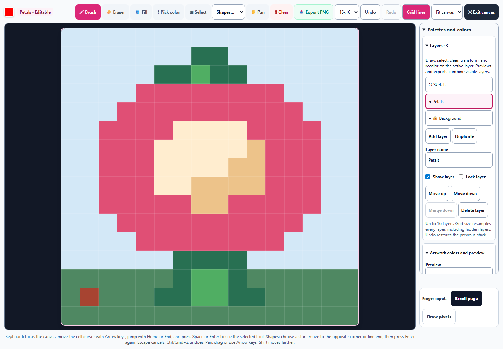
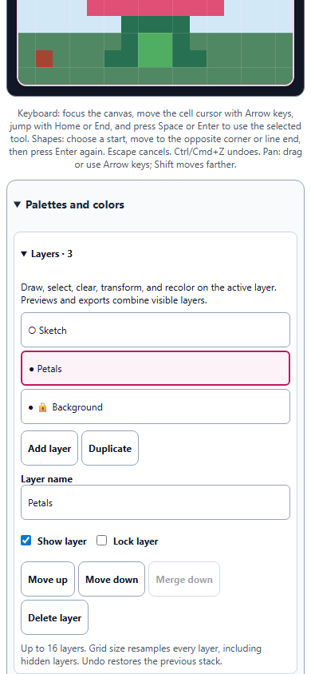

# Pixel Art: layers and recoverable editing

October 1, 2026. Included in the Art Studio enhancement commit.

Pixel Art now supports up to 16 independent layers in the existing palette panel. The expanded grid remains 854 × 854 CSS pixels at a 1440 × 1000 desktop viewport. On a 390 × 844 phone, the layer controls fit without horizontal overflow and provide 44-pixel touch targets.

## Working with layers

- Add an empty layer, duplicate a layer, rename it, move it up or down, merge it into the layer below, or delete it. The layer list shows the top layer first and marks the active layer.
- Visibility and locking protect drawing. Hidden or locked layers reject brush, eraser, fill, shapes, moving selections, transforms, and recoloring; the panel explains why editing is unavailable. Copying remains available, including copying from a locked layer and pasting into a new editable layer.
- Clearing removes pixels from the active layer. Erasing reveals layers underneath. The artwork color palette and color replacement operate on the active layer, while the picker samples the visible composition.
- Shape and selection previews appear within their layer, so higher layers cover them correctly. Switching layers cancels unfinished gestures before drawing on another layer. The local clipboard survives layer switches and still clears when the learner or grid changes.
- Merge down preserves the visible composition, including partial alpha. Both layers must be visible and unlocked. The last layer cannot be deleted, and locked layers cannot be destructively reordered, merged, or deleted.

## Recovery and compatibility

Undo and Redo restore the complete stack: pixels, order, names, visibility, locks, active layer, and grid size. Resolution changes resample every layer, including hidden or locked artwork, with nearest-neighbor mapping. Undo recovers the original resolution and exact cell colors.

Saved studies retain independent layer data. Forking a study restores its complete stack without sharing mutable pixel maps with the saved original. Legacy flat pixel artwork opens as one editable layer. The composed `pixelData` field remains available for existing consumers; the layer stack is authoritative for newer artwork. Invalid saved coordinates, duplicate IDs, overlong names, and excess layers are sanitized.

PNG export, transparent native-resolution sprite export, and the enlarged, actual-size, and repeating-tile previews combine all visible layers. Hidden artwork stays saved and is excluded from the visible output. Grid lines, cursor outlines, and unfinished guides stay out of exports.

## Verification

**170 tests passed across 16 files**, with no failures: 154 cases in the layer regression run and 16 Color Mixer cases after synchronizing the existing Spectral wrapper with its build check. The pinned Spectral source, embedded license, and SHA-256 remain intact.

New helper and actual-control tests cover legacy migration, malformed saved state, alpha composition, independent snapshots, layer protection, copying and pasting, clearing, recoloring, duplication, order, merge, deletion, resizing, naming, canceled gestures, and the 16-layer limit. Saved-study tests exercise save, fork, editing after save, navigation recovery, and opening historical flat artwork. Existing keyboard, accessibility, ownership, persistence, context-guard, hydration, snapshot, and touch tests also pass.

The Chromium layer check verifies real drawing controls, protection and Undo, exact compositing, independent duplicated pixels, recoverable merge and deletion, clean exports, gesture cancellation, desktop canvas size, and phone layout. The existing artwork-color browser workflow also passes with layers enabled. JavaScript syntax, canonical/public parity, all 26 English layer/help entries, scoped whitespace checks, and the pinned Spectral check pass.

Evidence:

- [Layer browser results](pixel-layers-browser-results.json)
- [Regression results](pixel-layers-regression-results.json)
- [Mixer regression results](pixel-layers-mixer-results.json)
- [Existing color browser results](pixel-colors-browser-results.json)
- [Validation and source hash](pixel-layers-validation.json)
- [Native transparent sprite](pixel-layers-sprite.png)
- [Changes against the pre-pass source](pixel-layers-preservation.diff)

Run `node dev-tools/artstudio_pixel_layers_qa.cjs` for the browser check. The checks exercise the tool in Chromium; they do not launch the packaged desktop application.
