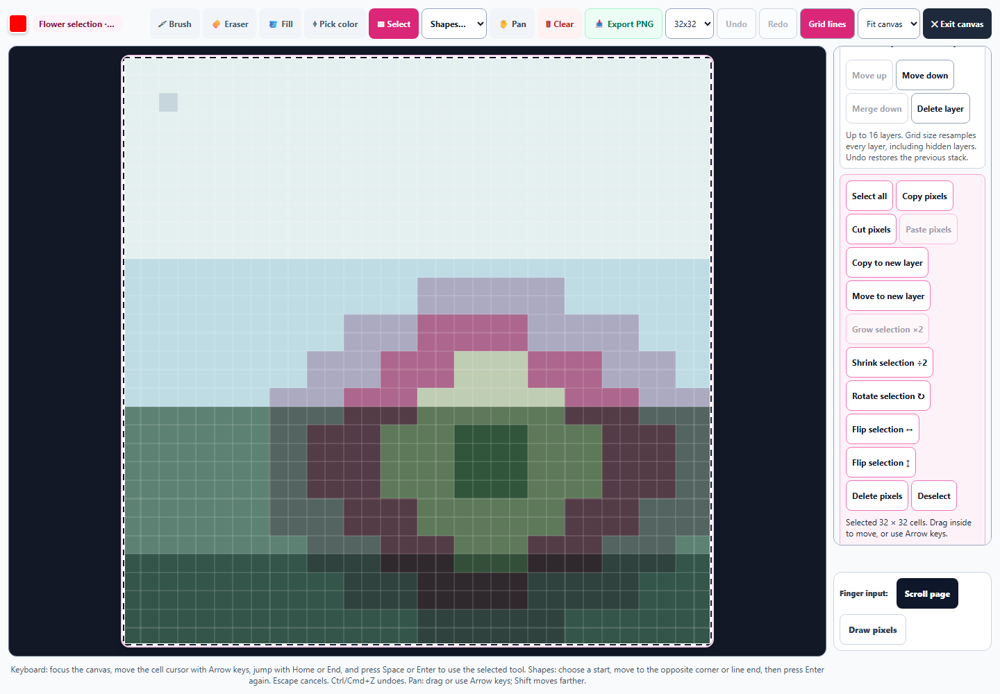
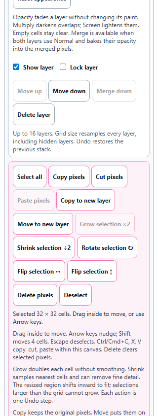
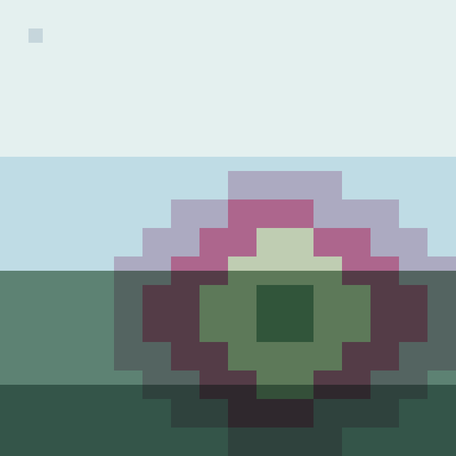

# Pixel Art selection editing

Selected paint can now grow ×2, shrink ÷2, or become an independent layer through Copy to new layer or Move to new layer. The desktop grid still measures 854 × 854. New controls fit 320px and 390px phone layouts without horizontal overflow and have 44px touch targets.

Grow replicates every exact cell color and alpha without smoothing. Shrink samples nearest cell centers and can remove fine detail; Undo recovers it. Odd dimensions round up. Resized regions shift inward to fit the grid, and Grow is unavailable when either doubled dimension exceeds the grid. Transparent holes preserve destination paint outside the original selection.

Copy retains the source paint and creates an unlocked adjacent layer. Move removes only the selected source pixels and preserves the composite image exactly. Both keep opacity, blending, and visibility; hidden copies stay hidden. The new layer becomes active and retains the selection so editing can continue. Locked sources can be copied, while Move and resizing are protected. Transfers respect the 16-layer limit. Each edit is one Undo step and saved studies recover the complete layer stack.

All 207 scoped tests across 17 files passed, including all Pixel Art suites, pointer/capture ownership, artwork recovery, semantics, and English key checks. The focused run passed 68 tests across three files; those cases are included in the broader count. Syntax, source/public mirrors, the pinned spectral build, and nine new entries across all three English catalogs were checked.

Chromium checks used real selection drags and keyboard selection, verified exact moved composite and downloaded PNG bytes, and recovered scaled/moved layers through real IndexedDB. These were standalone browser checks, not a packaged desktop launch. See [validation](pixel-selection-validation.json), [browser results](pixel-selection-browser-results.json), and [regression output](pixel-selection-regression.txt).

Changes are deliberately uncommitted and were not staged by this pass.

## Expanded drawing workspace

## Phone controls at 320px

## Clean enlarged artwork export

