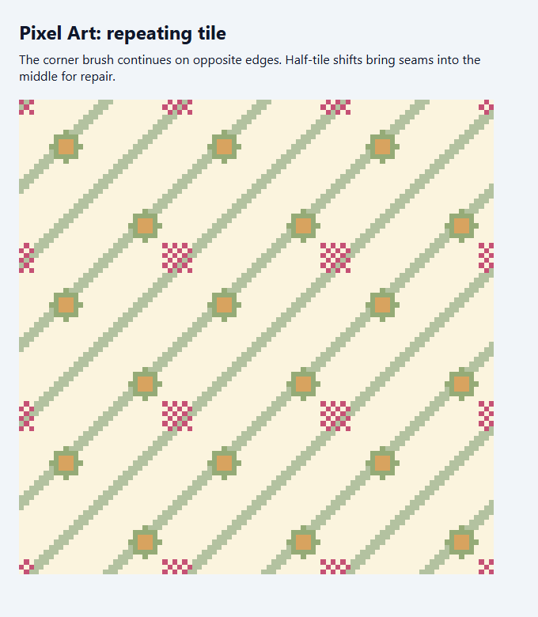
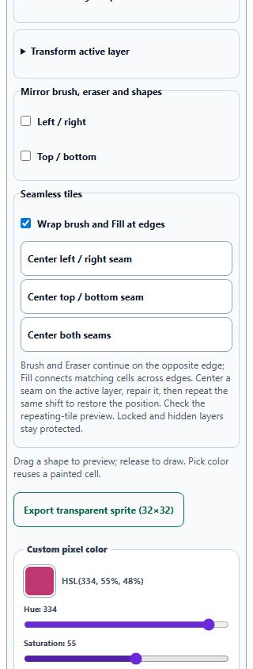

# Pixel Art: seamless tile editing

Pixel Art now offers **Wrap brush and Fill at edges** and three seam-centering controls. Brush and Eraser continue onto the opposite edge, including at corners. Round tips retain their footprint, ordered dithering stays anchored to artwork cells, and both mirror axes continue to work. Fill connects matching colors across opposite edges through four-neighbor connectivity; disconnected regions remain separate. Ordinary clipped editing remains the default.

**Center left / right seam**, **Center top / bottom seam**, and **Center both seams** shift the active layer by half a tile without cropping or resampling. Repair the seam in the middle, then repeat the same shift to restore its position. Exact RGBA/HSL cell strings, transparency, opacity, blending, and other layers are preserved. Each shift has one Undo step, unchanged periodic patterns consume no history, and locked, hidden, and empty layers are protected. Mode changes or seam shifts end an active pointer gesture safely, preventing late releases from adding stray paint.

The existing repeating-tile preview shows a clean 3 × 3 composite, while exports contain one tile. Wrapping and edited paint recover through saved-study Fork without modifying the saved original. The expanded desktop grid remains **854 × 854**. All three seam buttons have 44px targets and fit 320px and 390px phone layouts without horizontal overflow.

All **292 unique scoped tests across 21 files passed**, including 28 new tile-workflow cases, every Pixel Art suite, Watercolor simulation and lifting, pigment mixing, capture and pointer ownership, artwork recovery, accessibility, and English keys. An initial saved-study test used an incomplete button label, and the initial browser harness needed to scroll its first drawing target into view; both harness issues were corrected before the final clean runs. See [validation](pixel-tiling-validation.json) and [regression output](pixel-tiling-regression.txt).

Standalone Chromium checks used actual edge Fill and a wrapped, dithered pointer stroke; verified exact PNG bytes before/after Undo and two shifts; downloaded the clean export; and recovered layer appearance, paint, and wrapping from real IndexedDB. Desktop and both phone previews were visually inspected. The packaged desktop application was not launched. See [browser results](pixel-tiling-browser-results.json).

Source and public mirror match. Syntax, the pinned spectral build, all seven new English entries across three catalogs, preservation of prior English entries, and scoped whitespace checks passed. The previous Pixel selection and Watercolor lifting improvements remain intact. **No changes were staged or committed by this pass.**

## Repeating tile

## Narrow phone controls

