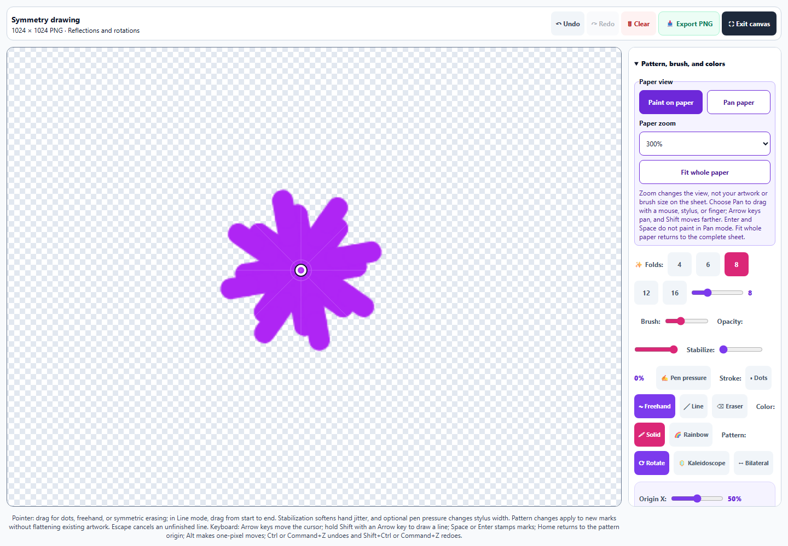
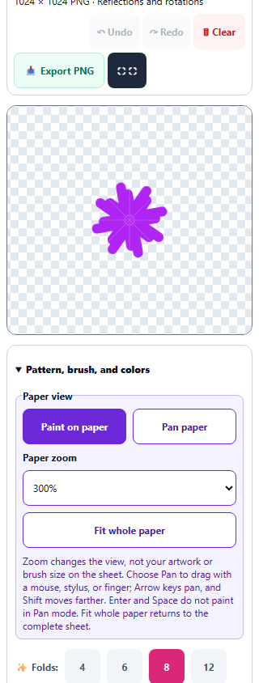

# Symmetry Studio: detail drawing and paper navigation

Symmetry Studio now has **150%, 200%, and 300% paper zoom**, **Pan paper**, and **Fit whole paper**. Zoom retains the visible paper center. Pan works with a mouse, stylus, or finger; Arrow keys move the viewport, Shift moves farther, and Home/End reach its limits. Enter and Space do not draw in Pan mode. Keyboard guidance follows the active mode, and choosing finger drawing or page scrolling explicitly returns to Paint.

The viewport stays fixed when scrollbars appear. Auto margins center the fitted sheet while allowing the entire zoomed sheet to be reached. Canvas, pattern guides, and the keyboard cursor occupy the same sheet, so scrolling keeps their positions aligned. The drawing coordinate system stays at 512 units, the backing store stays **1024 × 1024**, and zoom does not alter brush size or existing paint. Export PNG still captures the entire original sheet, without editing guides, cursors, or viewport cropping.

Panning and view changes add no Undo entries. Changing mode, zoom, or Fit ends a gesture safely: completed freehand marks remain one recoverable edit, provisional Lines are discarded, and late pointer releases do not add paint. Pointer IDs and primary-input guards prevent other fingers or stylus events from taking over a pan. Keyboard navigation ends pointer panning before moving the viewport, so a later pointer move cannot roll back the keyboard position. Escape ends an active pan. Fit resets zoom and scroll origin while keeping the chosen Paint/Pan mode.

View settings stay out of saved artwork. Restoring a study or changing learner returns to Fit and Paint; Clear and artwork restoration cancel outstanding navigation. The shared finger-input controls accept the Symmetry view mode without changing other tools' default behavior. Pan leaves both painting/scrolling choices inactive and supplies accurate accessible instructions.

All **472 unique scoped tests across 33 files passed**, including **26 new navigation cases**, the existing Symmetry drawing/keyboard suites, all Pixel Art suites, Watercolor simulation/lifting/navigation/mixing, pointer/capture ownership, saved-artwork recovery, hostile saved state, idle loops, canvas guards, accessibility, English keys, and shared finger-input checks. The main regression run passed 444 cases across 32 files but exited with an infrastructure error because the Pixel tiling worker timed out while starting. A clean targeted recheck passed all 28 cases from that remaining file. The total above counts unique executed cases across those two runs, not a single clean full run. The focused Symmetry recheck also passed 54 cases across 3 files. Earlier worker startup failures and an interrupted run are preserved; test budgets were not changed in the repository. See [validation](symmetry-navigation-validation.json), [regression output](symmetry-navigation-regression.txt), [Pixel tiling recheck](symmetry-navigation-tiling-recheck.txt), and [focused checks](symmetry-navigation-focused.txt).

Standalone Chromium checks retained an **816 × 816** fitted desktop canvas and measured **1632 × 1632** at 200%, with exact center anchoring. They exercised actual zoom/pan controls, painting with Undo/Redo, safe Line cancellation, full PNG downloads, and Save/Clear/Fork through real IndexedDB. Synthetic primary pen/touch events covered the corresponding input paths. Desktop and 320px/390px phone previews were visually inspected; both phones retained fixed viewports, controls at least 44px tall, and no horizontal overflow. The packaged desktop application and physical stylus hardware were not launched. See [browser results](symmetry-navigation-browser-results.json).

Source and public mirror match. Syntax, the pinned spectral build, all eight new English entries across three catalogs, and preservation of prior Art Studio English entries passed. The preceding Pixel selection, seamless tile editing, scaled PNG exports, Watercolor lifting, and paper navigation improvements remain in the working tree. **No changes were staged or committed by this pass.**

## Detail workspace

## Phone controls

