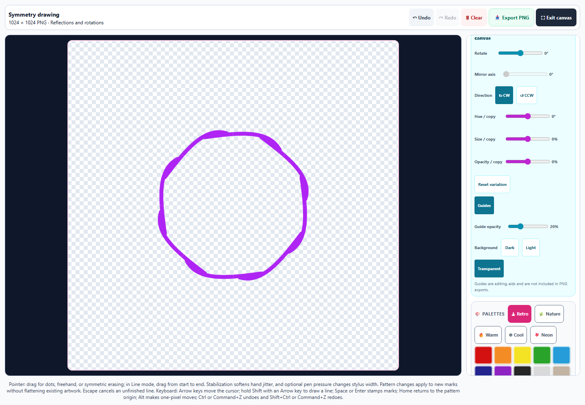
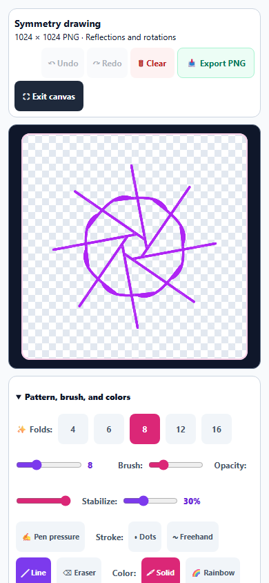
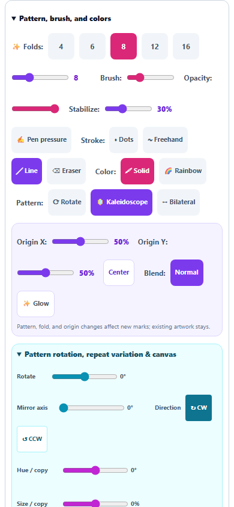
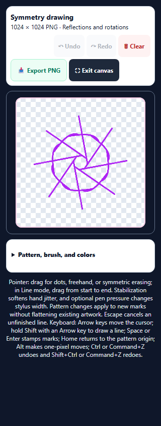

# Symmetry Studio: expanded drawing and clean capture

October 1, 2026. Included in the Art Studio enhancement commit.

Symmetry Studio now gives drawing its own responsive paper area, with pattern, brush, color, and touch controls in a scrollable sidebar on larger screens and a collapsible panel below the canvas on phones. Undo, Redo, Clear, PNG export, and Expand canvas stay in the workspace header. The expanded desktop canvas measured **816 × 816 CSS pixels at 1440 × 1000**; its backing canvas and PNG exports are **1024 × 1024 pixels**.

The backing canvas stays fixed while the displayed canvas fits the available space. Expanding, leaving fullscreen, resizing, and expanding again preserve the canvas node, painted pixels, and history. Historical 512-pixel snapshots restore into the same drawing geometry. Brush widths, pattern origins, reflection axes, keyboard positions, and guide geometry retain their existing 512-unit coordinates.

## Drawing and recovery

- A line remains a preview until the owning pointer releases. Preview pixels stay out of artwork captures and PNG exports. Escape, pointer cancellation, capture loss, and changes to pattern or brush settings discard an unfinished line. Completed lines are captured after their preview state has been cleared.
- Other pointers cannot move, finish, or cancel an active gesture. Freehand and erasing consume coalesced samples and the dispatched endpoint, then reach the actual release coordinate even with stabilization enabled. A stylus release with zero pressure keeps the last valid pressure for its final segment.
- Interrupted freehand paint remains one recoverable history step. Clear finishes that gesture, clears the artwork, and prevents a later pointer release from redrawing it. Undo can recover both the clearing and the preceding stroke. History remains bounded to twenty steps.
- Undo and Redo button availability follows the canvas history and restore state. Their actual React click handlers work when the buttons are enabled; keyboard history also cancels a provisional line before applying a committed edit.
- Save and Fork retain exact committed artwork and preserve the saved original. Learner and study changes invalidate stale PNG decodes and clear history, including changing away and returning to the same learner. Drawing waits for restoration; Clear cancels a pending restore and any export queued for it.

Artwork stays transparent internally. Light and dark PNG backgrounds are composed only at export, while a transparent PNG preserves empty pixels. Editing guides and the keyboard cursor remain outside exported artwork. Capturing artwork does not change the persisted checkpoint or reset an active gesture.

## Layout and access

The desktop sidebar scrolls independently. Phone layouts put the canvas immediately after the header, with controls and keyboard help below it. Control heights are at least 44 pixels, and buttons also have a 44-pixel minimum width. Color palettes now use a light background with readable labels. Keyboard instructions use light text against the dark fullscreen fallback background. The keyboard help includes Escape, and the live canvas description announces the pattern, fold count, stroke, blend, origin, and keyboard cursor through translatable strings.

At **390 × 844**, the canvas measured **328 × 328 CSS pixels**, with 54 controls meeting the height floor and no horizontal overflow. A **320 × 844** check also passed using the fullscreen fallback after a simulated native-fullscreen rejection. Escape restored page scrolling and retained the artwork.

## Verification

**207 tests passed across 19 files, with no failures.** Fifteen new cases cover backing resolution, logical geometry, clean line capture, pointer ownership, release endpoints, pen pressure, actual Undo/Redo controls, pattern changes, recoverable Clear, display resizing, legacy snapshots, stale decodes, learner ownership, queued exports, and unavailable drawing contexts. The broader run includes existing symmetry keyboard, Pixel Art import/layer/color/selection, artwork round-trip, saved-study, hydration, accessibility, ownership, and touch regressions.

Chromium verified a real mouse stroke, exact pixels after actual Undo/Redo clicks, clean line previews and completed-line persistence, competing pointers, pattern-change cancellation, all three export backgrounds, guide exclusion, an actual downloaded PNG, workspace resize recovery, saved-study immutability and forking, both phone widths, and native-fullscreen fallback recovery. No page errors were recorded. The transparent export was 1024 × 1024 with 23,772 painted pixels and a fully transparent corner before the line checks.

JavaScript syntax, canonical/public equality, all ten new English entries across the three existing registries, scoped whitespace checks, and the pinned Spectral build check pass. The broad regression run preceded the final phone layout and fallback contrast CSS adjustments; the browser check verifies the final layout. These checks use the standalone tool in Chromium rather than the packaged desktop application.

Evidence:

- [Validation and source hashes](symmetry-workspace-validation.json)
- [Browser results](symmetry-workspace-browser-results.json)
- [Regression results](symmetry-workspace-regression-results.json)
- [Downloaded transparent PNG](symmetry-workspace-export.png)
- [Changes against the pre-pass source](symmetry-workspace-pass.diff)

Run `node dev-tools/artstudio_symmetry_workspace_qa.cjs` for the browser check.
