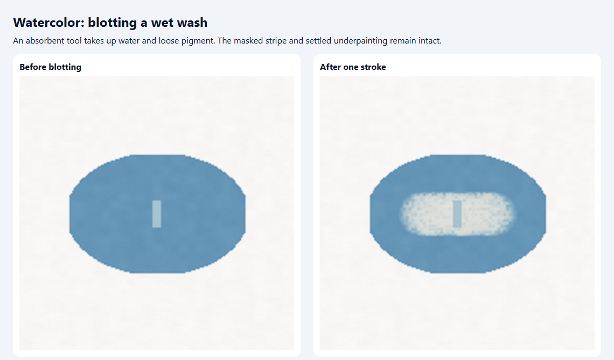
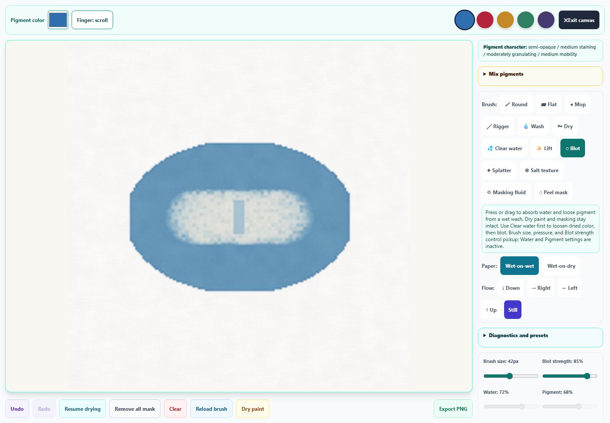
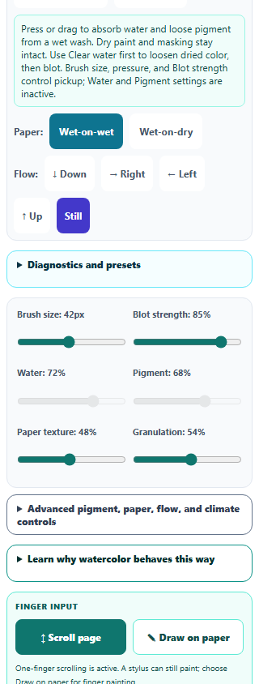

# Watercolor: absorbent blotting and reliable clearing

October 1, 2026.

Watercolor now offers a **Blot** tool beside Lift. Blot absorbs water and loose surface pigment without adding fresh water or scrubbing settled color out of the paper. It creates a broken, absorbent texture, responds to brush size and stylus pressure, and has a separate **Blot strength** control. Water and Pigment load sliders are inactive while Blot is selected.

The tool preserves masking fluid and fixed underpainting. It removes each mobile pigment parcel with its RGB and material properties in the same proportion, retaining the remaining pigment hue. A completely dry cell stays unchanged. Clear water can first remobilize dry color; Blot then removes the released pigment, while strongly staining color remains more resistant. These behaviors approximate the practical lifting and blotting workflow described by [DANIEL SMITH](https://danielsmith.com/tutorials/watercolor-for-beginners/) and [Winsor & Newton](https://www.winsornewton.com/blogs/guides/how-to-lift-watercolour). The textured pickup model is a numerical approximation rather than a calibrated sponge simulation.

In the controlled wet-wash fixture, one mouse stroke removed **20.8% of the sheet's water** and **18.9% of its mobile pigment**. Fixed pigment and the masked stripe stayed unchanged. The fixture deliberately starts with a uniform painted region; ordinary strokes continue using the existing brush, paper, drying, and flow model.

Blotting uses the existing twenty-step history and compact wet-state format. The visible Undo and Redo controls recover water and paint. Saved-study forks restore the wet painting, pause state, selected tool, and strength without changing the saved original. The 1024 × 1024 PNG action exports exact clean artwork. Cursor and diagnostic overlays remain excluded.

Clear now finishes an active pointer gesture before clearing the paper. A late movement or release cannot redraw the cleared page; Undo recovers the interrupted mark.

The expanded desktop paper measured **810 × 810 CSS pixels at 1440 × 1000**. Blot strength has a 44-pixel minimum target height, with associated guidance. Both **390 × 844** and **320 × 844** phone layouts fit without horizontal overflow.

Passing results cover **787 unique tests across 80 files**. The initial run found two assertion failures; both are fixed. The completed standard-reporter run passed 79 of 80 files, with two Watercolor cases exceeding their 20-second timeout. The Watercolor file was rerun after replacing costly typed-array deep comparisons with exact byte comparisons; all 40 cases passed in 22.17 seconds with the existing 60-second per-run allowance. The ordinary 20-second budget is unchanged. The full-run and recheck logs are retained, and the consolidated results identify the passing log for each file. Two attempts using JSON output stalled and were interrupted. The Watercolor engine, mixing, and pointer checks also separately passed all 50 cases earlier.

Eight new simulation and workflow cases check mobile parcel pickup, masking, fixed glazes, dry paint, strength, pressure, repeated strokes, clear-water absorption, rewetted staining behavior, continuous strokes, compact recovery, visible controls, and interrupted clearing. Browser checks use the repository's standalone tool in Chromium with real IndexedDB, rather than the packaged desktop application. No page errors were recorded.

The full run also caught missing stereogram success feedback and a Harmony semantics test that still expected the former table. Capture and depth PNG export feedback are restored, and the test now checks the accessible experiment controls. Pixel Art layer recoloring now uses a new guidance key; the legacy whole-artwork wording is preserved for older translations rather than silently changing its meaning. Four new English entries match in all three registries.

The accumulated Pixel layer, Pixel image import, Symmetry workspace, animated depth editor, and this Watercolor pass form one scoped Art Studio commit. Other tools' shared-registry edits stay outside that commit.

Evidence:

- [Validation and source hashes](watercolor-blot-validation.json)
- [Consolidated passing results](watercolor-blot-standard-results.json)
- [Complete standard-reporter output](watercolor-blot-full-suite.txt)
- [Watercolor recheck output](watercolor-blot-watercolor-recheck.txt)
- [Initial full run](watercolor-blot-regression-results.json)
- [Focused rechecks after fixes](watercolor-blot-final-fixes-results.json)
- [Browser results](watercolor-blot-browser-results.json)
- [Downloaded clean PNG](watercolor-blot-export.png)
- [Changes against the pre-pass source](watercolor-blot-pass.diff)

Run `node dev-tools/artstudio_watercolor_blot_qa.cjs` for the browser check.
