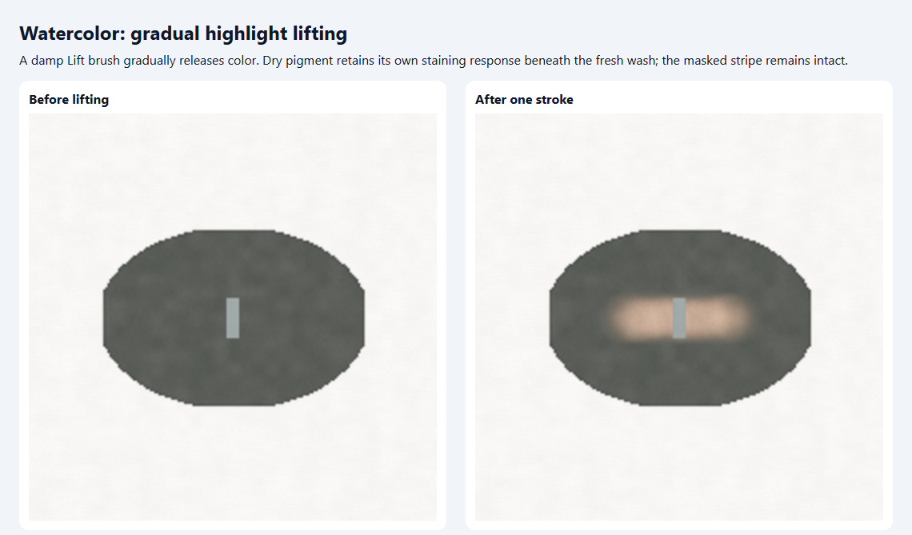
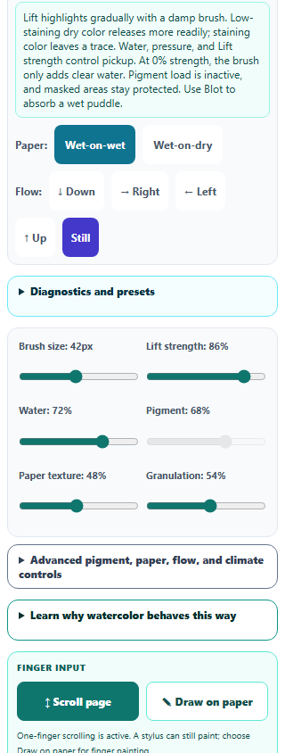

# Watercolor: gradual highlight lifting

Lift now has an accessible 0–100% strength control. Lower strength gently recovers highlights; stronger strokes remove more loose and settled color while retaining residual paint. At 0%, the brush adds clear water without removing pigment. Water stays adjustable, inactive Pigment load is disabled, and guidance explains the technique. Strength persists across brush changes and saved studies.

The dry glaze uses its own stored staining trait when lifting. Previously, a fresh wet wash's staining mass could change an unrelated dry glaze's resistance. Selecting a new paint profile also cannot rewrite the glaze's response. Pickup scales with pressure and available moisture, so an unloaded water brush can work on damp paper, while dry bristles on dry paper leave pigment unchanged. Paper sizing continues to influence lifting. Entire color/material parcels scale together, preserving their hue and properties; masks and cells outside the brush remain protected.

This is an artistic simulation. The design follows [Winsor & Newton's lifting guidance](https://www.winsornewton.com/blogs/guides/how-to-lift-watercolour): damp tools and gradual repetition lift color, with non-staining pigments releasing more readily. The numerical response and separation of wet and settled parcels are implementation choices, rather than measured pigment constants.

All **173 unique scoped tests across 16 files passed**, including 12 new lifting cases, the existing 40-case Watercolor simulation, pigment mixing, capture and pointer ownership, saved-artwork recovery, hostile saved state, canvas guards, accessibility, English keys, Pixel selection editing, and Pixel appearance. An initial new test incorrectly required bloom response to remain unchanged after adding water; its corrected pigment-preservation assertion passes in the full run. See [validation](watercolor-lift-validation.json), [regression output](watercolor-lift-regression.txt), and [Pixel appearance output](watercolor-lift-pixel-appearance.txt).

Browser checks exercised actual Lift selection, keyboard strength adjustment, zero-strength pointer strokes, one-stroke Undo/Redo, exact 1024 × 1024 PNG download, and study Save/Fork recovery through IndexedDB. The expanded desktop paper measured 820 × 820. At 320px and 390px, controls stayed within the viewport with 44px slider targets. Exported paint and the saved original remained intact. These were standalone Chromium checks; the packaged desktop application was not launched. See [browser results](watercolor-lift-browser-results.json).

Source and public mirror match. Syntax, the pinned spectral build, both new English entries across three catalogs, preserved prior English entries, and scoped whitespace checks passed. Prior Pixel selection improvements remain in the working tree. **No changes were staged or committed by this pass.**

## Lifted highlight

## Phone controls

