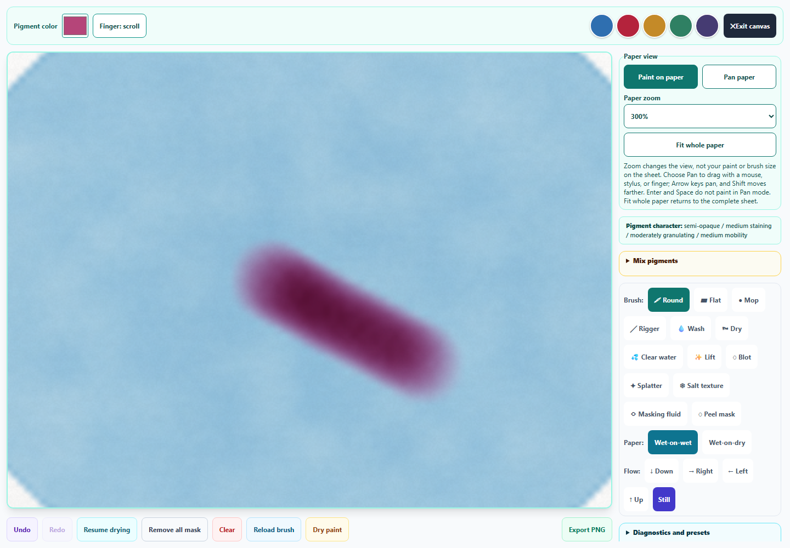
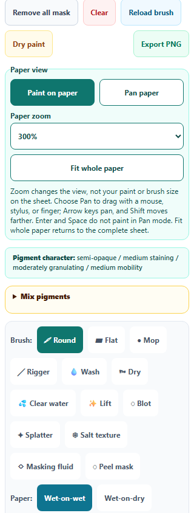

# Watercolor: detail painting and paper navigation

Watercolor now has **150%, 200%, and 300% paper zoom**, a **Pan paper** mode, and **Fit whole paper**. Zoom preserves the visible paper center. Pan works with a mouse, stylus, or finger; Arrow keys move the viewport, Shift moves farther, and Home/End reach its limits. Enter and Space do not paint in Pan mode. Explicitly choosing finger drawing or page scrolling returns to Paint mode, with matching visual states and accessible guidance.

The viewport stays fixed as paper grows, including when scrollbars appear. The brush cursor follows the sheet through scrolling, and drawing coordinates continue to map to the original paper. Brush size and the simulation do not change with zoom. The backing canvas and clean exports remain **1024 × 1024**; Export PNG downloads the entire painting even at 300% zoom. Fit returns to zoom 1 and the viewport origin while retaining the chosen Paint/Pan mode.

Panning and view changes do not add Undo entries, drain the brush, or alter paint. Changing mode, zoom, or Fit safely completes the current gesture without accepting a late pointer release. Other pointer IDs cannot take over a pan. Clear and artwork restoration cancel navigation. A restored study or a different learner starts with the complete sheet in Paint mode. View state is kept out of saved artwork, and Fork continues to preserve the saved original.

All **328 unique scoped tests across 25 files passed**, including 19 new navigation cases, all Pixel Art suites, Watercolor simulation/lifting/mixing, pointer and capture ownership, artwork recovery, hostile saved state, canvas guards, idle loops, accessibility, and English keys. The final touch-control appearance correction passed a further **29-case check across 2 files**; those cases are already included in the unique total. One initial engine case timed out at its explicit 20-second limit under load; the complete recheck passed using the existing supported 60-second environment override. An older accessibility assertion now verifies the new help reference and the existence of every linked instruction. See [validation](watercolor-navigation-validation.json), [regression output](watercolor-navigation-regression.txt), and [final focused check](watercolor-navigation-final-focus.txt).

Standalone Chromium verified actual zoom, mouse/keyboard panning without paint or history changes, detail painting with Undo/Redo, exact clean full-sheet PNG download, and Save/Clear/Fork through real IndexedDB. At the 1440 × 1000 desktop viewport, fitted paper measured **810 × 810**, and 200% paper measured **1620 × 1620** with the exact normalized center retained. Both 320px and 390px phone viewports stayed fixed during zoom, had no horizontal document overflow, and provided 44px navigation controls. Desktop and phone previews were visually inspected. The packaged desktop application was not launched. See [browser results](watercolor-navigation-browser-results.json).

Source and public mirror match. Syntax, the pinned spectral build, all eight new English entries across three catalogs, and preservation of every preceding Art Studio English entry passed. The previous Pixel selection, seamless tile editing, and Watercolor lifting improvements remain in the working tree. **No changes were staged or committed by this pass.**

## Detail painting

## Phone controls

