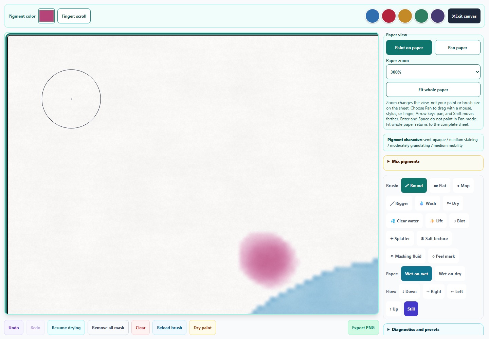
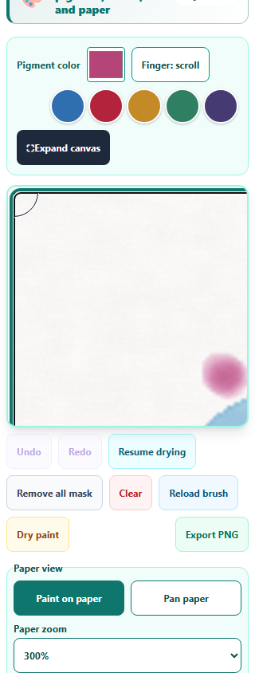

# Watercolor: precise detail work

Watercolor now follows the keyboard brush through zoomed paper. **Alt + Arrow** makes fine moves, **Shift + Arrow** moves four times farther, and Home/End reveal opposite corners. Ordinary Arrow movement retains its brush-relative spacing. Focus, movement, and dabbing scroll only the paper viewport by the amount needed to reveal the brush; an oversized Mop or Wash keeps its center visible. Alt moves one 192-grid simulation cell, rather than one exported pixel.

The keyboard outline stays visible while its focus owns the brush. Pointer hover can temporarily replace it; leaving restores the keyboard position, and blur hides it. Pointer painting and panning focus the canvas without scrolling to a distant keyboard point. Restoring Undo/Redo coordinates refreshes a visible keyboard outline without forcing the viewport to jump. Screen-only ownership stays out of captured artwork, and the existing saved-state format is unchanged.

Keyboard drawing or navigation safely ends an active pointer gesture first. A pointer stroke and keyboard dab remain separate Undo steps, and late pointer events cannot add paint. Escape ends a stroke while retaining completed marks as one recoverable edit. Pan keyboard actions and Escape release capture, so late drag movement cannot overwrite keyboard scrolling. Blur also ends capture. Pan ignores Alt combinations and keeps Enter/Space from painting. Paint/Pan instructions and declared shortcuts follow the active mode; the accessible canvas description includes keyboard position.

The brush outline is confined to its own clipped overlay. It cannot create extra empty scroll space at the paper edges, while the canvas focus ring remains outside that clipping layer. The existing footprint remains pressure/tilt/size aware; flat-brush CSS curvature approximates the physical shape rather than claiming an exact contact perimeter. Paint physics, reservoirs, simulation resolution, clean capture, and full **1024 × 1024** PNG export are retained.

All **507 unique scoped tests across 34 files passed**, including **35 precision cases**, all Pixel Art suites, Symmetry workspace/navigation/keyboard controls, Watercolor physics/mixing/lifting/navigation, saved-artwork recovery, pointer ownership/completion, hostile state, idle loops, canvas guards, accessibility/English keys, and shared touch controls. The final broad run completed without assertion failures or worker errors. The final focused run passed 54 cases across 2 files. Initial fixtures were corrected for compact-history quantization, browser scroll clamping, and CSS normalization; their logs remain available. An existing zoom case exceeded 60 seconds during host slowdown; final validation used a temporary limit of 120 seconds without changing repository budgets or assertions. See [validation](watercolor-precision-validation.json), [regression output](watercolor-precision-regression.txt), and [focused output](watercolor-precision-focused.txt).

Chromium checks cover actual keyboard precision and viewport following, pointer-focus isolation, hover/blur ownership, independent Undo/Redo, capture cancellation, maximum-size Mop/Wash outlines at 300%, clean complete PNG download, saved-study restoration, and desktop/320px/390px layouts. Synthetic primary pen/touch events supplement the real mouse/keyboard paths. The previews were visually inspected. Physical stylus hardware and the packaged desktop app were not launched. See [browser results](watercolor-precision-browser-results.json).

Source/public mirrors, syntax, pinned spectral build, all three new English entries across three catalogs, and preservation of earlier Art Studio English entries passed. Prior Pixel Art, Watercolor lifting/navigation, and Symmetry improvements remain in the working tree. **No changes were staged or committed by this pass.**

## Detail workspace

## Phone view

