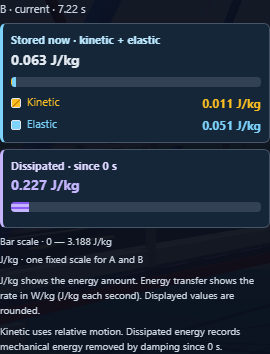
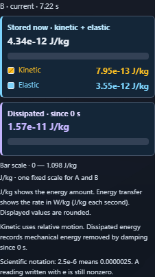
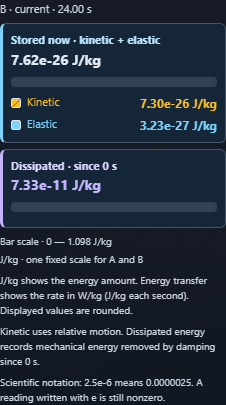

# Bridge Lab: energy in this frame

The 3D scene now separates energy stored at the selected moment from energy removed by damping since the experiment began. Students can follow the bridge motion and read both amounts without adding past dissipation to the energy currently stored.

## What changed

- **Stored now** has its own total, with kinetic and elastic components underneath.
- **Dissipated since 0 s** has a separate total and bar.
- Both bars use the same fixed event scale. Saved A and B share that scale.
- Native values stay readable when the amount is too small to draw as a visible bar. Tiny nonzero readings use scientific notation; zero stays zero.
- The display states that readings are rounded. Adding rounded components can differ from the displayed total in the last digit.
- Patterns and text labels distinguish the components alongside color.
- The selected trial, time and bar range are visible. The panel explains energy amount in J/kg and transfer rate in W/kg.
- Readings use the recorded simulation fields at the selected time. Graphics fallback retains the current experiment, and deliberate recovery restores the selected saved trial.

The existing minimum event scale of 0.001 J/kg remains. Bar widths are proportional to the recorded amounts and have no minimum visible width.

## Validation

| Check | Result |
| --- | --- |
| Numerical model sweep | 144 configurations passed; model code unchanged by final wording |
| Focused desktop, phone and graphics fallback cases | 3 passed; one worker; no retries; video off |
| New feature captures | 6 fresh PNGs, hashed and bound to the browser run |
| Source mirrors and JavaScript syntax | Passed |
| English fallbacks | 1,355 literals match each registry independently |
| Complete unit campaign | Could not complete |

### Unit validation limitation

The full unit run exhausted native memory. A slower retry was interrupted. Fresh fork and thread workers then timed out before collecting tests. These attempts and their logs are preserved; no unit pass count is inferred from them. The two new unit cases remain in the suite, alongside the browser assertions that check recorded amounts, tiny and zero values, shared scales, decay and fallback.

The current source and browser test hashes match the completed browser run. The numerical sweep ran before the final rounding sentence; removing exactly that sentence reproduces the checked source hash, proving the model code is unchanged. [Implementation verification](implementation-verification.json) records that check, the artifact hashes and the unit limitation. Run `node verify-implementation.cjs` to repeat those artifact checks. The broader `verify.cjs` remains available for a future completed unit campaign and full browser run.

## Views

### Desktop: stored energy and cumulative loss

### Phone: tiny nonzero readings

### Phone: after the shaking ends

Changes are uncommitted.
