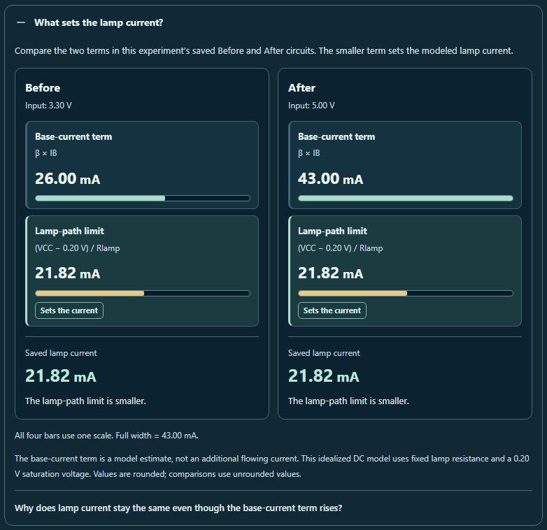

# CircuitTool: explaining the saved current limit

The tested lesson now includes **What sets the lamp current?** after **Trace the change**. Its Before and After cards compare two terms from the lesson's fixed saved circuits:

- **Base-current term:** beta times base current.
- **Lamp-path limit:** supply minus the model's 0.20 V saturation voltage, divided by lamp resistance.

The smaller term sets the modeled lamp current. Each card shows the actual saved lamp current separately. A text label and border identify the term that sets it; exact equality identifies the saturation boundary. All four bars share one scale, so the Before and After lengths can be compared directly.

For **Find the limit**, the base-current term rises from **26.00 to 43.00 mA**, while the lamp-path limit and saved lamp current stay at **21.82 mA**. The extra base drive cannot increase the lamp current in this model. Gain and sensor experiments instead show the base-current term below the lamp-path limit.



## Learning and visual behavior

The disclosure starts closed and appears only after a valid Test. It uses the same fixed Before/After solutions as the existing saved evidence. Editing the live circuit, reversing probes, replaying an experiment, or using Undo leaves this comparison tied to the selected saved experiment.

The two cards sit beside each other on desktop and stack on phones. Reading magnitudes and units keep their own text spans, and formulas and numeric values retain their order in RTL layouts. The terms have separate labels and bar colors, with an explicit limiting-term decision that also works in forced colors.

The context names the saved circuits. The model note distinguishes the base-current estimate from an additional flowing current, states the idealized DC assumptions, and explains that comparisons use unrounded values. A short lesson-specific prompt asks students to connect these terms to their own explanation.

## Preservation boundaries

This is a native, read-only disclosure. Opening it writes no tool state, grades nothing, and inserts no answer. Existing predictions, explanations, measurements, writing controls, history, notebook, import/export schema, solver equations, and AI payloads are preserved.

Product changes are confined to **stem_lab/stem_tool_circuit.js** and its identical public mirror.

Frozen source SHA-256:

```text
eb63c510e59a9aba7b6ae27cca7f4e3974fa983c8956d9d5283cf9631f25d8a7
```

## Verification evidence

All **303 test cases across 17 files** passed. The browser audit passed **14 views** with no reported accessibility violations or material visual issues in the reviewed states.

The browser evidence includes **56 proportional bars**, **84 intact numeric magnitudes**, **142 measured fonts at exactly twice their original size**, 14 visible-focus checks, two native disclosure checks, six workflows, two lifecycle checks, and a two-instance ID check. Opening and closing preserve the full tool state, writing node, draft, backward selection, and textarea scroll position. The root reviewer inspected six representative PNGs; the browser reviewer inspected all 14.

- [Regression aggregate](regression.json)
- [Regression receipts](regression-receipt.json)
- [Browser results](browser-results.json)
- [Visual review](visual-review.json)
- [Independent validation](validation.json)

The scoped tests include the three fixed lessons; cutoff, tiny current, exact and rounded-looking equality; raw shared-scale proportions; hidden outcomes before testing; native disclosure behavior; locale changes; writing preservation; live edits, replay and Undo; lesson switching; actual JSON import/restore; retry; and separate mounted instances.

Browser coverage includes all three lessons at desktop and phone widths, actual 200% text at 320 pixels, forced colors, RTL, native keyboard operation, control size, local heading IDs, complete saved measurements, and unchanged writing and tool state.

Normal accessibility scans include contrast. Forced-color scans document the existing axe 4.12.1 authored-color exception and measure actual used colors separately. The previous [diagnostic](../circuit-explanation-guide-2026-10-01/forced-colors-diagnostic.json) retains its verified provenance.

From the repository root:

```powershell
node reports/circuit-current-limit-2026-10-02/run-regression.cjs
node reports/circuit-current-limit-2026-10-02/browser-check.cjs
node reports/circuit-current-limit-2026-10-02/validate.cjs
```

Run the browser audit after the isolated regression processes exit. Reports record the original working-file bytes; Git can normalize text line endings. Use a fresh report directory and freeze inputs again if those bytes change.
