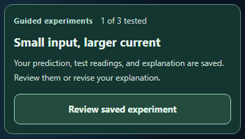

# CircuitTool: clearer actions when returning to an experiment

The guided experiment entry now uses the selected lesson's saved stage to choose its action and help text.

| Saved stage | Entry action |
| --- | --- |
| Ready to start | Open guided experiment |
| Choosing a prediction | Resume prediction |
| Prediction saved | Continue to test |
| Test readings saved | Review result and explain |
| Explanation saved | Review saved experiment |

The cue beside each action explains the next step. A saved prediction now points students toward testing. A saved explanation invites review and revision.

Each action opens the selected experiment at its existing question or saved result. Starting and testing remain explicit lesson actions. The entry derives its stage from the same normalized journey used by the lesson, including legacy records and explanations that contain only spaces. An explanation counts as saved once a tested lesson has text; its quality is left to the student.

The existing tested count and the five journey stages describe separate parts of the student's work. Switching experiments, editing settings, typing an explanation, or loading a file updates the entry text through the existing render flow. Navigation happens when the student activates the entry button.

## Verification

**140 scoped tests passed across eight files**, including 26 entry cases. They cover entry behavior, journey stages, the experiment map, continuation, the uncommitted writing-space improvement, explanation guidance, localization, and form labels. Each file passed in a fresh process with one worker and the existing test time limits. Raw results, exact assertions, commands, and file hashes are retained.

Source and desktop mirror match: `bb8f51b53428aa52fe39c22c8411090fe0014a12217ded61ba51ab42507e443a`.

The browser audit passed **ten scans and ten visual views**: all five stages on a 390-pixel phone, testing and review on desktop, both stages with 200% text at 320 pixels, and review in forced colors. Five native keyboard actions preserved exact saved state and focused the existing question or result. Real lesson progression, translation and live edits, and actual JSON import and restore passed. Ten visible-focus checks passed; all sixteen enlarged-text measurements matched twice their normal font size. Source, mirror, tests, and audit script stayed unchanged during their checks. Independent source and pixel review found no material issues.

All nine ordinary scans included contrast checks. The forced-color scan excluded only axe-core 4.12.1's known `color-contrast` issue, supported by the [existing diagnostic](../circuit-explanation-guide-2026-10-01/forced-colors-diagnostic.json). Its image and actual system colors were checked separately; all five visible text nodes measured 21:1 contrast. These focused checks do not establish full accessibility conformance.

## Previews



- [Saved prediction, ready to test](entry-test-390.png)
- [Testing entry with 200% text](entry-test-200pct-text-320.png)
- [Review entry in forced colors](forced-colors-entry-review-320.png)

## Reproduce

From the repository root:

```powershell
node reports/circuit-entry-stages-2026-10-01/run-regression.cjs
node reports/circuit-entry-stages-2026-10-01/browser-check.cjs
node reports/circuit-entry-stages-2026-10-01/validate.cjs
```

The regression runner preserves raw results. Use a fresh report destination for a new run. Installed Vitest, Playwright, Chromium, React, Tailwind cache, and axe-core dependencies are required.

This round and the earlier writing-space changes are left uncommitted at the user's request.
