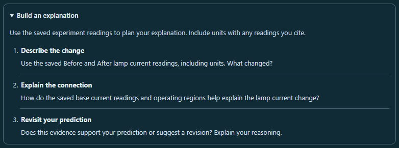

# CircuitTool: build an explanation from saved readings

Tested guided lessons now include an optional **Build an explanation** disclosure beside the student's writing. It starts closed and provides three prompts:

1. Describe the change using the saved Before and After lamp current readings and their units.
2. Explain the connection using readings relevant to the selected experiment.
3. Decide whether the evidence supports the prediction or suggests a revision.

Manual experiments refer to saved base current and operating regions. The night-light experiment refers to junction voltage and base current in **Trace the change**. Prompts refer to the saved experiment evidence while the live circuit remains editable.

The guide becomes available after Test, including incorrect predictions and revisited explanations. It inserts no writing, adds no grade, and does not gate progression. Student explanations and investigation notebook notes remain separate.

Opening the native disclosure changes only the view. Typing, translating, live edits, and switching tested lessons preserve its open state and the existing writing field. Retry hides it through the existing tested flag; testing again creates a closed disclosure. Writing jumps retain their existing focus and scrolling behavior.

## Validation

**449 tests passed across 27 files**, including 20 new workflow cases, on identical, frozen source and desktop mirror: `71dfecf576b594109e4bacf23df3d4449cb331b82d8f1dc34f27928bc42616f9`.

The process run passed 420 tests in 26 files. One worker timed out before starting, so the runner retried that omitted file; all 29 tests passed. No test assertions failed. The final result combines the complete process run and recovery, verifying exact file coverage, every assertion, and matching hashes. Both raw reports and the complete command receipts are retained.

The browser audit passed **16 accessibility scans with 17 screenshots**. Closed and open guides for all three lessons were checked at 1280, 390, and 320 pixels, plus 200% text and forced colors. Six keyboard toggles preserved state and native summary focus. Five lifecycle proofs covered Test, writing and locale changes, saved-lesson switching, replay, continuation, retry, and actual JSON import/restore. Sixteen visible-focus checks, eight focus transitions, and two right-to-left layout checks passed. All 26 enlarged-text measurements matched exactly twice their normal 320-pixel baseline.

All 14 ordinary scans included contrast checks. The two forced-color scans excluded axe-core 4.12.1's `color-contrast` rule because it reports authored colors despite the browser's system-color override. A reused diagnostic records that behavior and its original source; this update separately measured the used system colors and reviewed both forced-color images. These focused checks cover the changed workflows and do not establish full accessibility conformance.

Independent source and visual review found no material issues. Receipts record source, mirror, tested-file, browser-script, report, and screenshot hashes. Source and browser script stayed unchanged during their checks. The regression runner uses one isolated process worker; any worker-startup omissions are rerun and combined only after checking exact file coverage, every assertion, and matching hashes.

### Previews



- [Student writing and guide on a narrow phone](explanation-writing-context-320.png)
- [Sensor prompts at 200% text](guide-sensor-200pct-text-320.png)
- [Sensor prompts in forced colors](forced-colors-guide-sensor-320.png)

### Reproduce

From the repository root:

```powershell
node reports/circuit-explanation-guide-2026-10-01/run-regression.cjs
node reports/circuit-explanation-guide-2026-10-01/browser-check.cjs
node reports/circuit-explanation-guide-2026-10-01/validate.cjs
```

The installed Vitest, Playwright, Chromium, React, Tailwind cache, and axe-core dependencies are required.
