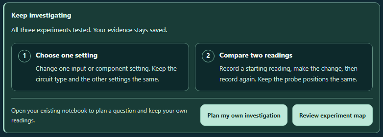

# CircuitTool: from guided experiments to your own investigation

After all three experiments have valid saved Tests, **Keep investigating** now offers two compact planning steps:

1. **Choose one setting.** Change an input or component setting while keeping the circuit type and other settings fixed.
2. **Compare two readings.** Record before and after the change with the same probe positions.

**Plan my own investigation** opens the existing investigation notebook and focuses its summary. **Review experiment map** remains available. Wrong predictions and blank explanations still count as tested experiments; writing is optional.

The two numbered cards sit side by side when there is room and stack on narrow screens. They share the established teal surfaces, clear borders, readable spacing, and keyboard focus styles. Forced colors use system text and borders.

## Work stays saved

Opening the notebook changes only its open state. It keeps circuit settings, probe positions, electrical Undo/Redo, lesson records, explanations, notebook fields and observations, and other tool data. Repeated opens retain the same state object when the notebook is already open.

The existing **Open investigation notebook** button uses the same local route. Both buttons focus their own notebook immediately, including when two tools are mounted. Writing, locale changes, imports, and restores cannot replay a delayed navigation request.

If an experiment still needs a valid Test, the existing next-experiment action appears. The new handoff creates no notes, answers, observations, rewards, or circuit changes.

## Verification

All 172 assertions across ten files passed. The browser audit passed 12 views with 22 focus checks and six native notebook-opening actions. All 21 measured fonts doubled exactly at 200% text; all nine forced-color text nodes measured 21:1. The browser reviewer inspected all 12 PNGs, and the root reviewer inspected seven.

Two completed per-file reports account for 35 assertions; the remaining 137 ran together with one thread worker and an isolated environment for each file. Three earlier worker-startup failures ran zero assertions and are preserved separately. Source and test bytes and assertion time limits were unchanged. The first browser attempt is also preserved; its only correction replaced two redundant capture selectors with the direct notebook summary selector.

The final validator checks source and mirror bytes, all raw test receipts and startup archives, complete browser workflows, doubled text, forced colors, and every reviewed PNG hash.

- [Regression results](regression.json)
- [Regression receipts](regression-receipt.json)
- [Browser results](browser-results.json)
- [Visual review](visual-review.json)
- [Independent source review](independent-review.json)
- [Source preservation](source-preservation.json)
- [Existing test selector compatibility](continuation-helper-correction.json)
- [Final validation](validation.json)

Product changes are confined to the CircuitTool source and identical public mirror. Reversing the nine recorded changes reproduces the previous source after normalizing line endings. One existing test helper now excludes the new notebook action when selecting the next-experiment button; its assertions are unchanged.

Changes are left uncommitted and unstaged.

