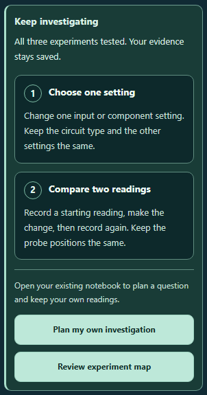

# CircuitTool: a clearer path to your own investigation

After students test all three guided experiments, **Keep investigating** offers two steps: choose one setting, then compare readings before and after changing it. **Plan my own investigation** opens their existing notebook and focuses its summary. Wrong predictions and blank explanations still count; writing stays optional.

The notebook buttons now focus the notebook belonging to the current tool. Opening it preserves circuit settings, lesson drafts, observations, probe positions, and electrical history. See the [handoff report](../circuit-investigation-handoff-2026-10-02/README.md) for the workflow change and its complete verification.

## Easier reading on phones

The planning cards keep their number and heading together when there is room. Enlarged headings can move below the number, and each paragraph uses the full card width. This gives enlarged text more room and keeps words intact at the tested 320 px width. Number markers grow with the text and retain their circular shape.

The final change is confined to the existing phone media query. Desktop CSS is unchanged, and both reviewers checked the desktop capture. The ordered list, two list items, reading order, saved work, and keyboard actions remain intact.

## Verification

The handoff passed 172 assertions across ten test files and twelve browser views. After the phone refinement, the twelve handoff assertions passed again on the final source. Six fresh browser views cover desktop, 320 px and 390 px phones, doubled text at 320 px, forced colors, and right-to-left reading.

Both reviewers inspected all six final screenshots. The audit checks full-width paragraphs, headings and prompts without words split across lines, marker proportions, native list semantics, twelve visible keyboard focus states, notebook opening, and map review. Every measured font doubles exactly in the enlarged-text view. Forced-color text is checked using its actual system colors; normal views keep the regular contrast scan.

The source and public mirror match. Reversing the recorded phone CSS reproduces the verified handoff source byte for byte. The earlier handoff evidence remains unchanged. A retained grid attempt fixed paragraph width but still split enlarged headings; its pixel review led to this wrapping layout. Its RTL measurement correction counts rendered lines rather than bidirectional punctuation fragments and preserves the raw rectangles.

- [Final validation](validation.json)
- [Fresh regression results](regression.json)
- [Native regression receipts](regression-receipt.json)
- [Browser measurements](browser-results.json)
- [Browser reviewer](visual-review.json)
- [Root screenshot review](root-visual-review.json)
- [Independent source review](independent-review.json)
- [Byte-exact source preservation](source-preservation.json)
- [Retained grid attempt review](../circuit-investigation-reading-2026-10-03/visual-review-before-heading-fix.json)

Changes are left uncommitted and unstaged.
