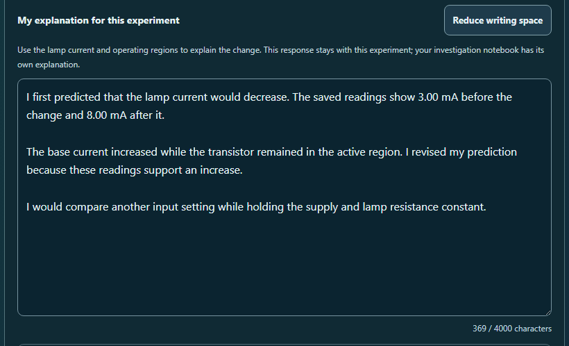

# CircuitTool: more room for lesson explanations

The guided experiment explanation now opens with six rows of writing space. An **Expand writing space** button doubles it to twelve; **Reduce writing space** returns to six. The label and button wrap naturally on phones, and the field grows with enlarged text.

A quiet counter below the field shows the current text length against the existing 4000-character limit. The counter is associated with the field's help text and has no live region. The explanation guide remains available below it after Test.

## Preserving student work

The control changes local display state. It keeps the existing textarea, text, cursor selection, and native manual resizing. Activating the size button clears only a manually set height so that the chosen row count takes effect. Ordinary rerenders leave manual height alone.

The display preference stays selected while changing lessons, editing circuit settings, or loading and restoring an investigation. Remounting the workbench returns to six rows. The preference is excluded from saved investigation data.

The lesson and notebook writing controls remain independent. Existing **Write explanation** and **Review explanation** actions retain their focus and instant scrolling behavior. Electrical models, lesson actions, saved records, history, and AI context are unchanged.

## Checks

**168 scoped tests passed across eleven files**, including nineteen new mounted cases. They cover field identity and selection, quiet counting, imports, local display state, multiple instances, and writing jumps. The existing explanation-guide test retains its behavior checks with updated field-size and counter placement expectations.

The regression scope covers lesson navigation, continuation, saved records, notebook continuity, evidence writing, localization, and form accessibility. A combined test process ran out of memory before producing a complete JSON result; its raw logs and receipt are retained and excluded from passing coverage. Each recovery file passed in a fresh process with the same test time limits. Exact commands, raw results, assertion names, and unchanged source and test hashes are saved.

Source and desktop mirror match: `6c61943ab672e958f0b93afd69487231e2604a30af53c78705a85f1ce3591e84`.

The browser audit passed **twelve scans and twelve visual views**, covering desktop, 390- and 320-pixel phones, an untested draft, 200% text in both writing sizes, and forced colors. Twenty-four visible-focus checks and eight native keyboard toggles passed. All twelve enlarged-text measurements matched twice their normal font size. Actual JSON load and restore, locale changes, live circuit edits, and two independently sized instances also passed. Source, mirror, and audit script stayed unchanged during their checks; independent source and pixel review found no material issues.

All ten ordinary scans included contrast checks. The two forced-color scans excluded only axe-core 4.12.1's known `color-contrast` issue, linked to the [existing diagnostic](../circuit-explanation-guide-2026-10-01/forced-colors-diagnostic.json). Both images and actual system colors were checked; 126 visible text nodes passed contrast measurements. These focused checks do not establish full accessibility conformance.

The first browser attempt encountered a transient disk-space error before saving a capture. Its error log is retained separately and excluded from coverage. The completed run followed cleanup of only its own disposable browser profile and empty output placeholders.

## Previews



- [Phone writing and the next step](sensor-expanded-320.png)
- [Expanded writing with 200% text](gain-expanded-200pct-text-320.png)
- [Writing in forced colors](forced-colors-expanded-320.png)

## Reproduce

From the repository root:

```powershell
node reports/circuit-lesson-writing-space-2026-10-01/run-regression-isolated.cjs
node reports/circuit-lesson-writing-space-2026-10-01/browser-check.cjs
node reports/circuit-lesson-writing-space-2026-10-01/validate.cjs
```

The regression scripts preserve raw results and refuse to overwrite them. Use a fresh report destination for a new run. The installed Vitest, Playwright, Chromium, React, Tailwind cache, and axe-core dependencies are required.

This round is left uncommitted at the user's request.
