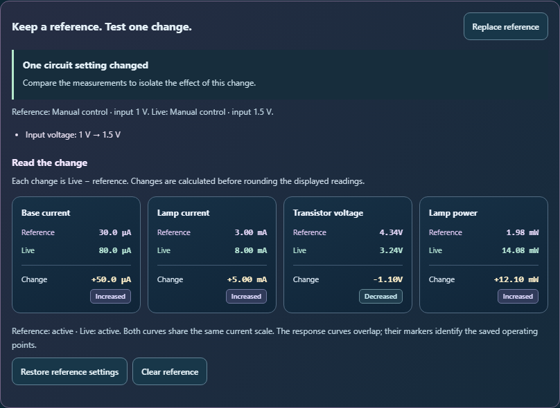
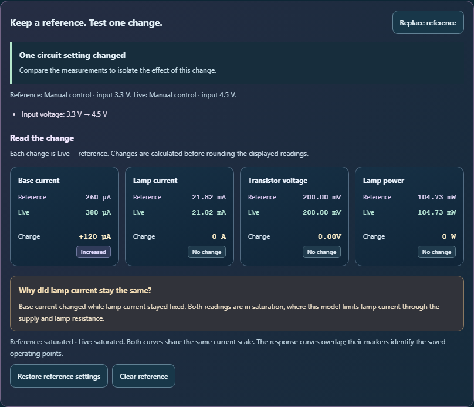

# Clearer live circuit comparisons

The live reference panel now puts base current, lamp current, transistor voltage and lamp power in four reading cards. Each card shows the reference, live value and signed change, with an **Increased**, **Decreased** or **No change** label. The panel explains that changes mean **Live − reference** and are calculated before display rounding.

When a single setting changes base current while both operating points remain saturated with identical lamp current, a short explanation connects those readings to the model's current limit. The explanation stays hidden for changes involving several settings or different circuit types.

## Interface

- Four cards across on desktop, two at intermediate widths, and stacked cards on phones.
- At the smallest phone width, the change sits beneath the reference and live readings so units and direction labels remain legible.
- Numeric readings keep left-to-right order inside right-to-left layouts.
- System colors keep the reference panel readable in forced-color mode.
- New text uses the existing translation callback and English fallbacks.

## Verification

- **66 tests passed across four files**, including **12 new reference UI cases**.
- The native browser workflow covers keyboard capture, typed input, restoring settings, replacing the reference, saturation feedback and clearing the reference. Saved notes and the student's explanation remain intact.
- Six browser views cover desktop, 390 px phones, a 320 px phone, forced colors and right-to-left layout. All passed scoped WCAG A/AA axe checks and overflow checks.
- Source and public mirror match. Reversing the recorded edits reproduces the prior source exactly. Scoped whitespace checks passed; changes remain uncommitted and unstaged.
- Circuit equations, persistence formats and AI request contents are unchanged. Browser verification uses the local React harness; it does not exercise the full desktop shell.

Run from the repository root:

```powershell
node --max-old-space-size=256 --max-semi-space-size=2 node_modules/vitest/vitest.mjs run tests/circuit_live_reference_readings.test.js tests/circuit_active_refinements.test.js tests/circuit_active_regions.test.js tests/circuit_active_electronics.test.js --pool=forks --maxWorkers=1 --isolate --testTimeout=30000 --hookTimeout=60000
node reports/circuit-live-reference-2026-10-04/validate.cjs
```

The browser script saves screenshots and refuses to overwrite its existing result. Preserve those outputs before rerunning it.

## Previews





Additional captures: [phone](phone-active.png), [small phone](small-phone-saturation.png), [forced colors](forced-colors.png), [right-to-left layout](rtl-reference.png).

## Review history

The first 66-test run passed before an explicit group role was added to the reading cards. Its result is retained in `regression-before-group-role.json`.

The initial browser pass exposed a forced-color contrast issue after four normal-color views passed. The failed result and its source edits are retained in `before-forced-color-fix/`. Explicit system colors resolved it.

A later browser pass passed all six views, but visual inspection found a broken direction word at 320 px and cramped right-to-left spacing. Those outputs are retained in `before-narrow-layout-fix/`. A wider change row and logical spacing resolved both. The final browser captures and final regression results reflect the finished source.

Final source SHA-256: `acb6c672744a47734694d993f69483c5424445a740c28ad77593cba6dc5296f6`.
