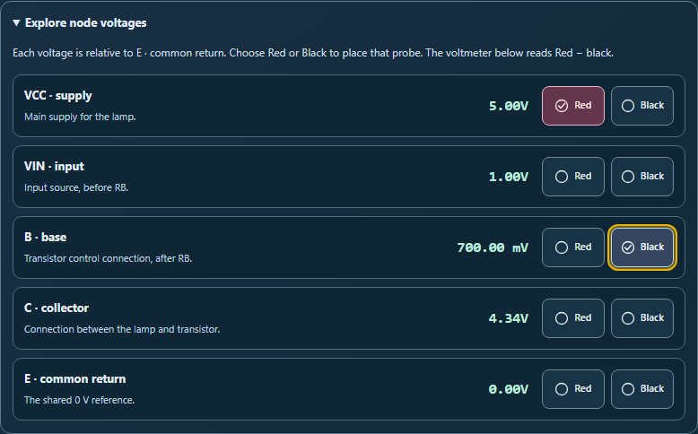
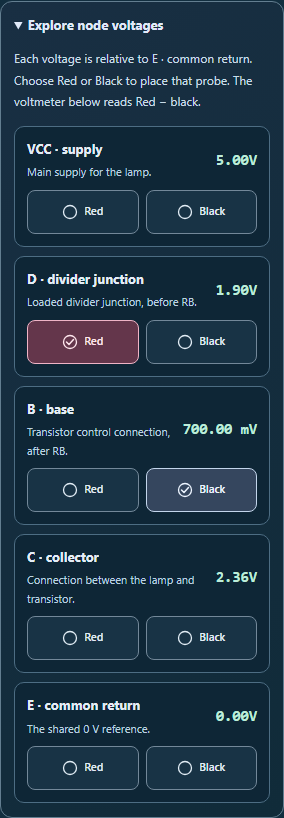
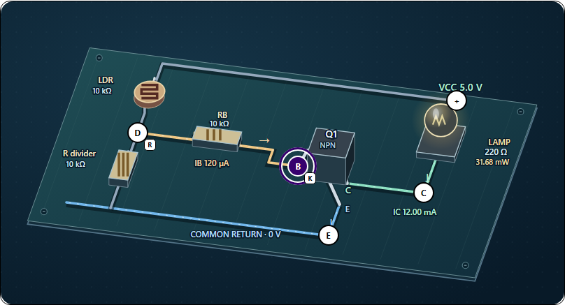

# Explore node voltages and place probes

The transistor workbench now has a collapsible node explorer under the probe controls. It puts all five node voltages and direct Red/Black placement buttons together, so students can choose nodes that are outside the visible part of the diagram on a phone.

## Changes

- Each node has its name, circuit role, and live potential relative to E · common return. Sensor circuits show the loaded divider junction, before the base resistor.
- Red and Black buttons place the chosen probe directly. Check marks and pressed states stay synchronized with the existing menus, diagram markers, shortcuts, and signed voltmeter reading.
- The explorer starts collapsed and keeps its open state and keyboard focus through live updates. Opening it writes no circuit data. Selecting a probe's current node also creates no write.
- Direct probe choices preserve component settings, the chosen board lead, Undo/Redo, reference settings, notes, and saved observations. Recorded operating points include the resulting probe order.
- Diagram buttons now have 44 × 44 pixel hit areas around their existing 30 pixel faces. Node positions and visible circuit geometry are unchanged.
- High contrast mode uses system colors for selections and gives focused diagram nodes a contrasting surround. Numeric voltages retain their direction in right-to-left layouts.

The displayed node values are rounded using the existing voltage formatter. The voltmeter calculates the difference from the full model values.

## Verification

65 tests pass across four suites, including 15 new node-explorer cases. They cover loaded sensor readings, cutoff, same-node and equal-potential readings, tiny differences hidden by rounding, menu and diagram synchronization, recorded probe order, independent tool instances, translation, and saved-work continuity.

Four native Chromium workflows exercise keyboard selection, real touch input, the enlarged diagram targets, responsive layouts, high contrast focus, and right-to-left text. A touch 20 pixels from a node's center successfully places a probe outside its original visible circle. All five targets measure 44 × 44 pixels, while their faces remain 30 × 30 pixels. Their measured alignment with the drawing is within one pixel.

All nine final screenshots were inspected directly. Seven scoped axe WCAG A/AA checks cover the explorer, controls, and meter. The two diagram views were checked visually, for focus styling, and for target geometry. No page overflow was found at 320, 390, or 1280 pixels; the diagram retains intentional horizontal scrolling.

Earlier results are retained in the before-* folders. Final review strengthened selected-node outlines and corrected a global focus rule that overrode the intended system-color focus treatment.

[Validation](validation.json) · [Regression results](regression.json) · [Browser results](browser-results.json) · [Source preservation proof](source-changes.json)

Source and desktop mirror match. Reversing this pass's recorded edits recovers the previous source byte for byte. Scoped whitespace checks pass, and the scoped Git index is empty. Changes remain uncommitted.

## Previews

### All five node voltages

### Phone sensor exploration

[320 px layout](small-phone-explorer.png) · [Closed explorer](desktop-closed.png) · [Signed meter reading](desktop-negative-reading.png)

### High contrast and keyboard focus

[High contrast explorer](forced-node-explorer.png) · [Right-to-left explorer](rtl-node-explorer.png) · [Phone diagram target](phone-board-target.png)
