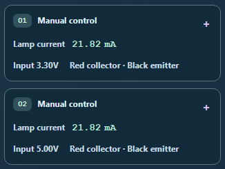

# CircuitTool: identify saved readings without opening every card

Saved observations now show their captured input or relative light level, ordered red and black probe connections, and an explicit **Lamp current** label in the collapsed card.

This makes two saturated points distinguishable even when both show **21.82 mA**: their saved inputs remain **3.30V** and **5.00V**. Live circuit edits leave these summaries fixed.

On phones, the current gets its own row beneath the circuit title. Numeric tokens stay intact with enlarged text. Each probe label stays grouped with its node in right-to-left layouts, while values and technical node names retain their left-to-right order. The disclosure marker is decorative; the card keeps its native keyboard behavior.

## Saved work and existing actions

The expanded readings, note fields, Revisit, Use as reference, and Remove actions remain intact. Recording still opens the new note, and removal and restoration keep the captured settings and authored notes. Portable investigation JSON, reports, electrical history, lesson work, and AI requests retain their existing behavior.

## Verification

All **51 tests across three files** passed: ten focused summary cases, sixteen notebook continuity cases, and twenty-five investigation cases. Eight browser views cover desktop, two phone widths, sensors and reversed probes, actual doubled text, forced colors, right-to-left reading, and translated labels.

The final browser checks native Enter/Space disclosure, visible focus, recording-to-note focus, fixed summaries after live edits, original body labels/actions, numeric tokens, complete probe pairs, and native accessible names. Both reviewers inspected every final screenshot. Normal views include contrast checks; forced colors use measured system colors.

The source and public mirror match. Reversing the three recorded changes reproduces the previously verified source byte for byte. Independent source review confirms that settings, readings, and ordered leads come from each saved observation.

Earlier evidence is retained: a fixture spacing correction and the first RTL pixel finding. The final grouped probe labels address that finding. A browser matcher initially treated the structured accessibility snapshot as plain text; a separate diagnostic confirmed the native name, and the final audit checks that name directly while retaining both representations.

- [Final validation](validation.json)
- [Regression results](regression-raw.json)
- [Native regression receipt](regression-receipt.json)
- [Browser measurements](browser-results.json)
- [Visual review](visual-review.json)
- [Root screenshot review](root-visual-review.json)
- [Independent source review](independent-review.json)
- [Byte-exact source preservation](source-preservation.json)
- [Native accessibility diagnostic](accessible-name-diagnostic.json)
- [Browser matcher correction](harness-correction.json)
- [Retained RTL finding](../circuit-observation-summary-2026-10-03/visual-review-before-rtl-fix.json)

Changes remain uncommitted and unstaged.
