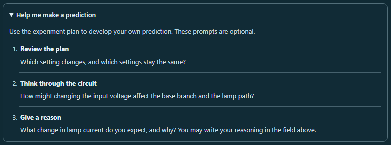

# CircuitTool: help with making a prediction

Started experiments now include **Help me make a prediction**, a compact optional disclosure below the writing field. Its three questions help students:

1. Review what changes and what stays fixed in the experiment plan.
2. Think through the selected circuit's input, base branch, lamp path, or sensor divider.
3. Give a reason for the lamp-current change they expect.

The guide starts closed. It provides open questions for each lesson and keeps the student's own reasoning in the existing field. Prediction choice remains the only requirement for Test.



## Learning flow and visuals

Only one support guide appears at a time. Before Test, students can open the prediction questions. After Test, the existing **Build an explanation** guide appears closed, alongside the saved evidence and the same retained draft. Explicit retry restores the prediction guide closed.

Both guides use the established bordered surface, numbered steps, separators, native disclosure marker, and visible keyboard focus. The prediction guide shares the existing scoped styles, including reduced-motion and forced-color behavior. The summary stays compact on phones; questions wrap within the card at normal and enlarged text sizes.

Opening and closing change only native view state. Typing, language changes, live circuit edits, and switching between started untested lessons preserve the open guide and writing field. Leaving for an unstarted lesson removes it; returning creates a closed guide. The existing notebook, saved evidence, solver, electrical history, import/export shape, grading, and AI context are preserved.

Product changes are limited to **stem_lab/stem_tool_circuit.js** and its identical public mirror. Existing tests and the prior verified product code remain byte-identical after reversing this pass's new component, call, and five shared style selectors.

## Verification

All **121 relevant test cases across eight files** passed, including 12 new guide cases. The browser audit passed **14 views**, with 14 visible-focus checks, nine native disclosure toggles, two native Test transitions, three preservation workflows, and a Tab/Shift+Tab check.

All 26 guide font measurements were exactly twice their original size in the two enlarged-text phone views. The 16 measured forced-color text nodes had 21:1 contrast. Normal accessibility scans include contrast. Forced-color scans retain the documented axe 4.12.1 authored-color exception and separately verify actual used colors.

All 14 PNGs were inspected by the browser reviewer; the root reviewer inspected six representative images. Neither review found a material issue. Draft text, backward selection, and expanded writing size survived Test. Empty writing remained optional. Language/live edits, independent lesson drafts, and actual JSON load/restore preserved their intended state and navigation behavior.

The preceding prediction-writing pass's pending browser review was also completed before this source change: **318 tests and 14 browser views passed**. Its frozen [validation](../circuit-prediction-reasoning-2026-10-02/validation.json) is pinned by this report.

- [Regression results](regression.json)
- [Regression receipts](regression-receipt.json)
- [Browser results](browser-results.json)
- [Visual review](visual-review.json)
- [Independent source review](independent-review.json)
- [Final validation](validation.json)

Frozen source SHA-256:

```text
6478b21accc3061b34a7328507d83bffec5d7de7d4786565e300e1ddb7d7a4ba
```

From the repository root:

```powershell
node reports/circuit-prediction-guide-2026-10-02/run-regression.cjs
node reports/circuit-prediction-guide-2026-10-02/browser-check.cjs
node reports/circuit-prediction-guide-2026-10-02/validate.cjs
```

Run the browser audit after the regression processes exit. These scripts require the frozen source and test bytes; use a fresh report directory if the inputs change. Full browser validation includes inspecting the PNGs and recording their hashes.

Changes are left uncommitted and unstaged.
