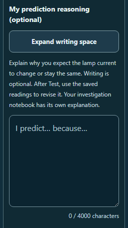

# CircuitTool: prediction reasoning before evidence

Students can now explain **why they expect a change** before running an experiment. The existing writing field follows the lesson stage:

- Before Test: **My prediction reasoning (optional)**, with **I predict… because…** as the starter.
- After Test: **My explanation for this experiment**, with the existing saved-reading guidance.

The pre-test help says writing is optional and invites students to revise their reasoning using the saved readings afterward. It gives no result or correct prediction.

## Draft continuity

The same textarea retains its saved text, ID, React ref, character limit, count, and local writing size. Test still depends only on choosing a prediction. Empty and whitespace drafts can be tested; nonblank reasoning does not mark Explain complete before testing. After Test, the existing saved-explanation progress rule continues to apply.

The stage comes from the normalized lesson record, so legacy records and invalid imported test flags receive the appropriate prompt. Three new semantic translation keys provide the prediction label, help, and starter; tested copy remains exact.

The independent notebook, saved circuit evidence, replay controls, solver, history, import/export shape, and AI context are preserved. Exact reversal of this pass restores the previous source hash, including the earlier uncommitted current-limit comparison.

Product changes are confined to **stem_lab/stem_tool_circuit.js** and its identical public mirror. This pass is left uncommitted.

## Verification

All **318 test cases across 18 files** passed. The resumed browser audit also passed **14 views**, with 28 visible-focus checks, two native Test transitions, three lifecycle checks, and independent IDs in two mounted tools.

The audit measured all 14 writing fonts at exactly twice their normal size in the two enlarged-text views. Both forced-color views retained readable text, borders, controls, and placeholders. All 14 PNGs were inspected by the browser reviewer; the root reviewer inspected five representative images.

Native checks confirm that the same draft, textarea, backward selection, and expanded writing size survive Test. Empty writing remains optional. Language changes, lesson switching, actual JSON load/restore, and label focus preserve the intended saved work and navigation behavior.

The initial browser preflight stopped because the system drive was nearly full. After space became available, the unchanged frozen audit ran successfully and closed Chromium. The original preflight failure is retained.

Two earlier regression attempts found wording-sensitive test assumptions. Their raw results, logs, input snapshots, and exact assertion corrections are preserved. The product source stayed frozen; test time limits were unchanged. Final validation independently checks both archives and every final per-file receipt.



- [Regression aggregate](regression.json)
- [Regression receipts](regression-receipt.json)
- [Browser audit](browser-results.json)
- [Visual review](visual-review.json)
- [Independent source review](independent-review.json)
- [Final validation](validation.json)
- [Original browser preflight](browser-preflight-failure.json)

Frozen source SHA-256:

```text
b207d09a0e834d5abeae5fba88f8303e3e457189ba58088677af6f05e3d543fa
```

The scripts require the frozen source and test bytes. Use a fresh report directory if the inputs change. Full browser review includes inspecting the PNGs and recording their hashes.

```powershell
node reports/circuit-prediction-reasoning-2026-10-02/run-regression.cjs
node reports/circuit-prediction-reasoning-2026-10-02/browser-check.cjs
node reports/circuit-prediction-reasoning-2026-10-02/validate.cjs
```

No staging or commit was performed by this task.
