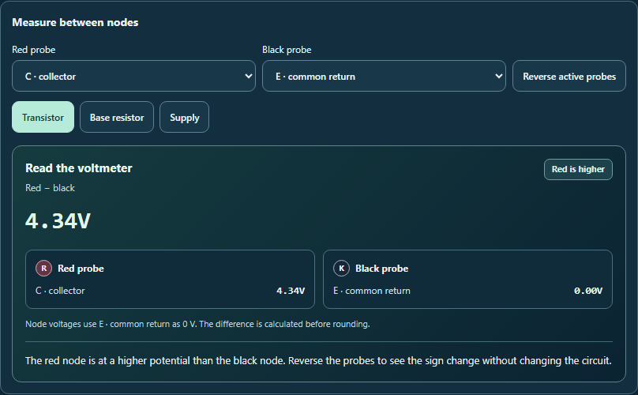

# Understand the voltmeter reading

The Active Electronics measurement panel now shows a large signed voltage alongside each probe's node name and voltage relative to common return. It gives a short explanation for four cases:

- **Red is higher:** a positive difference, with a prompt to try reversing the probes.
- **Red is lower:** a negative difference that follows the probe order.
- **Same node:** the meter subtracts a node's voltage from itself.
- **Equal potential:** different nodes have the same voltage; they can both be above common return.

The explanation uses the unrounded reading, so tiny differences remain distinct from zero. The panel also explains the rounding of displayed values. Manual inputs and sensor divider junctions have their correct node labels.

The Transistor, Base resistor and Supply shortcuts now show which ordered pair is selected. Reversing a pair clears that selection until the original order is restored.

## Verification

- **84 tests passed in five files**, including **13 new voltmeter cases**. Coverage includes reversed probes, both zero cases, small nonzero readings, sensor labels, normalized probe fallbacks, independent accessibility IDs, translation callbacks and preservation of history and saved work.
- A native browser workflow exercises keyboard reversal and shortcuts, probe menus, changing input, both zero cases and the sensor circuit.
- **Seven views** cover desktop, 390 px and 320 px phones, forced colors and right-to-left layout. Scoped WCAG A/AA axe checks and overflow checks pass in each view. The screenshots were visually reviewed.
- Source and public mirror match. Reversing the recorded edits reproduces the prior source exactly. Scoped whitespace checks pass; changes remain uncommitted and unstaged.

Circuit equations, saved-file formats and AI payloads are unchanged. Browser verification uses the local React harness rather than the full desktop shell.

## Previews



Additional captures: [negative reading](phone-negative.png), [same node](small-phone-same-node.png), [different nodes at equal potential](small-phone-equal-potential.png), [sensor circuit](desktop-sensor.png), [forced colors](forced-colors.png), [right-to-left layout](rtl-meter.png).

## Reproduce

Run from the repository root:

```powershell
node --max-old-space-size=256 --max-semi-space-size=2 node_modules/vitest/vitest.mjs run tests/circuit_probe_readout.test.js tests/circuit_voltage_explorer.test.js tests/circuit_active_electronics.test.js tests/circuit_live_reference_readings.test.js tests/circuit_second_reading_guidance.test.js --pool=forks --maxWorkers=1 --isolate --testTimeout=30000 --hookTimeout=60000
node reports/circuit-probe-readout-2026-10-04/validate.cjs
```

`browser-check.cjs` generates the screenshots and checks the browser workflow. It refuses to overwrite existing results; preserve them before rerunning.

## Review history

The initial 84-test run passed. The first browser run passed five normal-color views, then found insufficient forced-color contrast in the older controls surrounding the new readout. Explicit system colors for the controls and selected shortcuts resolved the issue. Initial outputs are retained in `before-control-contrast-fix/`. Final regression and browser outputs reflect the finished source.

Final source SHA-256: `9b43c0d42971a646ec379e2faca8a4eeb57584fdbe289ebd6cdd079f623f9862`.
