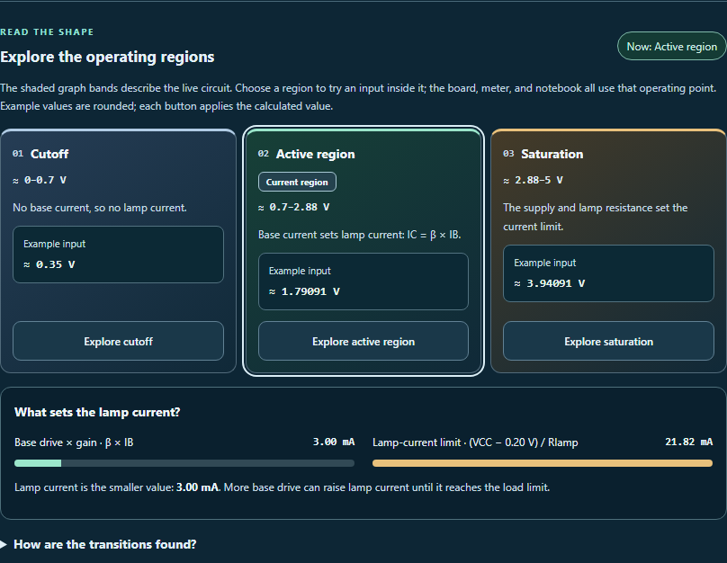
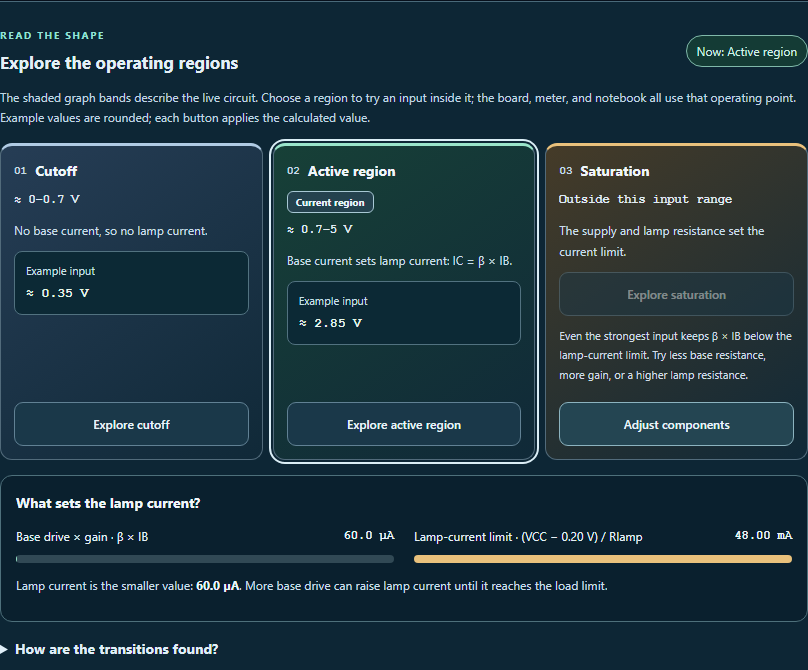

# More deliberate region exploration

The operating-region cards now preview the input or light level that each **Explore** button will apply. A **Current region** label identifies the active card in text as well as color. Values are shown approximately; buttons continue to apply the full calculated example, including narrow intervals and regions available only at an endpoint.

Unavailable regions now offer **Adjust components**. This opens the existing component settings and focuses their summary. After editing, **Explore operating regions** returns keyboard focus to the region heading. The available regions update from the circuit's current settings.

Navigation uses local element references and makes no tool-state writes. Region actions still change only the input, with the existing undo behavior. Saved notes, explanations, probe connections and references are retained.

## Verification

- **69 tests passed across four files**, including **11 new cases** for manual/light/dark examples, full-precision input, endpoint reachability, navigation, focus, component edits, independent instances and translated additions.
- **Two native browser workflows** verify applying an example and making an unavailable region reachable through component tuning. They check focus, history and saved-work preservation.
- **Seven browser views** cover desktop examples, unavailable regions, 390 px and 320 px phones, component tuning, forced colors and right-to-left layout. All pass scoped WCAG A/AA axe checks and overflow checks. The screenshots were visually reviewed.
- Source and public mirror match. Reversing the recorded edits reproduces the prior source exactly. Scoped whitespace checks pass; changes remain uncommitted and unstaged.

The existing unavailable-region test was updated to accept an instance-specific ID, so multiple workbenches can each refer to their own explanation. Circuit equations, stored data and AI payloads are unchanged. Browser checks use the local React harness rather than the full desktop shell.

## Previews





More views: [phone examples](phone-examples.png), [small-phone unavailable region](small-phone-unavailable.png), [component tuning](phone-component-tuning.png), [forced colors](forced-colors.png), [right-to-left layout](rtl-examples.png).

## Reproduce

Run from the repository root:

```powershell
node --max-old-space-size=256 --max-semi-space-size=2 node_modules/vitest/vitest.mjs run tests/circuit_region_navigation.test.js tests/circuit_active_regions.test.js tests/circuit_voltage_explorer.test.js tests/circuit_value_entry.test.js --pool=forks --maxWorkers=1 --isolate --testTimeout=30000 --hookTimeout=60000
node reports/circuit-region-exploration-2026-10-04/validate.cjs
```

`browser-check.cjs` generates the previews and verifies the native workflows. Preserve its outputs before rerunning; it refuses to overwrite its result file.

## Review history

The initial 69-test run and both browser workflows passed. Visual inspection found that existing current-budget readings could reverse their units in a right-to-left layout. Numeric isolation now keeps the explorer's example values, current readings and transition values in order. Earlier passing outputs are preserved in `before-reading-direction-fix/`; final browser checks explicitly verify the current-reading direction.

Final source SHA-256: `13f6ce1ccbd9f85774ef54c1e33bfde33f6020724aee0788eb67dc44a614e4d0`.
