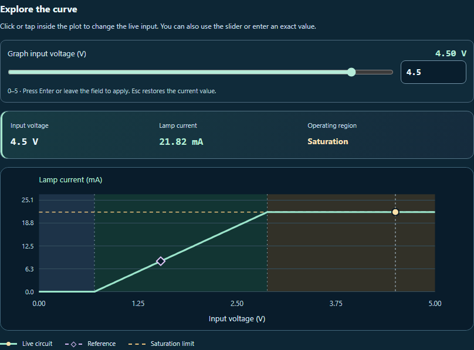
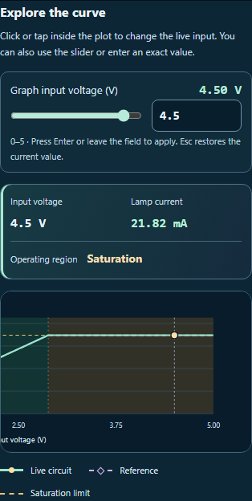
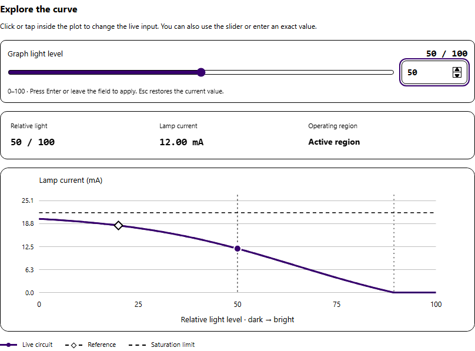
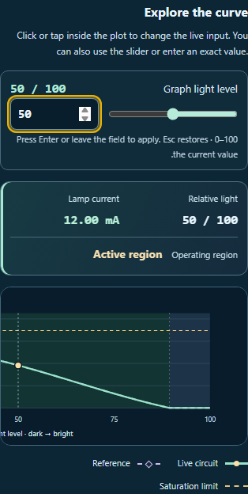

# Explore the response graph

The response graph now supports direct point selection and keeps the live input, lamp current, and operating region together above the plot. The readout stays visible at narrow widths while the graph can scroll horizontally.

## Changes

- Click or tap inside the plot to set the live input. Selection follows the horizontal axis; the circuit model calculates the current. Manual selections use 0.01 V increments and sensor selections use whole light levels. The exact-value field still accepts finer values.
- The graph, both input controls, live readings, and Undo/Redo stay synchronized. A new point creates one electrical history entry; selecting the current value creates none.
- A swipe, cancelled pointer, secondary pointer, outside-plot release, or circuit change during a gesture leaves the input alone. Coordinate conversion uses the SVG's actual screen transform, including scaling and horizontal scrolling.
- The legend matches the solid live curve and circular marker, dashed reference and diamond marker, and dashed saturation limit. System colors keep the plot readable in high contrast mode. Numeric readings and graph text keep their direction in a right-to-left layout.
- The source and desktop copy match. Saved observations, notes, reference settings, probe choices, and the circuit equations retain their existing behavior.

## Verification

67 tests pass across four suites, including 19 new graph interaction cases. Coverage includes transformed coordinates, both sensor circuits, exact endpoints, pointer cancellation, independent tool instances, translation, draft input, reference scale, and history.

Three native Chromium workflows exercise mouse selection, keyboard slider and exact entry, Undo/Redo, reference markers, real touch taps and horizontal swipes, sensor input, high contrast, and right-to-left layout. Seven screenshots were inspected directly. Each view has no page overflow and no scoped axe WCAG A/AA violations. Accessibility checks cover the graph component.

The source syntax, mirror equality, reversible change proof, scoped Git whitespace check, and empty scoped index are verified by [validate.cjs](validate.cjs). See [validation.json](validation.json), [regression.json](regression.json), and [browser-results.json](browser-results.json).

Earlier check results are retained in the `before-*` folders. Validation caught and resolved a stylesheet placement error and SVG direction inheritance. Two sensor test expectations were corrected to agree with the unchanged circuit equations.

Changes are uncommitted.

## Previews

### Desktop selection and reference

### Phone layout

### High contrast

### Right-to-left layout

Additional views: [desktop active region](desktop-active.png), [320 px cutoff](small-phone-cutoff.png), and [dark sensor](phone-dark-sensor.png).
