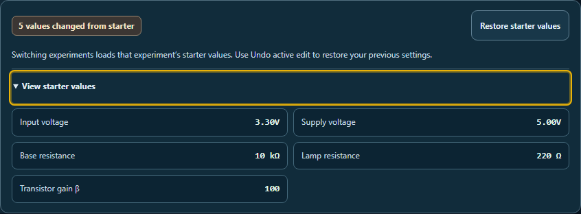

The selected experiment now preserves a student's custom setup when clicked again. Restoring defaults is an explicit **Restore starter values** action, with an expandable preview of the values it will use. A status shows how many active circuit values differ from the starter, and the reset button is disabled when they already match.

Switching to a different experiment loads its starter values, as explained beside the controls. Reset and experiment switching use the existing undo history, so **Undo active edit** recovers the previous custom circuit. Notes, explanations, references, probe connections and saved lesson records survive those actions. The preview shows manual input values for Manual control and light/divider values for sensor experiments.

Verification passed:

- **68 tests across four files**, including **14 new starter-setting cases** for selected experiments, explicit reset, undo/redo, switching, inactive settings, previews, multiple instances and translations.
- **Two native browser workflows**, covering keyboard selection, reset, undo/redo, experiment switching and saved-work preservation.
- **Seven browser views**, covering desktop, 320 px and 390 px phones, restored values, sensor defaults, forced colors and right-to-left layout. Scoped WCAG A/AA axe checks and overflow checks passed, and all captures were visually reviewed.
- Source and public mirror match. Reversing the recorded edits reproduces the prior source exactly. Scoped whitespace checks passed; changes remain uncommitted and unstaged.

Browser verification uses the local React harness. The circuit equations and saved-file formats are unchanged. A syntax check caught a preparation error before source files were written; the corrected source passed the subsequent tests and browser workflows.



More captures: [collapsed preview](desktop-custom.png), [small phone](small-phone-preview.png), [restored values](phone-restored.png), [sensor starter values](phone-sensor-preview.png), [forced colors](forced-colors.png), [right-to-left preview](rtl-preview.png).

Run these commands from the repository root to repeat the focused checks:

```powershell
node --max-old-space-size=256 --max-semi-space-size=2 node_modules/vitest/vitest.mjs run tests/circuit_starter_settings.test.js tests/circuit_active_notebook_continuity.test.js tests/circuit_active_lesson_records.test.js tests/circuit_second_reading_guidance.test.js --pool=forks --maxWorkers=1 --isolate --testTimeout=30000 --hookTimeout=60000
node reports/circuit-starter-settings-2026-10-04/validate.cjs
```

`browser-check.cjs` generates the previews and verifies the workflows. Preserve existing outputs before rerunning it; it refuses to overwrite the result file.

Final source SHA-256: `50486bc06bafbf6be919fd868d303f41a6f1f8f71a617ca2eec12fae51ddd6a7`.
