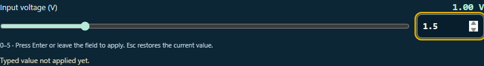
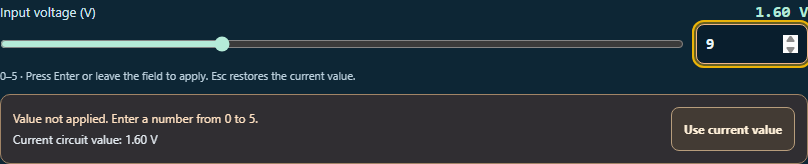

# Clearer circuit value entry

Exact-value fields now make the difference between a typed draft and the live circuit value visible. A pending cue appears while the draft differs from the current value, and the help explains that **Enter or leaving the field applies a valid number**. **Escape restores the current value.**

If a number is empty or outside the allowed range, a recovery panel shows the range and the value the circuit is still using. **Use current value** discards the invalid draft and returns keyboard focus to the same input. Rejected drafts and recovery do not add circuit history or change saved work.

The shared control also now:

- Uses unique IDs for labels, inputs, help and errors in each workbench instance.
- Synchronizes the exact field when the slider changes.
- Refreshes drafts and errors when a control's allowed range changes, including pulse-edge limits in Connected Networks.
- Preserves signed numeric order and units in right-to-left layouts.
- Uses translation callbacks for new guidance and accessible names, with system colors in forced-color mode.

## Verification

- **114 tests passed across five files**, including **17 new value-entry cases**. They cover pending drafts, Enter and blur, invalid and empty numbers, Escape and button recovery, history, saved evidence, independent workbench IDs, logarithmic frequencies, negative DC levels, dynamic limits and translated guidance.
- **Two native browser workflows** cover Active Electronics and Connected Networks. They verify keyboard and pointer recovery, focus return, graph synchronization and preservation of circuit state and history during recovery.
- **Seven browser views** cover desktop and phone layouts, forced colors, right-to-left layout, logarithmic controls and a changed pulse-edge limit. All pass scoped WCAG A/AA axe checks and overflow checks. Final previews were visually reviewed.
- Source and public mirror match. Reversing the recorded edits reproduces the prior source exactly. Scoped whitespace checks pass; changes remain uncommitted and unstaged.

The existing Enter/blur behavior is preserved. Circuit equations, storage formats and AI payloads are unchanged. Browser checks use the local React harness rather than the full desktop shell.

## Previews





More views: [phone](phone-invalid.png), [forced colors](forced-colors.png), [right-to-left](rtl-invalid.png), [logarithmic frequency](network-log-invalid.png), [updated pulse-edge limit](network-updated-bound.png).

## Reproduce

Run from the repository root:

```powershell
node --max-old-space-size=256 --max-semi-space-size=2 node_modules/vitest/vitest.mjs run tests/circuit_value_entry.test.js tests/circuit_active_refinements.test.js tests/circuit_second_reading_guidance.test.js tests/circuit_network_signals.test.js tests/circuit_network_files.test.js --pool=forks --maxWorkers=1 --isolate --testTimeout=30000 --hookTimeout=60000
node reports/circuit-value-entry-2026-10-04/validate.cjs
```

`browser-check.cjs` generates the previews and checks the native workflows. Preserve its existing outputs before rerunning; it refuses to overwrite the result file.

## Review history

The first run passed 112 tests and failed one new test because its waveform fixture used the label “Source voltage (V)” instead of the existing “DC level (V)”. That result and fixture are retained in `before-test-label-correction/`. The corrected suite, with translation coverage added, passed all 114 tests.

The initial browser pass passed both workflows and all seven views. Visual inspection found that the header's value and unit could reverse in right-to-left layout. Isolating numeric direction fixed it; the final browser check also asserts that direction. Earlier passing outputs are retained in `before-numeric-direction-fix/`.

Final source SHA-256: `4228b377ea77e58ab31f06e562196a523c802f829ebb7b2e7f381b618b1d6583`.
