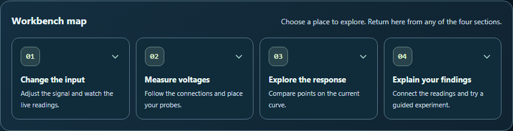
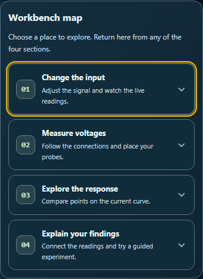
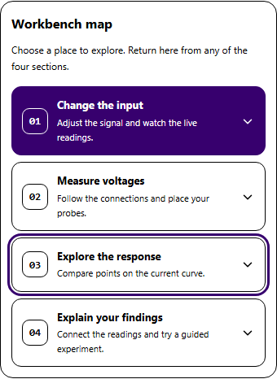

# Circuit workbench map — October 6–7, 2026

The transistor workbench now provides a compact map for its input controls, voltage measurements, response curve, and explanations. Students can jump to a section and return to its matching map card.

## Changes

- Four numbered cards explain what each section offers. Each route has a name, description and explicit destination.
- A jump focuses the destination heading and scrolls it into view. Tab continues into that section's available controls.
- Each section has a return button with a minimum 44 px target. It focuses the matching map card.
- Navigation does not write circuit data, add Undo steps, open lessons, or change disclosure states. Settings, probe choices, notes, predictions and explanations remain available.
- Four columns become two on tablets and compact rows on phones. Text supports translation and independent direction. High contrast focus and hover states use system colors.

## Verification and limits

- **68 behavior tests passed across separate runs**, including all 13 new navigation cases on the final source. The existing measurement, edit-preview and guided-entry suites passed before the last two system-color CSS refinements.
- **A clean combined unit run was not obtained.** The initial runs hit worker startup, setup, and test timeouts. Earlier raw results are retained rather than replaced by a synthetic passing report. The passing suite sources and reports are listed separately in [validation.json](validation.json).
- **Four real Chromium workflows passed on the final source:** keyboard navigation through all four sections and their next controls; phone touch and return; saved state, disclosure and Undo preservation; high contrast and right-to-left layouts.
- **Eight rendered previews were inspected directly.** All eight have zero violations in scoped axe WCAG A/AA checks. These checks cover the changed surfaces, not the entire application.
- Source and desktop mirror match. JavaScript syntax, preservation of all prior source bytes, and scoped Git whitespace/index checks are verified by [validate.cjs](validate.cjs).
- The first browser check incorrectly expected an enabled Undo button. The corrected check follows native Tab behavior when Undo and Redo are disabled. Earlier evidence is in before-final-focus.

Changes are uncommitted and unstaged.

## Previews

## Evidence

- [Final browser results](browser-results.json)
- [Standalone navigation suite](regression-map.json)
- [Last combined-run attempt](regression.json)
- [Earlier regression attempt](before-single-worker/regression.json)
- [Initial regression attempt](before-final-focus/regression.json)
- [Exact source changes](source-changes.json)
