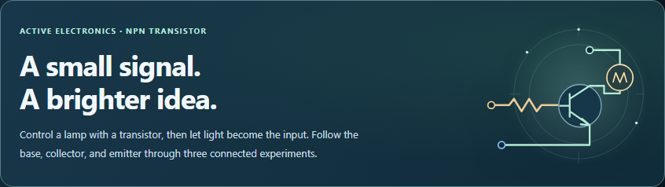
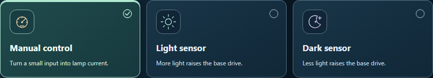
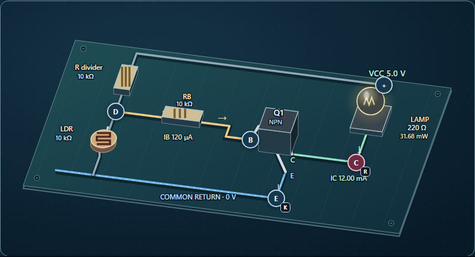
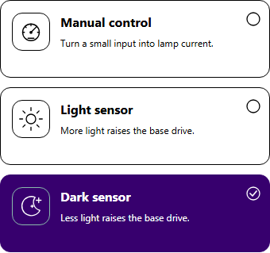

# Circuit workbench visual refinement

The transistor workbench now has a more distinct opening, illustrated experiment choices, and richer board artwork. The work keeps the existing simulation, controls, and saved investigations intact.

## Visual changes

- A framed introduction pairs the headline with lightweight circuit artwork. The artwork is decorative and gives way to the text on narrow screens.
- Manual, light, and dark experiments have distinct icons. A check mark, outlined selection, and mint surface identify the current experiment. Keyboard focus has its own gold outline.
- Experiment cards become compact rows on phones, with room for translated text and right-to-left layouts. System colors preserve readable selected text in high contrast mode.
- Panel surfaces and operating-region indicators have clearer borders and depth. Cutoff, active, and saturated states retain their text explanations.
- The circuit drawing has a subtle grid, shaded board surface, and mounting details. Component positions, wire routing, and clickable probe targets keep their existing geometry.
- Board gradients and patterns now use IDs unique to each mounted workbench. Two workbenches can render their artwork independently.

The artwork uses SVG and CSS. No image downloads or animation were added. Reduced-motion preferences disable the card transitions.

## Verification

61 existing regression tests pass across four suites covering starter settings, active electronics, circuit refinements, and live power readings. Four native Chromium workflows verify experiment selection and Undo/Redo, saved-work continuity, board and schematic probe targets, accessible layouts, and independent SVG definitions in two workbenches.

All 15 final screenshots were reviewed directly. Twelve scoped axe WCAG A/AA checks cover the hero, experiment controls, and input panels. Diagram views were checked visually and for node alignment; their intentional horizontal scrolling is allowed at phone widths. No page overflow was found at 320, 390, or 1280 pixels. The measured probe-target offset was below one pixel.

Visual review caught obscured selected-card text in high contrast mode even though its automated check passed. The final screenshot confirms the correction. Quick-input button contrast was also corrected. Earlier evidence is retained in the before-contrast-fix folder.

[Validation](validation.json) · [Regression results](regression.json) · [Browser checks](browser-results.json) · [Source preservation proof](source-changes.json)

The source and desktop copy are identical. Reversing this pass's recorded edits recovers the previous source byte for byte. Scoped whitespace checks pass, and the scoped Git index is empty. Changes remain uncommitted.

## Previews

### Opening panel

[Previous introduction](baseline/hero-desktop.png)

### Experiment choices

[Previous experiment cards](baseline/projects-desktop.png) · [320 px layout](projects-small-phone.png) · [Right-to-left layout](projects-rtl.png)

### Circuit board

[Schematic view](schematic-desktop.png) · [Phone view](board-phone.png)

### High contrast

[High contrast input panel](input-forced.png) · [Phone readings](input-phone.png)
