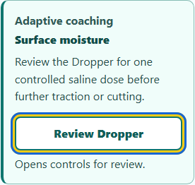
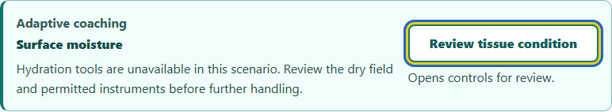
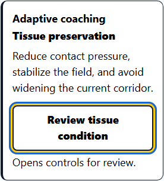

# Dissection Lab: clear adaptive coaching

Completed locally on October 9, 2026. Everything remains uncommitted; nothing was staged, pushed or deployed.

## Improvements

- Adaptive coaching pairs a readable recommendation with a clearly named review action. Text is 16px, or 18px with large text; controls are at least 48px high. The card wraps at phone and narrow embedded widths.
- Dry-field guidance leads to the Dropper. Restricted-tray guidance explains that hydration tools are unavailable and opens tissue review. Tissue preservation, tension and field-quality recommendations also open the Field monitor.
- Optical recommendations lead to view controls, calibration recommendations lead to the relevant instrument, and saved comparisons open their review controls. Other technique guidance leads to the Technique controls summary.
- Review actions preserve the learner's tool, technique mode, calibration, notes, scores and recorded work. They focus controls without starting a demonstration, playback or specimen action.
- Accessible descriptions connect actions to recommendations. Conditional controls references appear when their targets are mounted. High contrast, forced colors and keyboard focus remain clear.

## Validation

| Check | Result |
| --- | --- |
| Focused unit checks | 32 passed: 10 new coaching cases, 20 checkpoint/monitor regressions and two existing technique cases; 210 unrelated cases excluded |
| Final browser scenarios | Four passed: 320px dry field, desktop restricted tray, narrow large-text/high-contrast tissue review, and forced-color orientation |
| Accessibility | Four scoped axe audits: zero violations |
| Layout | 16px/18px text, controls at least 48px, 3px focus outlines, no measured card overflow |
| Preservation | All 588 protected files unchanged; source and unit changes reverse exactly to archived baselines |
| Repository checks | JavaScript syntax, runtime parity and scoped whitespace checks passed; index unchanged; coaching edits remain uncommitted |

Accepted final runs are **unit-7** and **browser-3**, with stable source and fixture hashes. Browser-1 also passed four cases before the final native-disclosure refinement. Browser-2 stopped during a desktop tool-session reset after one scenario, without completed results. Unit-4 exited with code 3221226505 before producing completed results; its stderr was empty. Unit-5 completed with 31 passing cases and one obsolete button-label expectation; that assertion was corrected. Unit-6 timed out starting its worker and ran no tests. Interrupted runs and the obsolete-expectation failure are retained and excluded from final pass totals. Their processes were confirmed stopped before retries began. One heavy test job ran at a time, with one worker, no retries and no video recording.

The desktop reset also ended collaborator sessions. The saved unit-test draft was recovered, reviewed and applied locally. Two Windows file-open errors during an intermediate refinement were recovered with the patch tool; final hashes and reversibility checks passed. The normal sandbox could not initialize its ACLs, so scoped commands used approved execution outside that sandbox.

The shared repository advanced from 2f9789e0 to 75bbb402 during this pass through a concurrent Machine Lab commit. Its committed diff excluded all coaching source and test files. The coaching edits remain unstaged and uncommitted; this pass made no commit.

These checks cover the coaching card and native navigation. They are not a full application or screen-reader audit. No dependencies, project test configuration or unrelated source files were changed.

## Visual review

### Phone

### Desktop

### Large text and high contrast

The forced-color capture, geometry, native handoff records and raw axe reports are in browser-3/captures. verification.json records test inputs, final hashes and preservation checks. The edits folder contains exact reversible receipts and compressed source/test archives.
