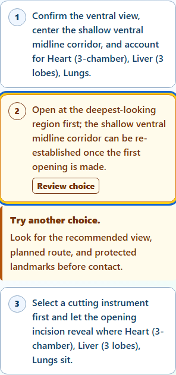
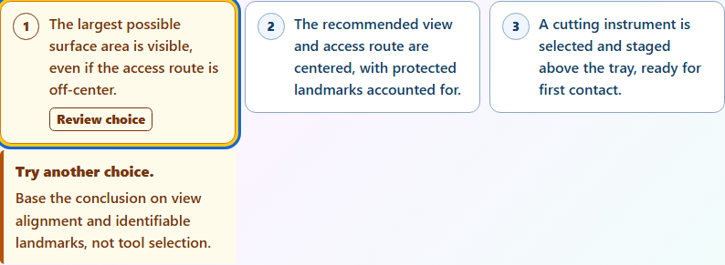
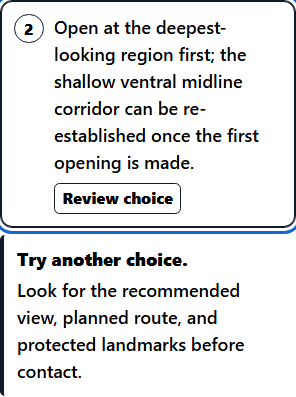

# Dissection Lab: coaching beside the selected answer

Completed locally on October 9, 2026. Everything remains uncommitted; nothing was staged, pushed or deployed.

## Improvements

- Incorrect-answer coaching now appears directly below the selected answer in planning, reflection and Guided observation checkpoints. Learners can read the explanation without searching below the remaining choices.
- **Try another choice** introduces the existing coaching. Selecting another answer moves the coaching to that answer, with one feedback message on screen.
- Answers and feedback use 16px text, or 18px with large text. Cards wrap at narrow widths and retain high-contrast and forced-color support.
- Answer names remain unchanged for assistive technology. The selected answer is described by its coaching; the paragraph is outside the button.
- Confirmed-plan feedback remains in the preparation phase. Saved feedback with a missing or obsolete choice remains available below the choices; blank or non-text saved messages create no dangling description references.

The existing answer checking, attempt tracking, Guided advancement, announcements and keyboard handlers are unchanged. Stable choice wrappers preserve focus when feedback appears or moves.

## Validation

| Check | Result |
| --- | --- |
| Focused unit tests | 30 passed: 10 new coaching cases plus 20 monitor and availability regressions; 202 unrelated cases excluded by name filter |
| New browser scenarios | Four passed: phone planning, desktop reflection, narrow embedded large text/high contrast, and forced-color Guided observation |
| Existing browser regressions | Two passed: checkpoint keyboard/coaching confirmation and Guided observation keyboard confirmation |
| Before capture | One phone scenario captured on the original source |
| Accessibility | Four primary scoped axe audits: zero violations and zero incomplete checks |
| Layout | Text at least 16px/18px; buttons at least 64px; no measured horizontal overflow |
| Preservation | All 507 protected files unchanged; source edits and the appended unit tests reverse exactly to their archived baselines |
| Repository checks | JavaScript syntax, runtime parity and scoped whitespace checks passed; HEAD and staging unchanged |

The browser scenarios verify original answer names, descriptions, unique feedback IDs, placement beneath the selected answer, Tab/arrow navigation, unchanged state when browsing, two incorrect attempts, and native correct-answer transitions. Physical specimen work, observations and scoring remain preserved except for the explicitly checked learning or Guided-identification updates. These are focused checks, not a full application or screen-reader audit.

Accepted final runs are **unit-3**, **browser-4**, and **adjacent-5**, with stable source and relevant fixture hashes. The initial unit-2 process stopped with a memory-allocation error before producing test results. It is retained and excluded from pass totals. The same unit checks passed after resources recovered. All test jobs used one worker, no retries, and no video recording.

## Visual review

### Phone: coaching stays with the selected answer

### Desktop: explanation belongs to its answer card

### Large text and high contrast

Forced-color and moved-feedback captures are in browser-4/captures. Before screenshots are in before-1/captures; existing keyboard regression evidence is in adjacent-5/captures.

## Evidence

- verification.json records final hashes, source parity, exact edit reversal and passing test runs.
- accessibility-review.json records the four raw audit hashes, typography and geometry checks.
- edits contains reversible source receipts and compressed baseline/final source and test archives. The test addition preserves the original CRLF convention.
- helpers preserves the scripts for this pass; manifest.json hashes the report files.

No dependencies or test configuration were changed. The normal sandbox could not initialize its ACLs, so scoped commands used approved execution outside that sandbox. No cleanup, commit, push or deployment was performed.
