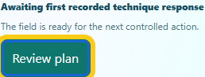
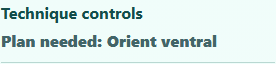

# Dissection Lab: consistent monitor and technique guidance

Completed locally on 2026-10-09. Changes remain uncommitted; nothing was staged, pushed, or deployed.

## Improvements

- The Field monitor offers **Review plan** or **Explain result** when that learning checkpoint is required. Keyboard activation focuses the checkpoint heading and preserves the entire saved state.
- **Prepare next** keeps the existing preparation behavior. It opens the instrument tray and focuses the required instrument without selecting or performing it automatically.
- Completed techniques, revealed layers and running animations have accurate disabled labels. The procedure action is absent in Guided, quiz, practical and study modes, where its checkpoint is unavailable.
- Simple steps, the technique summary and heading now agree on whether a plan, an explanation or an action is next. Final completion appears after the explanation.
- The physical progress strip is named **actions performed**, so it does not imply that the learning checks are finished.
- The monitor button, summary, heading and Simple steps cue use 16px text, or 18px in large-text mode. The button is at least 48px high; narrow layouts wrap the summary; contrast modes and keyboard focus remain clear.

The shared preparation handler and physical action gates are unchanged. Canonical and public runtime copies are identical.

## Validation

| Check | Result |
| --- | --- |
| Focused unit tests | 21 passed: 10 new monitor cases, 10 availability regressions and one existing instrument rendering case; 201 unrelated cases excluded by name filter |
| Browser scenarios | 5 passed: phone planning, desktop final reflection, narrow embedded large text/high contrast, forced colors, and native preparation |
| Before captures | 2 passed on the original source, recorded separately |
| Scoped axe audits | Four audits with zero violations; three gradient checks covering six existing text nodes resolved manually |
| Contrast bounds | Response text at least 8.49:1; priority text at least 4.72:1 including its existing opacity |
| Preservation | All 391 protected files unchanged; eight source edits and the focused test edits reverse exactly to their archived baselines |
| Repository checks | JavaScript syntax and scoped whitespace checks passed; HEAD and staging unchanged |

Browser tests verify keyboard navigation, whole-state preservation for checkpoint routes, final native explanation, preparation without automatic tool selection, 16px/18px text, 48px controls, visible focus and horizontal overflow. Unit cases also cover revealed layers, animation guards and the four alternate modes. These focused checks do not represent a full application or screen-reader audit.

The first browser run checked programmatic focus after a pointer click, which did not activate the browser's keyboard focus indicator. The fixture now tabs from the monitor summary to its action and retains the same solid 3px outline assertion. The failed browser-3 run is retained; accepted final runs are **unit-2** and **browser-4**, both pinned to the final source and relevant fixture hashes. Two independent source reviews also corrected past-tense step naming and a large-text CSS specificity conflict before those runs.

The earlier attempt was blocked by a full system drive before application edits. Work resumed after storage recovered. The original blocker record is retained. No temporary-file cleanup, dependency changes or configuration changes were needed. The normal sandbox failed to initialize its ACLs, so scoped commands used approved execution outside that sandbox.

## Visual review

### Phone: the monitor points to the pending plan

### Final reflection: completion waits for the explanation

Large-text, forced-color, heading, Simple steps and preparation captures are in browser-4/captures. Layout metrics and raw accessibility results accompany them.

## Evidence

- verification.json records final hashes, passing run counts, source parity and preservation checks.
- accessibility-review.json records raw audit hashes and the contrast calculations.
- edits contains reversible receipts and compressed baseline/final source and test archives. The test addition uses the existing CRLF newline convention.
- helpers preserves this pass's scripts; manifest.json hashes the report files.
