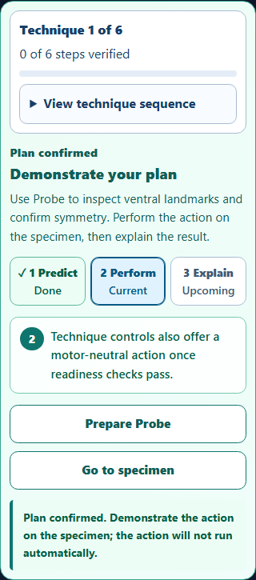
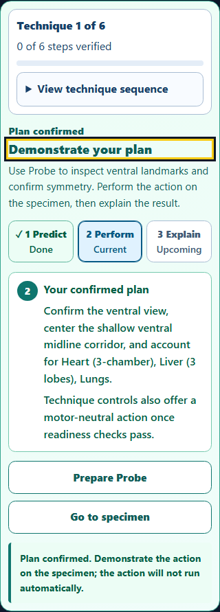

# Dissection Lab: confirmed-plan handoff

Completed locally on October 9, 2026. Changes remain uncommitted.

## What changed

After a correct plan, keyboard focus now moves to **Demonstrate your plan**. The checkpoint keeps **Your confirmed plan** visible while the learner prepares the required instrument and demonstrates the action. Tab reaches **Prepare** next. Confirming an answer does not select an instrument or perform a specimen action.

The recap shows the learner's saved answer only when it matches the current technique's correct option. Older saves with missing, unknown or inconsistent choices retain the existing preparation guidance. Plan text uses 16px type, or 18px with large text enabled. High-contrast and forced-colors presentation remains readable.

## Before and after

Before: confirming the plan focused the specimen canvas, and the preparation card did not retain the answer.

After: the focused preparation heading and confirmed response stay together above the explicit actions.

## Validation

- **18 browser tests passed:** 15 checkpoint cases across five layouts, keyboard focus, Guided and assessment routes, saved-state recovery and technique transitions; three existing roadmap cases cover native actions, explanations, verification and Undo.
- **13 targeted unit tests passed; 178 unselected tests skipped.** The existing unit fixture and roadmap browser fixture were unchanged. Two pre-change browser captures also passed.
- **15 accepted axe audits detected zero violations.** Forty gradient-related incomplete nodes were checked manually against conservative palette bounds; the lowest ratio was 7.20:1. New confirmed-plan text on white measures 7.68:1. This is a scoped accessibility review, not a whole-app certification.
- Phone, embedded large-text and forced-colors screenshots were inspected. The recap wraps without horizontal clipping and the preparation controls remain distinct.
- Source/public copies match. Exact reversal verifies six source edits and eight browser-fixture edits against archived baselines. All **531 protected files**, HEAD and the shared staging area are unchanged. Source syntax and scoped whitespace checks pass.

One roadmap run was interrupted before its completion receipt. Its raw files remain available, and it is excluded from the totals above. The entire selected roadmap group then passed in a fresh run; see [interruption note](interrupted-run-note.json).

## Evidence and scope

[Validation summary](validation-summary.json) · [Accessibility review](accessibility-review.json) · [Preservation checks](verification.json) · [Checkpoint results](checkpoint-2/results.json) · [Roadmap results](roadmap-3/results.json) · [Unit results](unit-3/results.json)

Tests used a local Chromium harness serving the working-tree source. No full application build, deployed-host check or assistive-technology user session was performed. No files were staged, committed, pushed or deployed by this pass.

The browser runner sets DISSECTION_CHECKPOINT_OUTPUT to this report's capture directory. Historical accessible-name inputs remain in the September 30 report; reruns must set a fresh output directory to preserve that report.
