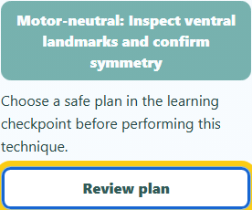
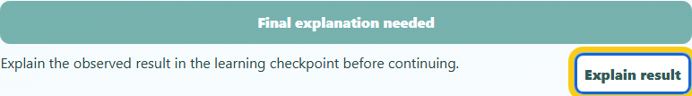
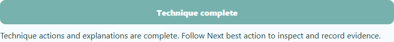

# Dissection Lab: clearer technique availability

Completed locally on 2026-10-09. Changes are uncommitted; nothing was staged, pushed, or deployed.

## What changed

- The motor-neutral action now has a visible explanation of its current availability: pending plan or reflection, animation, instrument selection, preparation, readiness, or completion.
- Review plan and Explain result move keyboard focus to the existing learning checkpoint. They preserve the current work and appear only when that checkpoint is available.
- The last technique shows **Final explanation needed** until the learner completes the reflection. Its visible and accessible names agree.
- Guidance uses 16px text, 18px in large-text mode, wrapping layouts, controls at least 48px high, and high-contrast/forced-color styles.

The existing disabled condition and technique action handler are unchanged. Canonical and public source files are identical.

## Verification

| Check | Result |
| --- | --- |
| Focused unit tests | 21 passed: 10 availability cases and 11 action-handoff regressions; 191 unrelated cases excluded by name filter |
| Browser interactions | 4 passed: 320px phone, desktop final reflection, narrow embedded large text/high contrast, and forced colors |
| Before captures | 2 passed on the original source, recorded separately |
| Scoped axe audits | 4 audits, zero violations; two gradient contrast checks resolved manually at a conservative 9.65:1 |
| Preservation | Exact baseline unit bytes and all 324 protected files preserved; source edits reverse to the original archived bytes |
| Repository checks | JavaScript syntax and scoped whitespace checks passed; HEAD and staging unchanged |

Browser checks cover visible guidance, accessible labels, keyboard focus, exact state preservation when opening the checkpoint, native completion after an explanation, text size, control size, and horizontal overflow. These are focused checks, not a full application or assistive-technology audit.

The first unit run exposed missing preexisting metadata in the final-reflection fixture. The fixture now starts with the normal tissue and caution metadata; exact preservation assertions remain intact. The failed run is retained in unit-2. Accepted final runs are browser-3 and unit-4, both pinned to the final source and relevant test hashes. The source also received a reviewed correction aligning the final-reflection accessible name with the visible label before both accepted runs.

## Visual review

### Phone: visible reason and direct checkpoint route

### Final reflection: honest pending state

### After the explanation

Large-text and forced-color screenshots, metrics, and raw accessibility reports are in browser-3/captures. All five final screenshots were inspected.

## Evidence

- verification.json records source/test hashes, successful runs, source parity, and preservation checks.
- accessibility-review.json records audit hashes and the manual contrast calculation.
- edits contains reversible source receipts and compressed baseline/final source and test archives. The LF unit-addition archive was normalized to CRLF and prefixed with CRLF for insertion into the existing test file.
- helpers contains the scripts used for this pass. manifest.json hashes this report's files.

Validation used one worker, no retries, and no videos. The normal execution sandbox could not start because of its ACL initialization error; scoped commands ran through approved elevated execution. No dependencies or test configuration were changed.
