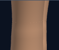
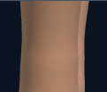

# First Response Lab: rescuer arm finish

Completed October 8, 2026. Changes remain uncommitted.

The rescuer arms now omit hidden end disks that overlapped at the elbows. This removes competing internal faces from rendering while retaining the existing outer arm shape and wrist shading.

Only the forearm and upper-arm draw ranges change. Every vertex, normal, index, material and transform remains identical. Hand placement, camera framing and compression behavior stay intact. Across the two arm assemblies, draw ranges omit 144 hidden cap triangles; the number submitted for rendering depends on which arm meshes are in view. Mesh, geometry and material counts remain unchanged.

## Before and after

### Adult heel side view: compression at the elbow

| Before | After |
| --- | --- |
|  |  |

[Before full view](native-final/adult-heel-side-baseline-compression-stage.png) · [After full view](native-final/adult-heel-side-candidate-compression-stage.png)

Release: [before](native-final/adult-heel-side-baseline-release-stage.png) · [after](native-final/adult-heel-side-candidate-release-stage.png). Wrist contact: [before](native-final/adult-heel-side-baseline-compression-wrists.png) · [after](native-final/adult-heel-side-candidate-compression-wrists.png).

### Child heel side view, app contrast, 320px viewport: compression at the elbow

| Before | After |
| --- | --- |
|  |  |

[Before full view](native-final/child-heel-side-contrast-baseline-compression-stage.png) · [After full view](native-final/child-heel-side-contrast-candidate-compression-stage.png)

Release: [before](native-final/child-heel-side-contrast-baseline-release-stage.png) · [after](native-final/child-heel-side-contrast-candidate-release-stage.png). Wrist contact: [before](native-final/child-heel-side-contrast-baseline-compression-wrists.png) · [after](native-final/child-heel-side-contrast-candidate-compression-wrists.png).

[Matched captures and measurements](native-final/arm-preview-metrics.json) identify the source, camera and contact state for each image. Elbow details are included where the elbows fall inside the captured view.

## Verification

- **Arm geometry:** six age/contrast cases passed with 4,562 assertions. The gate checks the intended draw ranges, elbow joins, hidden forearm boundaries and unchanged scene data through multiple compression states. Restoring an omitted elbow cap and changing an unrelated vertex both fail; each mutation is restored and reread. [Geometry results](checks/arm-verification.json)
- **Native Chromium:** two matched workflows passed with one worker and zero automatic retries. Eight source/view/phase captures produced 22 images, including 6 elbow details. Wrist geometry and shading remain exact; only the accepted arm draw ranges differ. Resources stay stable and the renderer is disposed once. [Browser results](native-final/summary.json)
- **Arm regressions:** 13 unchanged raw arm-contour tests passed against the candidate, covering arm shape, elbow normals and hand contact. [Raw test results](checks/raw-arm-contours/summary.json)
- **History and source:** four runtime copies are identical. All 39 raw fixtures and seven existing checkers remain unchanged; ten exact history reversals preserve previous comparison inputs. [History checks](checks/history-preservation.json)
- **Visual review:** Root and independent review covered the accepted captures. [Root review](checks/visual-review.json) · [Independent review](checks/independent-visual-review.json)

The matched captures submitted the following numbers of fewer triangles:

| View | Release | Compression |
| --- | ---: | ---: |
| Adult heel side view | 96 | 144 |
| Child heel side view, app contrast, 320px viewport | 96 | 120 |

The first desktop attempt timed out during baseline mounting before it reached the candidate. A private harness wrapper gives the same mounting checks 120 seconds instead of 30, preserving their conditions and restoring the page method afterward. Its [failure result](checks/initial-browser-failure/browser-run.json), [log](checks/initial-browser-failure/browser-run.log), [input pins](checks/initial-browser-failure/inputs.json), [repair record](checks/native-mount-repair.json) and [wrapper checks](checks/mount-window-check.json) are retained separately. The accepted desktop captures come from a fresh run.

A second attempt reached the candidate but exposed an incorrect test expectation: the release view submitted 96 fewer triangles because the upper arms were outside its viewing frustum. The test had expected all 144 omitted cap triangles. The corrected check derives the expected count from the affected meshes actually submitted by the renderer. The application candidate did not change. [Second failure result](checks/triangle-expectation-failure/browser-run.json) · [Second failure log](checks/triangle-expectation-failure/browser-run.log) · [Count-check repair](checks/native-draw-repair.json) · [Submission-recorder checks](checks/render-submissions-check.json)

The browser harness mounts the raw First Response module. These checks do not verify the full application loader or a deployment. Older geometry gates and the raw hand-alignment suite were not rerun in this pass. Source and checker pins are recorded in [verification.json](verification.json).

Source SHA-256: `8c045e6d8056e834d795ed4bfecb0418758c6a5c3e9d2ce4f05d69ec14dca940`.
