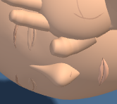
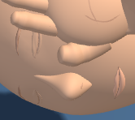
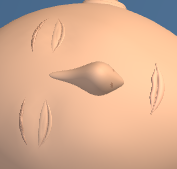
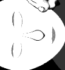

# First Response Lab: brow finish

The eyebrow mesh now samples along the arch, giving the surface more even shading beside the closed eyelids. Brow placement, dimensions, taper and material remain the same. Both brows stay mirrored and seated in the skull surface.

The visual improvement is modest at full stage scale. There are fewer dark fragments along the exposed brows in the normal views. Some stippling remains on the brow toward the top of the screen in the adult head close-up.

Only the two brow position and normal buffers change. Triangle counts, draw calls, geometries, materials and shader programs match in all three inspected views. Head proportions, eyelids, camera settings, pose, contact, lesson content and controls are preserved.

## Validation

- 12 CPU geometry cases passed across adult, child and infant, two poses and both contrast modes (376,795 checks). Closed shells, winding, normals, skin burial, relief, eyelid clearance, symmetry, scene preservation and resource reuse/disposal were checked. Deliberately raised brow vertices and invalid normals were rejected, restored and reread.
- Three raw-module browser comparisons passed, with one worker and zero retries: 6 captures and 12 PNGs. Both normal views have a visible pixel change; infant high contrast is a control comparison and may match. Each crop comes from its full-stage capture.
- Root and independent visual reviews accepted the same 12 image hashes.
- Fourteen exact history reversals passed. The 39 existing raw test files, 8 existing checkers and Git index are preserved. The raw tests were **not run as a suite** for this pass.
- The existing raw brow fixture assumes TubeGeometry for the eye seams. It was not run and is not claimed as passing.

| View | Changed stage pixels | Browser duration |
| --- | ---: | ---: |
| adult-support | 169 / 202882 | 17 s |
| adult-head | 281 / 202882 | 19 s |
| infant-head-contrast | 18 / 97976 | 13 s |

## Before and after

### adult-support

| Before | After |
| --- | --- |
|  |  |

[Full stage before](evidence/native-adult-support/adult-support-baseline-stage.png) · [Full stage after](evidence/native-adult-support/adult-support-candidate-stage.png)

### adult-head

| Before | After |
| --- | --- |
|  |  |

[Full stage before](evidence/native-adult-head/adult-head-baseline-stage.png) · [Full stage after](evidence/native-adult-head/adult-head-candidate-stage.png)

### infant-head-contrast

| Before | After |
| --- | --- |
|  |  |

[Full stage before](evidence/native-infant-head-contrast/infant-head-contrast-baseline-stage.png) · [Full stage after](evidence/native-infant-head-contrast/infant-head-contrast-candidate-stage.png)

## Scope and limits

These checks load the raw module through the existing browser harness. The full application loader, full-app build and deployment were not tested. The change remains uncommitted; this delivery performs no staging, commit, push or deployment.

Source: `546cbd2a4ebb7fd6c8930846ec754a8d329883b7ae820a5c1cfee61e836e4cb6` → `f551cf0c50073315effbf3fa5bcd9ce2dd3e1b806dbfcbd3f1434ba7e831af2c`.

CPU and browser evidence, the source delta, compatibility checks and visual reviews are saved under [evidence](evidence). Supporting audit files are retained separately: `selftest-invalid-normal.bin`, `selftest-raised-brow.bin`.

[Post-write verification](post-write.json) records the installed bytes, syntax, history reversals and preserved inputs.
