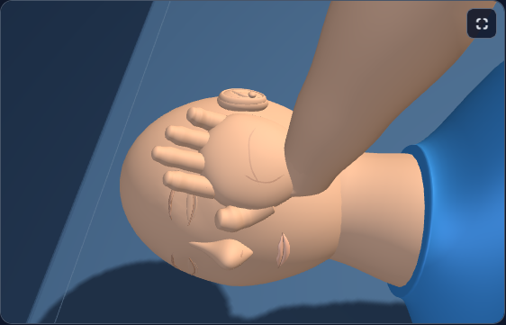
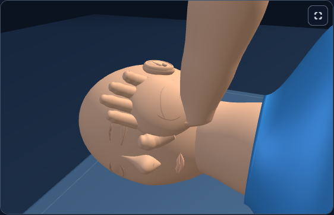
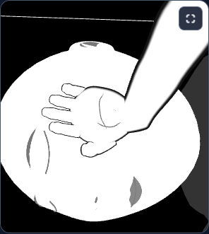
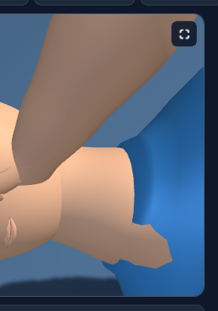
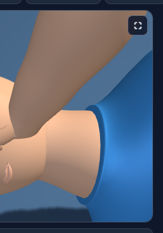
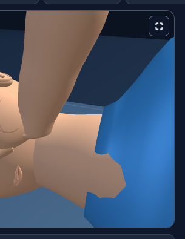
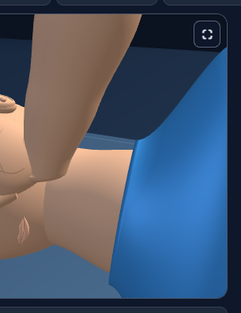
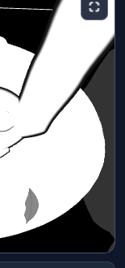
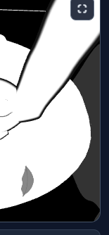

The shirt now fits around the neck in adult, child and infant recovery poses. A slightly deeper opening covers the neck surface that previously poked through the shirt. Finer triangles give the collar and shoulder transition a smoother outline.

The infant opening accounts for its upward neck angle. The chest contact surface, head, supporting hand and recovery framing retain their accepted geometry and behavior.

| View | Before | After |
| --- | --- | --- |
| adult-pose5 |  |  |
| adult-pose8 |  |  |
| infant-pose8-contrast |  |  |

Collar details:

 

 

 

[Focused verification](checks/accepted-verification.json) passed 12 recovery cases with 182,316 assertions, 12,236 neck-side samples and 2,352 cap samples. Three deliberately defective cases were rejected. One actual Vitest case passed through the new raw test wrapper.

[Three native browser comparisons](native-final/summary.json) passed with one worker and zero retries; all 12 final captures were inspected. Two additional checks exercised adult maximum compression and infant coach peak. The fitted collar reduces exposed neck-side samples in both compressed states; some pre-existing exposure remains during those compressions, so complete neck coverage is claimed for the sampled recovery poses.

The geometry checks inspect actual neck and torso triangles, including the neck's side surface behind the shirt opening. They also check closed surfaces, shading seams, sleeve attachment, chest contact geometry and resource disposal. Negative checks deliberately use the old coarse contour and remove a triangle, confirming that the gate rejects both defects and verifies restoration.

The initial density-only candidate smoothed the upper collar but left the neck protrusion visible. Its captures and ray measurements are retained. A preliminary infant browser check also caught an incorrect test expectation: contrast shirts are dark gray, while the neck is white. The corrected fixture uses the existing shirt color and retains the original failure evidence.

The historical comparison helpers reverse this exact collar change to their accepted source hashes. The current collar and neck geometry checks use the actual current runtime. All four source copies are synchronized; the two built copies were verified as exact older canonical versions before updating them.

The focused checker supports `node dev-tools/firstresponse_collar_refinement_check.cjs --selftest`. Full application builds and the full test suite were outside this pass.

Everything remains uncommitted.
