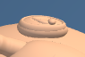
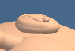
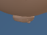
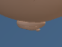

# First Response Lab: ear lobe refinement

The outer ear rim now fades into the lower lobe. The upper rim keeps its raised contour, while the bottom of the raised oval settles into the ear surface.

Only the left and right outer-rim position and normal buffers change. Geometry counts, rendered triangles, draw calls, materials and shader programs match the baseline. The other mannequin surfaces, head proportions, cameras, poses, contact, lesson content and controls are preserved.

## Validation

- 12 CPU geometry cases passed across adult, child and infant, two poses and both contrast modes (84,083 checks). The validator checks rim geometry, normals, lower-lobe relief, symmetry, scene preservation and resource allocation/disposal. Deliberate defects were rejected, and the saved bytes were restored and reread.
- 42 focused raw ear tests passed: 21 rim tests and 21 fold tests. Restoring the uniformly raised rim caused 6 failures; the candidate bytes were restored and reread. The rim fixture now distinguishes the raised upper contour from the buried lower-lobe end.
- Three raw-module browser comparisons passed, with one worker and zero retries in each accepted run: 6 captures and 12 PNGs. Both normal views have changed pixels. The infant high-contrast view is a control comparison and may match. Each ear crop comes from its full-stage capture.
- Root and independent visual reviews accepted the same 12 image hashes.
- Sixteen exact history reversals passed. The 38 other raw test files and 8 existing checkers are preserved. The Git index is guarded against the fresh delivery snapshot. The raw tests were **not run as a whole suite** for this pass.

| View | Changed stage pixels | Browser duration |
| --- | ---: | ---: |
| adult-support | 222 / 202882 | 42 s |
| child-head | 25 / 202882 | 22 s |
| infant-head-contrast | 8 / 97976 | 18 s |

## Visual review

- Viewed all twelve baseline and candidate stage images and ear crops at their captured sizes.
- In the adult supporting-hand close-up, the lower/right end of the outer rim joins the base as a rounded lobe. The upper ridge stays visible; the complete stacked-ring appearance is reduced.
- The child ear is small and partly occluded in the native head view. Its lower edge looks subtly smoother; this view provides limited evidence of the aesthetic change.
- The infant high-contrast ear remains a readable white silhouette. The changed contour is too small here to judge surface realism.
- No new detached edge, sharp point, hand displacement or framing change is visible. The overall ear still reads as a shallow oval relief in these views.

## Before and after

### adult-support

| Before | After |
| --- | --- |
|  |  |

[Full stage before](evidence/native-adult-support/adult-support-baseline-stage.png) · [Full stage after](evidence/native-adult-support/adult-support-candidate-stage.png)

### child-head

| Before | After |
| --- | --- |
|  |  |

[Full stage before](evidence/native-child-head/child-head-baseline-stage.png) · [Full stage after](evidence/native-child-head/child-head-candidate-stage.png)

### infant-head-contrast

| Before | After |
| --- | --- |
|  |  |

[Full stage before](evidence/native-infant-head-contrast/infant-head-contrast-baseline-stage.png) · [Full stage after](evidence/native-infant-head-contrast/infant-head-contrast-candidate-stage.png)

## Scope and limits

These checks load the raw module through the existing browser harness. The full application loader, full-app build and deployment were not tested. The change remains uncommitted; this delivery performs no staging, commit, push or deployment.

Source: `bb4526d583db90d928008a1fa9b7540dfef8c8acdfd4055c0fd71225454011bf` → `0af58d9afd30ed0de275caf53197320ddabed9308f08b191cce7bf4927d83f84`.

## Retained attempts and diagnostics

No unsuccessful native attempts were recorded.

CPU and browser evidence, the source delta, compatibility checks and visual reviews are saved under [evidence](evidence). Supporting audit files and directories: cpu-early.json, cpu-summary.json, selftest-invalid-normal.bin, selftest-raised-lobe.bin.

[Post-write verification](post-write.json) records the installed bytes, syntax, history reversals and preserved inputs.
