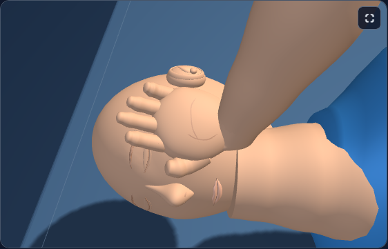
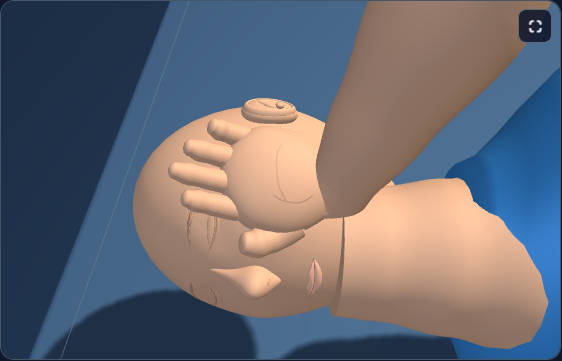
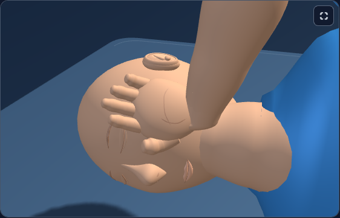
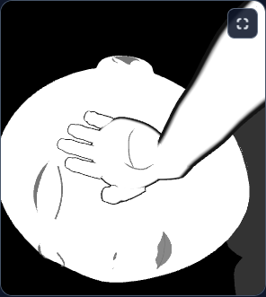
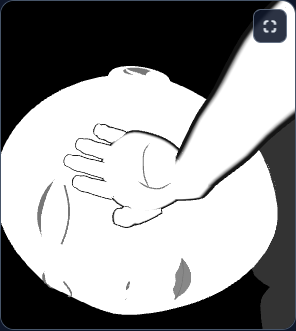
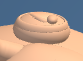
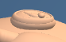
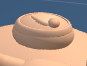
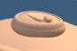

# First Response Lab: ear realism

The ears now have a thinner profile, a tapered lower lobe and a shallow central recess. The outer rim, inner fold and small front projection follow the same sculpted shell, giving the close-up a less circular silhouette.

The change is confined to the existing ear subtree. Head proportions, head movement, supporting-hand contact, camera settings and teaching behavior retain their accepted values. The canonical and desktop public runtime files remain identical.

## Visual comparison

The previews use matching cameras and poses. Ordinary adult and child views and an infant view at 320px in app contrast check the detail beside the supporting hand.

| View | Before | After |
| --- | --- | --- |
| adult-pose5 |  |  |
| child-pose8 |  |  |
| infant-pose5-contrast |  |  |

Ear detail:

### adult-pose5

 

### child-pose8

 

### infant-pose5-contrast

 

## Verification

- Existing ear rim and inner-fold assertions use the actual mesh triangles to check relief, buried joins, clearance, winding, welded normals and bilateral geometry.
- Additional checks cover the sculpted base and its overlap with actual skull triangles.
- Before/after comparisons verify geometry outside the ears, transforms, materials, camera metadata, answer targets and resource counts.
- Native Chromium verifies complete supporting-hand and cheek framing, identical camera and state, stable resources, one canvas and renderer disposal.
- A single exact source delta reverses to the accepted head/palm version. Historical fixture adapters compose through that reversal without replacing their fixed hashes; current ear tests still inspect the raw runtime.

[Accepted geometry results](checks/accepted-verification.json): 48 ear/base cases, 12 preservation comparisons and 6 centerline cases passed, with 36,792 assertions and 588 actual triangle rays. Minimum skull overlap is 0.02054 in ear-local units. [Three native workflows](native/summary.json) passed with one worker and zero retries; all 12 captures were inspected.

The existing raw ear test bodies ran through a standalone Node assertion harness using the vendored THREE library. Initial diagnostics are retained beside the accepted result: a private harness initialization error was corrected, and a strict normal-symmetry failure led to the explicit left-mesh reflection. No thresholds were relaxed.

The portable checker differs only in paths and inputs from the pinned accepted checker; its assertion bodies remain unchanged. Run from the repository root: `node dev-tools/firstresponse_ear_refinement_check.cjs`.

These are focused geometry and browser checks. No full application build or full test suite was run for this pass.

Everything remains uncommitted. No staging, push or deployment was performed.
