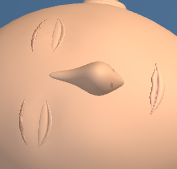

# First Response Lab: eyelid finish

The closed eyelids follow the rendered skull surface with smoother, mirrored shells. Mesh rings follow the eye path to improve the surface normals. Their corners and back faces sit below the skin, while a shallow upper and lower fold preserves the closed-eye expression. Fine eye creases follow the new lids, with aligned mesh rows at the corners.

Only the four lids and their two dependent seams may change geometry. Head proportions, materials, nose shading, camera settings, pose, contact, lesson content and controls are preserved. The refinement adds **4,992 rendered triangles** with no added draw calls, geometries, materials or shader programs in the three inspected views.

## Validation

- 12 CPU geometry cases passed across adult, child and infant, two poses and both contrast modes (367,831 checks). Closed shells, winding, normals, skin burial, visible relief, crease clearance, mirrored surfaces, scene preservation and resource reuse/disposal were checked. Deliberately raised vertices and invalid normals were rejected and restored.
- Three raw-module browser comparisons passed, with one worker and zero retries: 6 captures and 12 PNGs. Both normal views have a visible pixel change; infant high contrast is a visibility/control comparison and may match. Crops come from each matching full-stage capture.
- Root and independent visual reviews accepted the same 12 image hashes.
- Thirteen exact history reversals passed. The 39 existing raw test files, 8 existing checkers and Git index are preserved. The raw test files were **not run as a suite** for this pass.
- The existing raw eyelid fixture still assumes TubeGeometry; it was not run and is not claimed as passing.

| View | Changed stage pixels | Browser duration |
| --- | ---: | ---: |
| adult-support | 429 / 202882 | 180 s |
| adult-head | 729 / 202882 | 175 s |
| infant-head-contrast | 26 / 97976 | 281 s |

## Preview fixture repair

The first adult head preview failed in the baseline probe because the resting pose has no supporting-hand inspection metadata. The fixture now treats that context as optional for head views and still requires five cheek points in the supporting-hand view. The failed run is retained in [native-adult-head](evidence/native-adult-head/failure.json), and the accepted repeat is stored separately in `native-adult-head-recovered`.

The earlier supporting-hand comparison remains tied to its exact [original fixture](evidence/fixture-before-head-context-repair/firstresponse-face-preview.spec.ts.saved). Only that run may use the archived fixture hash; every other input remains checked against its recorded file hash. The repair record and original audit are archived with the evidence. The candidate and browser runner were unchanged by this fixture repair.

## Before and after

### adult-support

| Before | After |
| --- | --- |
|  |  |

[Full stage before](evidence/native-adult-support/adult-support-baseline-stage.png) · [Full stage after](evidence/native-adult-support/adult-support-candidate-stage.png)

### adult-head

| Before | After |
| --- | --- |
|  |  |

[Full stage before](evidence/native-adult-head-recovered/adult-head-baseline-stage.png) · [Full stage after](evidence/native-adult-head-recovered/adult-head-candidate-stage.png)

### infant-head-contrast

| Before | After |
| --- | --- |
|  |  |

[Full stage before](evidence/native-infant-head-contrast/infant-head-contrast-baseline-stage.png) · [Full stage after](evidence/native-infant-head-contrast/infant-head-contrast-candidate-stage.png)

## Scope and limits

These checks load the raw module through the existing browser harness. The full application loader, full-app build and deployment were not tested. The change remains uncommitted; this delivery performs no staging, commit, push or deployment.

Source: `af6ecb094af6d67ebb0955170a55e0a9726308c59f4ddd9b196d56cfe434e4c7` → `546cbd2a4ebb7fd6c8930846ec754a8d329883b7ae820a5c1cfee61e836e4cb6`.

CPU and browser evidence, source delta, compatibility checks and visual reviews are saved under [evidence](evidence). Earlier attempts and checker versions are retained separately: `baseline-shell-diagnostic.json`, `candidate-rejected-9c05/author-candidate.cjs`, `candidate-rejected-9c05/baseline.json`, `candidate-rejected-9c05/before.js`, `candidate-rejected-9c05/candidate.js`, `candidate-rejected-9c05/cpu-validation-failed-9c05.json`, `candidate-rejected-9c05/delta.json`, `candidate-rejected-9c05/firstresponse_eyelid_finish_delta.cjs`, `candidate-rejected-9c05/firstresponse_eyelid_finish_delta.json`, `candidate-rejected-9c05/history-input-snapshot.json`, `candidate-rejected-9c05/history-integration.json`, `candidate-rejected-9c05/history-preservation.json`, `candidate-rejected-9c05/lid-normal-diagnosis.json`, `candidate-rejected-9c05/lid-ring-diagnosis.json`, `cpu-diagnostics.json`, `cpu-early.json`, `cpu-early.json.previous-2fbf95d2a7b1.json`, `cpu-validation-failed-9c05.json`, `cpu-validation.json.previous-c8e5f37d4db9.json`, `lid-normal-diagnosis.json`, `lid-ring-diagnosis.json`, `sampling-revision.json`, `scope-differences.json`, `native-adult-head/failure.json`.

[Post-write verification](post-write.json) records the installed bytes, syntax, history reversals and preserved inputs.
