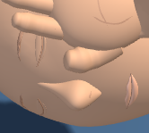
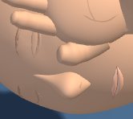
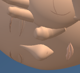
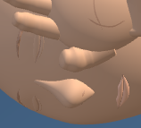
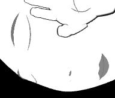

# First Response Lab — closed-eye clarity

2026-10-07 · Local changes; uncommitted.

The mannequin's closed eyes now use thin, tapered creases fitted over the actual skull and eyelid triangles. This reduces the broken, cord-like appearance of the previous eye lines in close-up. The improvement is subtle at the normal viewing size.

The original eyelids, head proportions, jaw, collar and supporting hands are preserved exactly. Clinical content and lesson behavior are unchanged.

## Before and after

These are actual browser captures at matching cameras, poses, dimensions and contrast settings.

| View | Before | After |
| --- | --- | --- |
| Adult, pose 5 |  |  |
| Adult, pose 8 |  |  |
| Infant, contrast |  |  |

Full supporting-hand views: [adult pose 5](native-final/adult-pose5-candidate-stage.png), [adult pose 8](native-final/adult-pose8-candidate-stage.png), [infant contrast](native-final/infant-pose8-contrast-candidate-stage.png).

## Validation

- Six geometry cases passed across adult, child and infant sizes, recovery poses 0/5/8 and infant contrast. Each crease triangle was sampled at 13 interior/edge locations, in addition to its vertices. Minimum sampled clearance was 0.000603 head units; the crease stays shallow and its ends taper to points.
- Every geometry buffer, finish, transform and support datum outside the two eye creases matched the accepted baseline. Repeated frames retained the same buffers and resource counts; disposal checks passed.
- Two deliberate mutations were rejected: a buried crease vertex and an exposed lid margin. Saved buffers were restored and reread.
- Three paired Chromium workflows passed with one worker and zero retries. They checked camera/state matching, exact original lid descriptors, complete supporting hands, cheek framing, actual contrast materials, stable resources and renderer cleanup. All 12 stage/detail images were reviewed.
- Thirty-nine existing raw test files remain unchanged. Seven historical source inputs are recovered exactly through the versioned delta helpers; this does not claim those 39 suites were rerun.

Browser checks mount the registered tool in the existing WebGL harness. Application routing, a full application build and deployment were outside this pass.

An initial attempt to fit the eyelid shells directly to the coarse skull facets caused a child corner shading defect. That deformation was removed. Only the two surface creases are included in the accepted change. The diagnostic records are retained under `checks/`.

## Evidence and implementation

- [Geometry results](checks/eye-verification-full.json)
- [Browser results](native-final/summary.json)
- [Visual review](checks/visual-review.json)
- [Historical input preservation](checks/history-preservation.json)
- [Combined verification](verification.json)

The four runtime copies share SHA256 `f21eeaf8d3bd87810142d77f2cfe5e7ab9ee56e80a6548d927a4dcabec7af511` (784,376 bytes). There are two exact source edits. Each new crease has 287 vertices and 380 triangles, replacing a 189-vertex, 320-triangle tube; no mesh or material is added.

The reusable checker is `dev-tools/firstresponse_eye_surface_check.cjs`. Run it with `--selftest` to include the deliberate-failure checks. No files were staged, committed, pushed or deployed.
