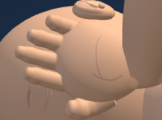
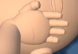
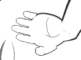

# First Response Lab: smoother finger joins

The patient fingers now blend their shading into the actual sculpted palm surface near the roots. The fit uses triangle normals, a surface-distance guard and a gentle fade before the first joint fold. Both hands keep their existing shapes, creases, nails, contact and poses. Thumb and rescuer shading remain unchanged.

## Verification

- All 65 focused raw-module tests passed, including finger folds, nail fit, hand surfaces and patient wrists.
- All 24 geometry cases passed: adult, child and infant; recovery poses 0, 2, 5 and 8; normal and high contrast.
- Three paired native browser views passed, including child-view resize and resource disposal. All rendered pixel changes stayed within the two regions projected from the eight patient finger meshes.
- Twenty-one exact historical helper reversals passed. Existing fixtures and checkers are unchanged.
- Deliberate source, geometry, browser-contract and visual-acceptance mutations were rejected, restored and reread.

The full application loader and build were not run. No staging, commit, push or deployment was performed. The shared Git index was preserved during installation.

## Before and after

Geometry-selected samples reduce the average palm/finger shading angle by 59.1–80.4 percent per finger. These samples include vertices partly covered by the palm; the images show the subtle change at native viewing size.

### adult-wide

Before

After

### child-narrow

Before

After

### infant-narrow-contrast

Before

After

## Evidence

See [geometry results](geometry-result.json), [raw results](raw-finger-tests/candidate-results.json), [visual review](visual-review.json), [history preservation](history-preservation.json) and [installation checks](post-write.json). The manifest pins the copied evidence. Unsuccessful native attempts, if present, are preserved as diagnostics and excluded from the three successful views.

Baseline: `dfe3e01f38a419187e468c749cc37827f486a47401b9916afaa9ec6f98a3f86a`

Candidate: `77394bfee2544c33c3274293a13e9666912c26f657117ac98d15416f220f060e`
