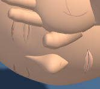

# First Response Lab: mouth material refinement

Completed October 9, 2026. Changes remain uncommitted.

Reduced the reflected highlight on the lips in the standard shaded view. The shared lip material's specular color changes from `0x25313b` to `0x060606`. Lip shape, placement, base color and the mouth seam remain identical; the app's high-contrast view is unchanged.

## Before and after

### Adult, recovery pose 5

| Before | After |
| --- | --- |
|  |  |

[Before full view](native-final/adult-pose5-baseline-stage.png) · [After full view](native-final/adult-pose5-candidate-stage.png)

### Infant, recovery pose 8 with app contrast

| Before | After |
| --- | --- |
|  |  |

[Before full view](native-final/infant-pose8-contrast-baseline-stage.png) · [After full view](native-final/infant-pose8-contrast-candidate-stage.png)

## Verification

The original infant attempt stopped during Chromium launch (exit code 3221225495), before any scene capture. One manual run after the environment refreshed passed with the same candidate and fixture bytes. The failed attempt is retained separately from the two accepted comparisons. [Original launch log](native-failure/native-infant-contrast/browser-run.log) · [Recovery record](checks/native-recovery.json)

- **Material and scene scope:** six age/contrast cases passed with 344 assertions. Every geometry buffer, draw range, other material property, transform and scene value remains exact through the checked frames. Incorrect lip specular and an unrelated vertex mutation are rejected, then restored and reread. [Results](checks/mouth-verification.json)
- **Native Chromium:** two matched workflows passed, producing four source/view captures and eight stage/detail images. Camera, pose, contact, rendering counts and resource lifecycle checks pass. [Native results](native-final/summary.json)
- **Source and history:** four matching runtime copies, 39 unchanged raw fixtures, eight unchanged older checkers and eleven exact historical reversals. Older gates and raw test suites were not rerun for this material-only change. [History checks](checks/history-preservation.json)
- **Visual acceptance:** [Root review](checks/visual-review.json) · [Independent review](checks/independent-visual-review.json).

The [initial mouth diagnostic](checks/mouth-diagnostic.json) found the lip rims already inside the head surface. This pass adjusts reflectivity. The native harness loads the raw First Response module; it does not verify the full application loader or a deployment. Exact source, checker and evidence pins are in [verification.json](verification.json).

Source SHA-256: `9de34818d5428c3b453f8617c4bd5622c711fbe79acd77fd2ef4fd35119f3f76`.
