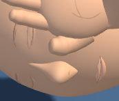
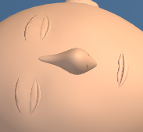

# First Response Lab: mouth surface refinement

The upper and lower lips now use mesh rings that follow the mouth. A fitted mouth seam follows the actual lip surfaces across the tested mannequin ages and poses.

Only the upper lip, lower lip and mouth seam geometry changes. The fitted seam adds exactly 1,960 rendered triangles in each inspected view. Draw calls, geometry counts, materials and shader programs match the baseline. Head proportions, brows, eyelids, camera settings, pose, contact, lesson content and controls are preserved.

## Validation

- 12 CPU geometry cases passed across adult, child and infant, two poses and both contrast modes (456,755 checks). The validator checks closed lip shells, winding, normals, skin burial, visible seam fit, symmetry, attachments, scene preservation and resource reuse/disposal. Raised lip vertices, a hidden seam and invalid normals were deliberately rejected, restored and reread.
- 21 focused raw lip tests passed. Hiding the mouth seam caused 9 failures; the saved candidate bytes were restored and reread. The fixture now checks the fitted surface directly and includes additional probes near the corners.
- Three raw-module browser comparisons passed, with one worker and zero retries in each accepted run: 6 captures and 12 PNGs. Both normal views have changed pixels. The infant high-contrast view is a control comparison and may match. Each crop comes from its full-stage capture.
- Root and independent visual reviews accepted the same 12 image hashes.
- Fifteen exact history reversals passed. The 38 other raw test files and 8 existing checkers are preserved. The current Git index is preserved from the refreshed delivery preflight through completion. The raw tests were **not run as a whole suite** for this pass.

| View | Changed stage pixels | Browser duration |
| --- | ---: | ---: |
| adult-support | 339 / 202882 | 16 s |
| adult-head | 426 / 202882 | 16 s |
| infant-head-contrast | 41 / 97976 | 14 s |

## Visual review

- Root directly viewed all 12 original PNGs after all three matched browser comparisons passed.
- Adult head: the closed central mouth crease reads as a more continuous line, and the inner lip edges have less fragmented shading. The visual change is subtle at full stage size.
- Adult support: the lip edge and tip shade more evenly in the oblique close-up. The mouth remains shallow; the supporting hand, head silhouette, contact, neck and framing appear consistent.
- Infant high contrast: lip and crease colors remain distinct and the small contour adjustment preserves the closed-mouth expression. No clipping or facial landmark loss observed.
- This is a focused mouth surface refinement. Fine stippling remains elsewhere on the thin facial contours.

## Before and after

### adult-support

| Before | After |
| --- | --- |
|  |  |

[Full stage before](evidence/native-adult-support/adult-support-baseline-stage.png) · [Full stage after](evidence/native-adult-support/adult-support-candidate-stage.png)

### adult-head

| Before | After |
| --- | --- |
|  |  |

[Full stage before](evidence/native-adult-head/adult-head-baseline-stage.png) · [Full stage after](evidence/native-adult-head/adult-head-candidate-stage.png)

### infant-head-contrast

| Before | After |
| --- | --- |
|  |  |

[Full stage before](evidence/native-infant-head-contrast/infant-head-contrast-baseline-stage.png) · [Full stage after](evidence/native-infant-head-contrast/infant-head-contrast-candidate-stage.png)

## Scope and limits

These checks load the raw module through the existing browser harness. The full application loader, full-app build and deployment were not tested. The change remains uncommitted; this delivery performs no staging, commit, push or deployment.

Source: `f551cf0c50073315effbf3fa5bcd9ce2dd3e1b806dbfcbd3f1434ba7e831af2c` → `bb4526d583db90d928008a1fa9b7540dfef8c8acdfd4055c0fd71225454011bf`.

## Retained attempts and diagnostics

Rejected candidate and earlier CPU evidence remain under [candidate history](evidence/candidate-history). The CPU audit records why those attempts were rejected or why a probe was corrected. They are separate from the accepted validation above.

- [native-adult-head-aborted](evidence/native-adult-head-aborted/failure.json): Tool execution aborted during a client refresh before browser output. Recorded child PID no longer exists; no browser results or PNG captures were produced.
- [native-adult-head-interrupted](evidence/native-adult-head-interrupted/failure.json): Tool execution was aborted during app refresh. Recorded child PID no longer exists; workflow produced no result JSON or PNG captures.

Detached launcher records and logs are retained when present. Interrupted launches are not counted as passing browser comparisons.

The first delivery preflight detected changed Git index bytes. All scoped runtime, test, helper and checker hashes still matched, and the staged-path listing was empty. Only the expected index hash in three private evidence files was refreshed; this task did not write the Git index. [The refresh record](evidence/index-refresh.json) and [original metadata](evidence/index-refresh-before) preserve that observation. Delivery guards compare against the refreshed index hash.

CPU and browser evidence, the source delta, compatibility checks and visual reviews are saved under [evidence](evidence). Supporting audit files and directories: `archive-aborted-native.cjs`, `candidate-history/`, `cpu-early.json`, `cpu-early.json.previous-4baafc991a13.json`, `cpu-validation.json.previous-a4a970a8cace.json`, `native-adult-head-detached.log`, `native-adult-head-launcher.json`, `recover-native-launch.cjs`, `selftest-hidden-seam.bin`, `selftest-invalid-normal.bin`, `selftest-raised-lip.bin`, `native-adult-head-aborted/`, `native-adult-head-interrupted/`.

[Post-write verification](post-write.json) records the installed bytes, syntax, history reversals and preserved inputs.
